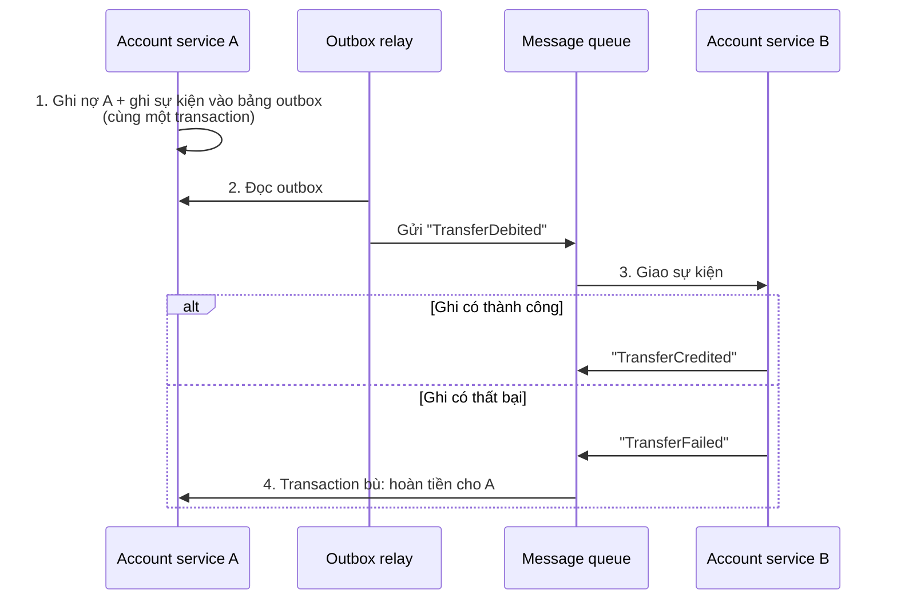
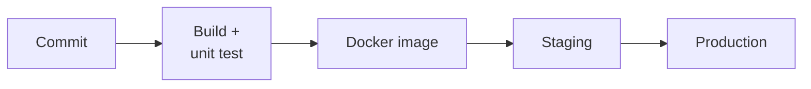

import Tabs from "@theme/Tabs";
import TabItem from "@theme/TabItem";

Một dự án học tập xây ứng dụng ngân hàng với **React + Spring Boot**, đi từ monolith đến microservices qua 3 giai đoạn. Ngân hàng là đề tài tốt để luyện những thứ khó nhất của backend: giao dịch tiền phải đúng tuyệt đối, bảo mật nhiều lớp, và nhất quán dữ liệu khi hệ thống bị tách nhỏ.

{/* truncate */}

## Lộ trình 3 giai đoạn

| | Giai đoạn 1: Lõi monolith | Giai đoạn 2: Tính năng & bảo mật | Giai đoạn 3: Microservices |
| --- | --- | --- | --- |
| **Kiến trúc** | Monolith chia module | Monolith chia module | Microservices |
| **Chức năng** | Đăng ký, đăng nhập, OTP, chuyển tiền nội bộ, lịch sử giao dịch | KYC đơn giản, báo cáo tài chính, quản lý tài khoản | Chuyển tiền liên ngân hàng (giả lập), thông báo bất đồng bộ |
| **Bảo mật** | Băm mật khẩu, JWT, HTTPS | Chống CSRF/XSS, mã hóa dữ liệu (AES), CSP | Xác thực giữa các service |
| **Dữ liệu** | Giao dịch ACID | Dữ liệu giả để kiểm thử | Retry, transactional outbox, saga; event sourcing (tùy chọn) |
| **DevOps** | Docker, Docker Compose | CI/CD với GitHub Actions, môi trường staging | Logging và monitoring tập trung (ELK, Prometheus) |
| **Học được** | Tích hợp React với Spring Boot, giao dịch ACID, Docker | Bảo mật web, CI/CD, sinh dữ liệu giả | Thiết kế microservices, message queue, giám sát hệ phân tán |

Monolith chia module ở giai đoạn 1–2 giúp tập trung vào nghiệp vụ trước; ranh giới module rõ ràng giúp tách service ở giai đoạn 3 dễ hơn. Khi nào nên tách và cái giá phải trả: xem [Kiến trúc Microservices](/docs/key-notes/microservices/).

## Công nghệ đề xuất

| Thành phần | Lựa chọn | Lý do |
| --- | --- | --- |
| Backend | Spring Boot | Hệ sinh thái mạnh cho nghiệp vụ tài chính: Spring Security, `@Transactional`, validation |
| Frontend | React | SPA tương tác nhanh; tự escape nội dung, giảm nguy cơ XSS |
| Cơ sở dữ liệu | **PostgreSQL** | Giao dịch ACID, khóa dòng, ràng buộc (`CHECK balance >= 0`, khóa ngoại) — đúng thứ sổ cái cần |
| Container | Docker, Docker Compose | Môi trường giống nhau từ máy dev đến production |
| Message queue | RabbitMQ hoặc Kafka | Giao tiếp bất đồng bộ, tách service, chạy tác vụ nền như gửi thông báo |

:::note

Bản gốc đề xuất MongoDB. MongoDB có hỗ trợ transaction nhiều document, nhưng với sổ cái — nơi cần ràng buộc chặt và truy vấn tổng hợp — cơ sở dữ liệu quan hệ là lựa chọn mặc định an toàn hơn.

:::

## Chức năng cốt lõi

| Chức năng | Backend (Spring Boot) | Frontend (React) |
| --- | --- | --- |
| **Đăng ký, đăng nhập, OTP** | API đăng ký/đăng nhập, băm mật khẩu, tạo và kiểm tra OTP, cấp JWT | Form đăng ký, đăng nhập, nhập OTP; quản lý trạng thái đăng nhập |
| **Tài khoản & lịch sử** | API thông tin tài khoản; lịch sử giao dịch có phân trang, lọc | Danh sách và chi tiết tài khoản; bảng lịch sử lọc, sắp xếp được |
| **Chuyển tiền & báo cáo** | API chuyển tiền trong một giao dịch ACID; API tổng hợp dữ liệu cho báo cáo | Form chuyển tiền có bước xác nhận; báo cáo dạng biểu đồ, bảng |

OTP nên có hạn ngắn (vài phút), dùng một lần, giới hạn số lần nhập sai, và chỉ lưu bản băm trên server.

## Bảo mật

| Lớp | Biện pháp |
| --- | --- |
| **Xác thực & phân quyền** | JWT cho API không trạng thái, lưu trong cookie `HttpOnly`, `Secure`, `SameSite`; OAuth2 khi cần đăng nhập qua bên thứ ba |
| **Mật khẩu** | Không bao giờ lưu dạng thô; băm bằng Argon2id hoặc bcrypt (đã có salt riêng cho từng user) |
| **Mã hóa khi truyền** | TLS/HTTPS cho mọi kết nối |
| **Mã hóa khi lưu** | Mã hóa dữ liệu nhạy cảm (PII) bằng AES-256-GCM; khóa nằm ở secret manager/KMS, không nằm trong code hay cùng database |
| **CSRF** | Bắt buộc khi JWT ở trong cookie: CSRF token của Spring Security + cookie `SameSite` |
| **XSS** | Validate và làm sạch input, dựa vào cơ chế escape của React (tránh `dangerouslySetInnerHTML`), bật Content Security Policy |

## Giao dịch và nhất quán dữ liệu

<Tabs groupId="banking-arch">
<TabItem value="monolith" label="Monolith: giao dịch ACID">

Trong một database, chuyển tiền là **tất cả hoặc không gì cả**: ghi nợ A và ghi có B cùng commit, lỗi ở bất kỳ bước nào thì rollback toàn bộ.

```java title="TransferService.java"
@Transactional
public Transfer transfer(UUID fromId, UUID toId, BigDecimal amount, String idempotencyKey) {
    // Request lặp lại (mạng chập chờn, người dùng bấm 2 lần) trả kết quả cũ
    var existing = transfers.findByIdempotencyKey(idempotencyKey);
    if (existing.isPresent()) return existing.get();

    // Khóa 2 dòng theo thứ tự id cố định để tránh deadlock
    var first = fromId.compareTo(toId) < 0 ? fromId : toId;
    var second = first.equals(fromId) ? toId : fromId;
    accounts.findByIdForUpdate(first);  // SELECT ... FOR UPDATE
    accounts.findByIdForUpdate(second);

    var from = accounts.getReferenceById(fromId);
    var to = accounts.getReferenceById(toId);
    if (from.getBalance().compareTo(amount) < 0) throw new InsufficientFundsException();

    from.debit(amount);
    to.credit(amount);
    return transfers.save(new Transfer(fromId, toId, amount, idempotencyKey));
}
```

- Tiền dùng `BigDecimal` (hoặc số nguyên đơn vị nhỏ nhất), **không dùng `double`**.
- `idempotencyKey` có ràng buộc `UNIQUE` trong database, để hai request trùng không tạo hai giao dịch.
- Tốt hơn nữa: sổ cái kép (double-entry) — mỗi giao dịch ghi một dòng nợ và một dòng có, số dư là tổng các dòng.

</TabItem>
<TabItem value="microservices" label="Microservices: outbox + saga">

Khi tài khoản A và B thuộc hai service với hai database, không còn transaction chung. Dùng **transactional outbox** để không mất sự kiện, và **saga** để hoàn tác khi lỗi:



1. Service A ghi nợ và lưu sự kiện vào bảng `outbox` **trong cùng transaction** — hoặc cả hai được lưu, hoặc không gì cả.
2. Một tiến trình relay (hoặc CDC như Debezium) đọc outbox và gửi lên message queue, thử lại đến khi thành công.
3. Service B nhận sự kiện và ghi có.
4. Nếu B thất bại, nó phát sự kiện lỗi; A chạy **transaction bù** để hoàn tiền (saga).

Queue giao tin **ít nhất một lần**, nên consumer phải **idempotent**: lưu id sự kiện đã xử lý và bỏ qua bản trùng.

</TabItem>
</Tabs>

## DevOps và kiểm thử



| Hạng mục | Công cụ | Mục đích |
| --- | --- | --- |
| CI/CD | GitHub Actions | Tự động build, test, đóng gói và triển khai |
| Monitoring | Prometheus + Grafana | CPU, bộ nhớ, độ trễ request, tỉ lệ lỗi |
| Logging | ELK stack hoặc Loki | Log tập trung để chẩn đoán sự cố |
| Sandbox | Môi trường staging riêng | Thử tính năng mới mà không ảnh hưởng dev hay production |
| Giả lập API | WireMock, Postman mock server | Mô phỏng API bên thứ ba (cổng thanh toán, ngân hàng khác) |
| Dữ liệu giả | Datafaker (Java), Faker.js | Dữ liệu thực tế, phủ nhiều kịch bản kiểm thử |

Khi triển khai lên VPS: xem [Thiết lập máy chủ Ubuntu](/docs/cloud-computing/ubuntu-server-setup/).
