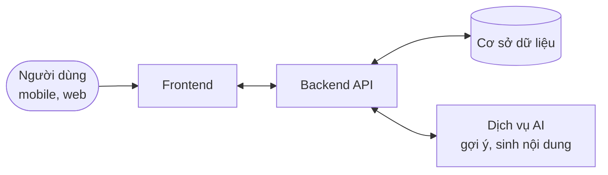
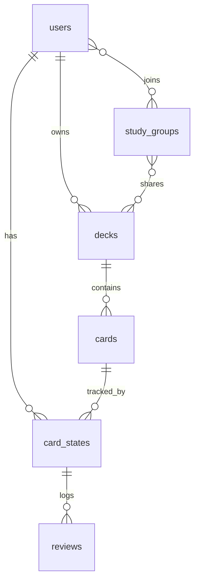

**Fluxlingo** là bản thiết kế một ứng dụng học ngôn ngữ thế hệ mới: lấy phương pháp flashcard với **lặp lại ngắt quãng** (spaced repetition) làm lõi, rồi thêm cá nhân hóa bằng AI, tính năng xã hội và một giao diện tối giản — để việc học vừa hiệu quả vừa đủ hấp dẫn để người dùng quay lại mỗi ngày.

{/* truncate */}

## Bối cảnh thị trường

| Ứng dụng | Điểm mạnh | Cơ hội cho Fluxlingo |
| --- | --- | --- |
| **Anki** | Thuật toán SRS rất hiệu quả, tùy biến sâu | UI/UX thân thiện với người mới; tích hợp AI liền mạch |
| **Memrise** | Video người bản xứ, game hóa | Bài kiểm tra tạo từ lịch sử học; tính năng cộng đồng, học nhóm |
| **Quizlet** | Thư viện nội dung khổng lồ do người dùng tạo, nhiều chế độ học | Lộ trình cá nhân hóa bằng AI thay vì chỉ dựa vào nội dung có sẵn; bảng xếp hạng |
| **Duolingo** | Game hóa đứng đầu thị trường, rất cuốn hút | Cho tùy chỉnh bộ học liệu sâu hơn, chia sẻ bộ flashcard cá nhân, nhóm học chuyên sâu |
| **Drops** | Học từ vựng trực quan, bài học 5 phút | Mở rộng sang ngữ pháp, bài kiểm tra, đồng bộ đa nền tảng, tính năng xã hội |

**Định vị:** sức mạnh SRS của Anki + sự cuốn hút của Duolingo + nội dung cá nhân của Quizlet, gói trong một giao diện dễ dùng.

## Lõi: lặp lại ngắt quãng

Mỗi thẻ được ôn lại ngay trước lúc người học sắp quên. Trả lời đúng thì khoảng cách đến lần ôn sau dài ra; quên thì quay lại khoảng ngắn. Thuật toán kinh điển là **SM-2**:

```ts title="sm2.ts"
type CardState = { repetitions: number; intervalDays: number; easeFactor: number };

// grade: 0 (quên hẳn) … 5 (nhớ ngay)
export function review(card: CardState, grade: number): CardState {
  if (grade < 3) return { ...card, repetitions: 0, intervalDays: 1 };

  const repetitions = card.repetitions + 1;
  const intervalDays =
    repetitions === 1 ? 1 : repetitions === 2 ? 6 : Math.round(card.intervalDays * card.easeFactor);
  const easeFactor = Math.max(1.3, card.easeFactor + 0.1 - (5 - grade) * (0.08 + (5 - grade) * 0.02));

  return { repetitions, intervalDays, easeFactor };
}
```

Thẻ mới bắt đầu với `easeFactor = 2.5`. Khi đã có dữ liệu ôn tập, có thể chuyển sang **FSRS** — thuật toán Anki dùng mặc định từ bản 23.10, học tham số từ lịch sử của chính người dùng và dự đoán chính xác hơn. Đây cũng là chỗ "cá nhân hóa bằng AI" có giá trị thật nhất.

## Tính năng

| Tính năng | Mô tả | Giai đoạn |
| --- | --- | --- |
| 🔁 **Ôn tập SRS** | Bộ thẻ, phiên ôn tập hằng ngày, lịch ôn theo thuật toán | MVP |
| 🔄 **Đồng bộ** | Lưu tiến độ trên server, đồng bộ tối đa 3 thiết bị | MVP |
| 📝 **Bài kiểm tra tự tạo** | Tạo bài kiểm tra từ lịch sử học, tập trung vào thẻ hay sai | Sau MVP |
| 🎯 **Cá nhân hóa bằng AI** | Lộ trình thích ứng, điều chỉnh độ khó, gợi ý nội dung | Sau MVP |
| 🤖 **AI tạo học liệu** | Sinh bộ flashcard và câu ví dụ mới | Sau MVP |
| 👥 **Học nhóm** | Tạo nhóm, chia sẻ bộ thẻ, thảo luận | Sau MVP |
| 🏆 **Bảng xếp hạng** | Thi đua với bạn bè và cộng đồng | Sau MVP |

Nội dung do AI sinh ra cần được người dùng xem lại trước khi thêm vào bộ thẻ — một câu ví dụ sai ngữ pháp sẽ được ôn đi ôn lại.

## Thiết kế

| Nguyên tắc | Cách làm |
| --- | --- |
| 🎨 Tối giản | Màn hình ôn tập chỉ có thẻ và nút đánh giá; giảm mọi thứ gây phân tâm |
| 📱 Cá nhân hóa giao diện | Tùy chỉnh chủ đề, font chữ, cỡ chữ |
| ✨ Hoạt ảnh tinh tế | Lật thẻ, chuyển thẻ mượt; tôn trọng `prefers-reduced-motion` |
| 🌗 Sáng / tối | Theo hệ thống, cho phép đổi tay — người học thường ôn buổi tối |

## Kiến trúc



Phiên ôn tập nên chạy được **offline**: lưu hàng đợi kết quả ôn trên thiết bị, đồng bộ khi có mạng. Lịch ôn tính lại từ lịch sử review nên không lo xung đột giữa các thiết bị.

### Mô hình dữ liệu



- `card_states`: trạng thái SRS của từng người dùng với từng thẻ (`interval`, `ease_factor`, `due_at`) — tách khỏi `cards` để nhiều người học chung một bộ thẻ.
- `reviews`: mỗi lần ôn (điểm, thời gian trả lời) — đầu vào cho bài kiểm tra tự tạo, thống kê và FSRS.
- Truy vấn quan trọng nhất là "thẻ đến hạn hôm nay": đánh index `(user_id, due_at)`.
