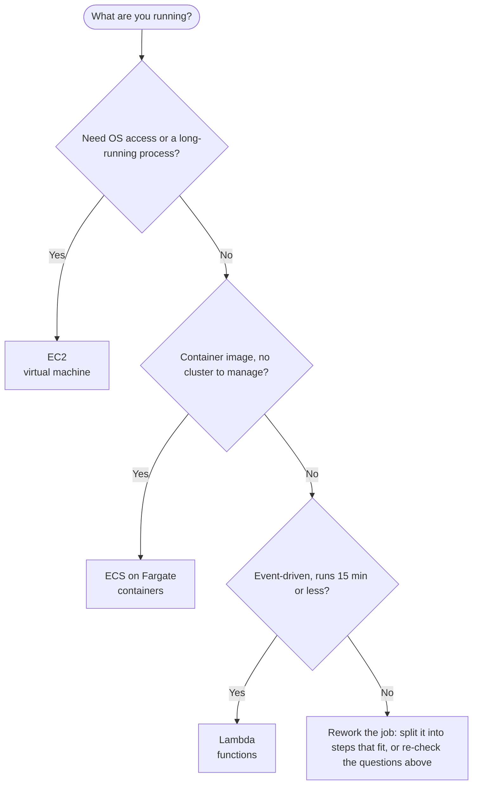

import Tabs from "@theme/Tabs";
import TabItem from "@theme/TabItem";

# Compute

Compute is where your code runs: a virtual machine, a container or a function.

## Decision chart

Start at the top and answer each question. Click a service box to jump to its setup steps.



The last question has a catch: Lambda stops a function at 15 minutes. A job that is not event-driven, or that runs longer, does not fit Lambda: split it into steps that do, or go back to the first two questions and decide whether it needs a server (EC2) or a container (ECS on Fargate).

## Compare the options

| Option | You manage | Scales | Cost shape | AWS | Azure | GCP |
|---|---|---|---|---|---|---|
| Virtual machine | OS, patches, runtime, app, and how many instances run | You add instances, by hand or with an Auto Scaling group | Pay while the instance runs, even when idle | [EC2](#ec2) | Virtual Machines | Compute Engine |
| Container | The container image and the task size (CPU and memory); no servers or cluster | You add tasks (copies of the container) | Pay for the vCPU and memory of running tasks | [ECS on Fargate](#ecs-fargate) | Container Apps, Container Instances | Cloud Run |
| Function | The function code and its settings (memory, timeout, role) | Automatic, one execution environment per concurrent request; can scale to zero | Pay per request and run time; no idle cost | [Lambda](#lambda) | Azure Functions | Cloud Run functions |

### Functions across providers {#functions-across-providers}

**Serverless** means the provider runs, scales and patches the servers while you write code. The most common form is **Function-as-a-Service (FaaS)**: small functions that run in response to events (an HTTP request, a file upload, a queue message, a schedule) and bill only for the time they run. Servers still exist, but you do not manage them. Other platforms in the same family: IBM Cloud Code Engine (IBM Cloud Functions was retired in 2024).

Core ideas, the same on every provider:

- **Event-driven**: a trigger invokes a handler. Triggers include HTTP requests, file changes, database updates, queues, storage events, streams (Kinesis, DynamoDB Streams) and schedules.
- **Pay per use**: billed for requests and run time, not for idle servers.
- **Automatic scaling**: the provider adds and removes instances for you, based on traffic, with no manual configuration.
- **No server management**: you do not manage the infrastructure, the operating system or scaling.
- **Stateless**: nothing survives between calls except what you store in a database, cache or bucket.
- **Cold start**: the first request on a new instance pays start-up time (runtime boot plus your top-level code); warm instances are reused.
- **Execution identity**: permissions come from the function's identity (an AWS IAM role, an Azure managed identity, a GCP service account).

Good fits: web and mobile backends (APIs), data processing (files, event logs, real-time data streams), automation and scheduled jobs (backups, data cleanup), event-driven apps that react to file uploads, database updates or IoT signals, webhooks, and glue between managed services. Pros: no idle cost, scales automatically, quick to ship. Cons: cold starts, a run-time limit (15 minutes on Lambda), and no state between calls, so state must live in another service.

How the three function platforms differ:

- **Timeout**: Lambda 15 min. Azure Functions on Flex Consumption defaults to 30 min and can be unbounded (the HTTP response limit is 230 s). Cloud Run functions allow HTTP up to 60 min and event-driven up to 9 min.
- **Memory**: Lambda 128 MB to 10,240 MB. Azure Flex Consumption instances come in 512 MB, 2 GB or 4 GB. Cloud Run functions go up to 32 GiB.
- **Concurrency per instance**: Lambda handles 1 request at a time. Azure Functions handles many per instance. Cloud Run functions handle up to 1000.
- **HTTP entry**: Lambda uses API Gateway, a Function URL or an ALB. Azure Functions and Cloud Run functions have a built-in HTTP trigger and URL.
- **Hosting plans**: Azure offers Flex Consumption (recommended), Premium and Dedicated. On GCP, functions deploy as Cloud Run services.
- **Execution identity**: AWS IAM role, Azure managed identity, GCP service account.

The same patterns on each provider (the AWS version is under Patterns and gotchas in Lambda):

- **HTTP API**: API Gateway HTTP API or a Function URL to Lambda; an Azure HTTP trigger; a Cloud Run function URL.
- **File processing**: an S3 `ObjectCreated` event; an Azure Blob trigger; an Eventarc Cloud Storage event.
- **Scheduled job**: EventBridge Scheduler; an Azure timer trigger (NCRONTAB expressions); Cloud Scheduler.
- **Orchestration and fan-out**: Step Functions on AWS, Durable Functions on Azure, Workflows on GCP.
- **Reduce cold starts**: smaller bundles and SDK clients created outside the handler everywhere; Lambda provisioned concurrency, and always-ready instances on Azure Flex Consumption.

Official docs: [AWS Lambda](https://docs.aws.amazon.com/lambda/) - [Azure Functions](https://learn.microsoft.com/azure/azure-functions/) - [Cloud Run functions](https://cloud.google.com/run/docs/functions/comparison) - [Serverless Framework](https://www.serverless.com/framework/docs).

Tools for deploying across providers (checked 2026-10-31):

```yaml title="serverless.yml"
service: hello-api
provider:
  name: aws
  runtime: nodejs24.x
  region: ap-southeast-1
  memorySize: 512
  timeout: 10
functions:
  hello:
    handler: index.handler
    events:
      - httpApi:
          path: /hello
          method: get
  nightly:
    handler: jobs.nightly
    events:
      - schedule: cron(0 2 * * ? *)
```

```bash
# Serverless Framework v4 (needs a free Serverless account / license key for orgs over the free threshold)
npm i -g serverless
serverless deploy                  # whole stack (CloudFormation)
serverless deploy function -f hello
serverless invoke -f hello --log
serverless logs -f hello --tail
serverless dev                     # proxy live AWS events to local code
serverless remove

# Azure Functions Core Tools
func init MyApp --worker-runtime node && func new --template "HTTP trigger" --name hello
func start
func azure functionapp publish my-func-app

# Google Cloud
gcloud run deploy hello --source . --function hello --base-image nodejs24 --region asia-southeast1
```

- **Serverless Framework**: latest stable is v4.46.0 (released 2026-10-28), after 4.44 on 2026-10-14 and 4.45 on 2026-10-20. v4 bundles TypeScript with esbuild and adds `serverless dev`. It is free for individuals and for organisations under the revenue threshold. v3 is no longer maintained.
- **Azure Functions**: Flex Consumption (GA 2024) adds fast scale, VNet integration and always-ready instances. The older Linux Consumption plan is scheduled to retire on 2028-09-30, so new apps should use Flex. Local tool: Azure Functions Core Tools (`func`).
- **Cloud Run functions**: Google Cloud Functions became Cloud Run functions in August 2024. `gcloud functions` still works, but `gcloud run deploy --function` is the new path. Local tools: the Functions Framework and `gcloud run deploy --source`.

## Set it up on AWS

### EC2 {#ec2}

<Tabs groupId="aws-setup">
<TabItem value="console" label="Console" default>

1. Open the EC2 console, pick the Region, and choose **Launch instance**. Give the instance a name.

   :::caution
   AMI IDs are unique to each Region. An AMI ID copied from another Region will not exist here.
   :::

2. Under **Application and OS Images**, choose a Quick Start AMI such as Amazon Linux 2023. Pick the instance type that fits the work (a small type such as `t3.micro` is enough to start), and make sure its CPU architecture matches the AMI (64-bit x86 or 64-bit ARM).

3. Choose how you will log in:

   - **Session Manager** (no key pair, no open SSH port): the instance needs the SSM Agent, outbound HTTPS (443) to the `ssm`, `ssmmessages` and `ec2messages` endpoints of the Region, and an instance profile whose role has the `AmazonSSMManagedInstanceCore` policy.
   - **Key pair**: select an existing key pair, or create one and store the private key file safely.

   :::caution
   With no key pair and no other login method such as Session Manager, you cannot connect to the instance.
   :::

4. Under **Network settings**, choose the VPC and subnet, and create or select a security group that opens only the ports you need. See [Networking (VPC and security groups)](./networking.mdx#vpc).

5. Under **Advanced details**, set **IAM instance profile** to the profile that carries the instance's role. See [Identity (IAM roles)](./identity.mdx#iam-roles).

   :::caution
   The console list shows instance profile names. When you create a role for EC2 in the IAM console, it creates an instance profile with the same name. A role made with the CLI or Terraform has no instance profile until you create one.
   :::

6. Under **Advanced details**, set the metadata option so that IMDSv2 (session tokens) is required (verify the exact label in the current console).

7. Choose **Launch instance**. When it is running, select it and choose **Connect**, then use the **Session Manager** tab (or **SSH client** with a key pair).

</TabItem>
<TabItem value="cli" label="CLI">

Create the role and instance profile once (the instance profile is a separate step in the CLI):

```bash
aws iam create-role --role-name web-ec2 --assume-role-policy-document '{
  "Version": "2012-10-17",
  "Statement": [{"Effect": "Allow", "Principal": {"Service": "ec2.amazonaws.com"}, "Action": "sts:AssumeRole"}]
}'
aws iam attach-role-policy --role-name web-ec2 \
  --policy-arn arn:aws:iam::aws:policy/AmazonSSMManagedInstanceCore
aws iam create-instance-profile --instance-profile-name web-ec2
aws iam add-role-to-instance-profile --instance-profile-name web-ec2 --role-name web-ec2
```

Launch, using the latest Amazon Linux 2023 AMI through its public SSM parameter and requiring IMDSv2:

```bash
aws ec2 run-instances \
  --image-id resolve:ssm:/aws/service/ami-amazon-linux-latest/al2023-ami-kernel-default-x86_64 \
  --instance-type t3.micro \
  --subnet-id subnet-0123456789abcdef0 \
  --security-group-ids sg-0123456789abcdef0 \
  --iam-instance-profile Name=web-ec2 \
  --metadata-options "HttpTokens=required,HttpEndpoint=enabled" \
  --count 1
```

Connect, check and clean up:

```bash
# Needs the Session Manager plugin for the AWS CLI on your machine
aws ssm start-session --target i-0123456789abcdef0

aws ec2 describe-instances --query 'Reservations[].Instances[].[InstanceId,State.Name]' --output table
aws ec2 terminate-instances --instance-ids i-0123456789abcdef0
```

Add `--key-name my-key-pair` to `run-instances` if you want SSH with a key pair instead of Session Manager. A new instance profile can take a moment to take effect everywhere (IAM is eventually consistent), so retry the launch if it reports that the profile is not found.

</TabItem>
<TabItem value="terraform" label="Terraform">

```hcl
data "aws_ami" "al2023" {
  most_recent = true
  owners      = ["amazon"]

  filter {
    name   = "name"
    values = ["al2023-ami-2023.*-x86_64"]
  }
}

data "aws_iam_policy_document" "ec2_assume" {
  statement {
    actions = ["sts:AssumeRole"]
    principals {
      type        = "Service"
      identifiers = ["ec2.amazonaws.com"]
    }
  }
}

resource "aws_iam_role" "web" {
  name               = "web-ec2"
  assume_role_policy = data.aws_iam_policy_document.ec2_assume.json
}

resource "aws_iam_role_policy_attachment" "ssm" {
  role       = aws_iam_role.web.name
  policy_arn = "arn:aws:iam::aws:policy/AmazonSSMManagedInstanceCore"
}

resource "aws_iam_instance_profile" "web" {
  name = "web-ec2"
  role = aws_iam_role.web.name
}

resource "aws_security_group" "web" {
  name        = "web"
  description = "Web server"
  vpc_id      = var.vpc_id
}

resource "aws_vpc_security_group_ingress_rule" "https" {
  security_group_id = aws_security_group.web.id
  cidr_ipv4         = "0.0.0.0/0"
  from_port         = 443
  to_port           = 443
  ip_protocol       = "tcp"
}

# Terraform removes the default allow-all egress rule, so add it back
resource "aws_vpc_security_group_egress_rule" "all" {
  security_group_id = aws_security_group.web.id
  cidr_ipv4         = "0.0.0.0/0"
  ip_protocol       = "-1"
}

resource "aws_instance" "web" {
  ami                    = data.aws_ami.al2023.id
  instance_type          = "t3.micro"
  subnet_id              = var.subnet_id
  vpc_security_group_ids = [aws_security_group.web.id]
  iam_instance_profile   = aws_iam_instance_profile.web.name

  metadata_options {
    http_tokens = "required"
  }

  tags = {
    Name = "web"
  }
}
```

Declare `vpc_id` and `subnet_id` as input variables. Use `vpc_security_group_ids` (not `security_groups`) when launching into a VPC, and keep rules in the separate `aws_vpc_security_group_*_rule` resources rather than inline `ingress` and `egress` blocks, because mixing the two causes conflicts.

</TabItem>
</Tabs>

### Lambda {#lambda}

<Tabs groupId="aws-setup">
<TabItem value="console" label="Console" default>

1. Open the Lambda console, choose **Create function**, then **Author from scratch**. Enter a name, pick a runtime (for example `nodejs24.x` or `python3.14`) and an architecture (x86_64 or arm64).

   :::caution
   Pick a runtime that is not close to deprecation. Once a runtime is deprecated, patches stop and later Lambda blocks creating and then updating functions on it. See the runtime list under Limits and runtimes below.
   :::

2. Under **Permissions**, keep the default: the console creates an execution role that includes the `AWSLambdaBasicExecutionRole` managed policy, which lets the function write logs to CloudWatch Logs. Add more permissions later for what the function calls (S3, DynamoDB and so on). See [Identity (IAM roles)](./identity.mdx#iam-roles).

3. Write the handler in the code editor (or upload a zip) and choose **Deploy**. The handler setting is `<file>.<export>`, for example `index.handler`. Lambda has managed runtimes for Python, Node.js, Java and more; Go and Rust run on the OS-only runtime (see Limits and runtimes). Build each function as one small job, such as processing an API request or transforming data.

   ```javascript
   // Node.js (ESM), handler = index.handler
   export const handler = async (event, context) => {
     return { statusCode: 200, body: JSON.stringify({ hello: "world" }) };
   };
   ```

   ```python
   # Python, handler = app.handler
   import json

   def handler(event, context):
       return {"statusCode": 200, "body": json.dumps({"hello": "world"})}
   ```

4. Under **Configuration**, **General configuration**, set memory and timeout. New functions default to 128 MB and a 3-second timeout.

   :::caution
   The 3-second default timeout is easy to trip with a slow dependency. Raise it, up to 15 minutes. Memory also sets CPU: Lambda gives CPU in proportion to memory, with the equivalent of one vCPU at 1,769 MB.
   :::

5. Under **Configuration**, **Environment variables**, add settings such as table names or feature flags.

   :::caution
   All environment variables together are limited to 4 KB. Do not put large values or long-lived secrets here.
   :::

6. In **Function overview**, choose **Add trigger** and pick the event source: API Gateway (or a Function URL) for HTTP, S3 for uploads, SQS for a queue, Kinesis or DynamoDB Streams for a stream, a DynamoDB table for data changes, or EventBridge Scheduler for a cron schedule.

   :::caution
   Behind API Gateway, the integration timeout defaults to 29 seconds. A 15-minute Lambda still fails the HTTP call at 29 seconds.
   :::

7. Choose **Test** to run it with a sample event. Logs appear under **Monitor**, **View CloudWatch logs**. See [Monitoring (CloudWatch)](./monitoring.mdx#cloudwatch).

</TabItem>
<TabItem value="cli" label="CLI">

Create the execution role (the trust policy lets the Lambda service assume it) and attach the basic logging policy:

```bash
cat > trust-policy.json <<'EOF'
{
  "Version": "2012-10-17",
  "Statement": [
    { "Effect": "Allow", "Principal": { "Service": "lambda.amazonaws.com" }, "Action": "sts:AssumeRole" }
  ]
}
EOF

aws iam create-role --role-name lambda-ex --assume-role-policy-document file://trust-policy.json
aws iam attach-role-policy --role-name lambda-ex \
  --policy-arn arn:aws:iam::aws:policy/service-role/AWSLambdaBasicExecutionRole
```

Package, create, invoke and update the function:

```bash
zip function.zip index.js

aws lambda create-function \
  --function-name hello \
  --runtime nodejs24.x \
  --handler index.handler \
  --zip-file fileb://function.zip \
  --role arn:aws:iam::123456789012:role/lambda-ex

aws lambda invoke --function-name hello out.json && cat out.json
aws lambda update-function-code --function-name hello --zip-file fileb://function.zip
aws logs tail /aws/lambda/hello --follow
```

`--runtime` and `--handler` are required for a zip package. A new role can take a moment to be usable, so retry `create-function` if it says the role cannot be assumed. Check the function's `State` with `aws lambda get-function-configuration --function-name hello` before invoking it.

Trigger it from an SQS queue with partial batch failure reporting:

```bash
aws lambda create-event-source-mapping \
  --function-name hello \
  --event-source-arn arn:aws:sqs:ap-southeast-1:123456789012:my-queue \
  --batch-size 10 \
  --function-response-types ReportBatchItemFailures
```

The role also needs permission to read the queue. Use a tool such as SAM or the Serverless Framework when a project has more than one function:

```bash
sam init && sam build && sam local invoke && sam deploy --guided
```

</TabItem>
<TabItem value="terraform" label="Terraform">

```hcl
data "aws_iam_policy_document" "assume_role" {
  statement {
    effect = "Allow"

    principals {
      type        = "Service"
      identifiers = ["lambda.amazonaws.com"]
    }

    actions = ["sts:AssumeRole"]
  }
}

resource "aws_iam_role" "lambda" {
  name               = "lambda_execution_role"
  assume_role_policy = data.aws_iam_policy_document.assume_role.json
}

resource "aws_iam_role_policy_attachment" "logs" {
  role       = aws_iam_role.lambda.name
  policy_arn = "arn:aws:iam::aws:policy/service-role/AWSLambdaBasicExecutionRole"
}

data "archive_file" "hello" {
  type        = "zip"
  source_file = "${path.module}/lambda/index.js"
  output_path = "${path.module}/lambda/function.zip"
}

resource "aws_lambda_function" "hello" {
  filename         = data.archive_file.hello.output_path
  source_code_hash = data.archive_file.hello.output_base64sha256
  function_name    = "hello"
  role             = aws_iam_role.lambda.arn
  handler          = "index.handler"
  runtime          = "nodejs24.x"
  memory_size      = 512
  timeout          = 10

  environment {
    variables = {
      LOG_LEVEL = "info"
    }
  }
}

resource "aws_lambda_event_source_mapping" "queue" {
  event_source_arn        = aws_sqs_queue.jobs.arn
  function_name           = aws_lambda_function.hello.arn
  batch_size              = 10
  function_response_types = ["ReportBatchItemFailures"]
}
```

`function_name` and `role` are the required arguments of `aws_lambda_function`. The `aws_sqs_queue.jobs` resource is assumed to exist elsewhere in your configuration. The execution role also needs permission to read from that queue.

</TabItem>
</Tabs>

#### How functions are invoked {#lambda-invocation}

- **Triggers**: HTTP (API Gateway, Function URL), queue (SQS), storage (S3), stream (Kinesis, DynamoDB Streams) and schedule (EventBridge Scheduler).
- **Synchronous**: the caller waits for the result (API Gateway, Function URL).
- **Asynchronous**: Lambda queues the event and retries it on failure, then sends it to a dead-letter queue (DLQ) or an on-failure destination.
- **Poll-based**: an event source mapping makes Lambda poll a queue or stream (SQS, Kinesis, DynamoDB Streams) and invoke the function with a batch.
- **Layers and extensions**: a layer shares dependencies between functions; an extension adds a sidecar agent (for example monitoring). A function can use up to 5 layers.

#### Limits and runtimes {#lambda-limits}

Defaults and limits (soft limits can be raised through Service Quotas):

- **Memory**: 128 MB to 10,240 MB in 1 MB steps. **Timeout**: up to 900 seconds (15 minutes).
- **Concurrency**: 1,000 concurrent executions per Region by default (soft limit). Each function can add 1,000 execution environments every 10 seconds.
- **Payload**: 6 MB request and 6 MB response for synchronous calls, 1 MB for asynchronous events (raised from 256 KB in 2025), and 200 MB for a streamed response. Send larger data through S3.
- **Package size**: 50 MB zipped (direct upload through the API or SDKs), 250 MB unzipped including layers, 10 GB for a container image. A function can use up to 5 layers.
- **Environment variables**: 4 KB in total. **`/tmp`**: 512 MB by default, configurable up to 10,240 MB, and ephemeral.
- **One request at a time**: each execution environment serves one request at a time, so concurrency equals requests in flight.

Runtimes (checked 2026-10-31): the newest generally available runtimes are `nodejs24.x` (released Nov 2025, on Amazon Linux 2023, deprecation date 2028-04-30) and `python3.14` (released Nov 2025, on Amazon Linux 2023, deprecation date 2029-06-30). `nodejs22.x` is deprecated on 2027-04-30, and `nodejs20.x` is already deprecated. `nodejs26.x` and `python3.15` are the first public-preview managed runtimes (Aug 2026): not for production, with general availability targeted for November 2026 and Node.js only after it reaches Active LTS. Lambda only offers a managed runtime once the language version reaches long-term support. Python, Node.js, Java, .NET and Ruby have managed runtimes; Go and Rust use the OS-only runtime `provided.al2023`. All supported runtimes run on x86_64 and arm64.

Runtime deprecation timeline: at least 180 days of notice (email, Health Dashboard, Trusted Advisor), then the deprecation date (no more patches), then blocked creates at least 30 days later and blocked updates at least 60 days later. For some runtimes AWS has moved the block dates later than that, so read the dates in the Lambda runtimes table. Existing functions keep running.

#### Patterns and gotchas {#lambda-gotchas}

Common patterns:

- **HTTP API**: API Gateway HTTP API or a Function URL in front of Lambda.
- **Queue worker**: an SQS event source mapping with a batch size and partial batch failure reporting (`ReportBatchItemFailures`).
- **File processing**: an S3 `ObjectCreated` event invokes the function.
- **Scheduled job**: EventBridge Scheduler runs the function on a cron or rate schedule.
- **Fan-out**: SNS or EventBridge to many functions, and Step Functions for orchestration.
- **Reduce cold starts**: smaller bundles, create SDK clients outside the handler, SnapStart (Java, Python and .NET), and provisioned concurrency (Azure calls the equivalent always-ready instances). Provisioned concurrency keeps environments pre-initialised and costs extra. Reserved concurrency only caps and guarantees concurrency and does not remove cold starts.

Gotchas:

- **Timeouts chain**: the API Gateway integration timeout defaults to 29 s, so a long function still fails the HTTP call.
- **Retries cause duplicates**: asynchronous and stream invocations retry, and SQS event source mappings process each message at least once. Make handlers idempotent.
- **Recursive loops**: a function that writes to the bucket that triggers it burns money. Lambda detects some loops, but do not rely on it.
- **Database connections**: thousands of concurrent instances can exhaust a database. Use RDS Proxy, connection pooling or a serverless database.
- **VPC access** adds networking setup (network interfaces, and a NAT for Internet egress). Attach a VPC only when the function needs it.
- **Runtime deprecation**: plan upgrades before the deprecation date (see above).

### ECS on Fargate {#ecs-fargate}

- **What it is**: Amazon ECS runs your containers, and Fargate removes the servers and the cluster of EC2 instances you would otherwise manage. You give CPU and memory per task, networking and IAM, then launch. Build the image first (see the Docker notes under Connects to). For a container web API (the "Container web API" pattern: Fargate behind an Application Load Balancer), ECS Express Mode is the shortcut: you give it a container image, a task execution role and an infrastructure role, and ECS creates the Fargate service, a load balancer with HTTPS, auto scaling, monitoring and networking (CLI: `aws ecs create-express-gateway-service`). It costs nothing extra; you pay for the resources it creates. AWS App Runner (deploy straight from an image or source code) is closed to new customers, and AWS recommends ECS Express Mode instead; existing App Runner services keep working.
- **Setup order**: push the image to a registry such as ECR, register a task definition with `requiresCompatibilities` set to `FARGATE` (CLI: `--requires-compatibilities FARGATE`), create a cluster, then run a task or create a service. The console getting-started wizard walks through it.
- **Task size**: CPU and memory are set per task, and only some pairs are valid. The smallest is 0.25 vCPU with 512 MiB, 1 GB or 2 GB, and the largest is 32 vCPU with up to 244 GB. 8 vCPU and larger need Linux platform version 1.4.0 or later.
- **Networking**: tasks always use the `awsvpc` network mode, so every task gets its own network interface and you must supply subnets and security groups. In a public subnet the task needs a public IP to pull images. In a private subnet it needs a NAT gateway (or an ECR interface endpoint). Behind a load balancer the target group type must be `ip`. See [Networking (VPC)](./networking.mdx#vpc).
- **Logs and cost levers**: the `awslogs` log driver sends container output to CloudWatch Logs. Fargate Spot runs interruption-tolerant tasks at a discount and gives a two-minute warning before it takes the capacity back.
- **Terraform**: `aws_ecs_cluster`, `aws_ecs_task_definition` and `aws_ecs_service` with the `FARGATE` launch type (verify the arguments against the hashicorp/aws provider docs).

## Connects to

- Identity: [Identity (IAM roles)](./identity.mdx#iam-roles) gives the instance profile and the Lambda execution role their permissions.
- Networking: [Networking (VPC, security groups)](./networking.mdx#vpc) decides which subnet and which ports a VM or task uses.
- Monitoring: [Monitoring (CloudWatch logs and metrics)](./monitoring.mdx#cloudwatch) shows Lambda logs, ECS task logs and EC2 metrics.
- [Docker knowledge](../technologies/docker-knowledge.md): build the container image that ECS on Fargate runs.
- [Docker cheatsheet](../technologies/docker-cheatsheet.mdx): the commands for building and pushing it.
- [Ubuntu server setup](./ubuntu-server-setup.mdx): configure a Linux server once you can log in to your EC2 instance.
