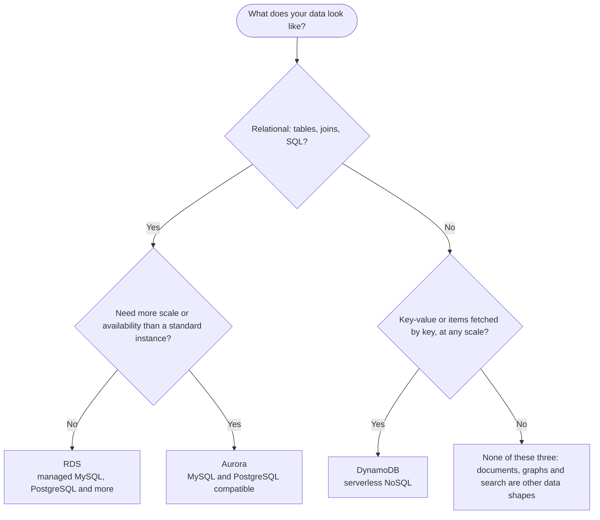

import Tabs from "@theme/Tabs";
import TabItem from "@theme/TabItem";

# Databases

A managed database runs the engine, the backups and the failover for you, so you choose the shape of your data and keep the access tight.

## Decision chart

Start at the top and answer each question. Click a service box to jump to its setup steps.



If the last answer is no, your data may be documents, graphs or full-text search, which need a different kind of database than the three here. For documents, see the [MongoDB notes](../technologies/database/no-sql/mongodb.md).

## Compare the options

| Option | You manage | Scales | Cost shape | AWS | Azure | GCP |
|---|---|---|---|---|---|---|
| Relational, standard | The engine and version, the instance class and storage, the schema and queries, and who can reach it (subnet group, security group) | Scale up by changing the instance class; storage autoscaling turns on when you set a maximum storage threshold (`MaxAllocatedStorage` in the API and CLI, `max_allocated_storage` in Terraform); read replicas for reads | Pay while the instance runs, even when idle; backup storage beyond the free allowance (equal to your provisioned database storage) is billed | [RDS](#rds) | Azure SQL, Database for PostgreSQL/MySQL | Cloud SQL |
| Relational, higher scale or availability | The same as RDS, as a cluster of one writer and its readers | Up to 15 Aurora Replicas share one storage volume of up to 256 TiB; Serverless v2 scales between a minimum and maximum capacity | Provisioned instances, or Serverless v2 capacity measured in Aurora capacity units (ACUs), which can scale to 0 | [Aurora](#aurora) | Azure SQL, Database for PostgreSQL/MySQL | AlloyDB, Spanner |
| Key-value, serverless | The table design (keys, indexes) and the capacity mode; no servers or instances | Serverless: scales to very large tables with single-digit millisecond performance | On-demand pays per read and write request; provisioned pays hourly for the capacity you set | [DynamoDB](#dynamodb) | Cosmos DB | Firestore, Bigtable |

## Set it up on AWS

### RDS {#rds}

<Tabs groupId="aws-setup">
<TabItem value="console" label="Console" default>

1. Create a DB subnet group. Open the RDS console, choose **Subnet groups**, then **Create DB Subnet Group**. Enter a **Name** and **Description**, choose the **VPC**, and under **Add subnets** pick the Availability Zones and then the subnets. The subnets should be private ones. See [Networking (VPC, private subnets)](./networking.mdx#vpc).

   :::caution
   A DB subnet group needs subnets in at least two Availability Zones of the Region, and AWS advises one subnet in every zone, even for a single-AZ database, so you can switch to Multi-AZ later. For a database to be publicly accessible, all subnets in its group must be public, so keep the group private for a database that only your app talks to.
   :::

2. Create a security group for the database in the same VPC. Add one inbound rule for the database port (3306 for MySQL and MariaDB, 5432 for PostgreSQL, 1433 for SQL Server, 1521 for Oracle) with the source set to the security group of your app, not to an IP range. See [EC2](./compute.mdx#ec2) and [ECS on Fargate](./compute.mdx#ecs-fargate) for where the app's group comes from.

   :::caution
   If you choose **Create new** under **VPC security group (firewall)** while creating the database, the console builds a group with an inbound rule for your own computer's IP address. Choose an existing group instead if you want only the app's group to get in.
   :::

3. Open **Databases**, choose **Create database**, then **Standard create**. Choose the **Engine type** and **Version**, then a **Templates** option.

   :::caution
   The **Production** template preselects the Multi-AZ failover option, Provisioned IOPS SSD (`io1`) storage and deletion protection. AWS recommends all three for production, so for a throwaway database pick another template, and switch deletion protection off before you try to delete it.
   :::

4. Under **Settings**, open **Credential Settings** and choose **Managed in AWS Secrets Manager** (AWS calls this **Manage master credentials in AWS Secrets Manager**). RDS generates the master password, stores it in a secret and rotates it every seven days by default.

   :::caution
   Secrets Manager charges apply. You cannot change the KMS key that encrypts the secret once RDS manages it. Deleting the database deletes the secret. Managed credentials are not supported with Blue/Green Deployments, and for most engines you cannot create a read replica while they are on. With **Self managed**, an auto-generated password is shown only once, so record it.
   :::

   Your app reads the credentials from the secret at run time (`aws secretsmanager get-secret-value --secret-id <secret ARN>`), so give its role permission to read that one secret. See [IAM roles](./identity.mdx#iam-roles).

5. Under **Availability & durability**, choose a **Multi-AZ DB instance** deployment for anything that matters: RDS keeps a synchronous standby copy in another Availability Zone and fails over to it.

   :::caution
   The standby cannot serve read traffic. For reads, add a read replica or use a Multi-AZ DB cluster. Multi-AZ can also add write and commit latency, and AWS recommends Provisioned IOPS storage for production workloads.
   :::

6. Under **Connectivity**, set the **VPC**, the **DB subnet group** from step 1, **Public access** to **No**, and the security group from step 2. If your app already runs on an EC2 instance, **Connect to an EC2 compute resource** does all of this for you: it makes a private database and the two linked security groups (`rds-ec2-n` and `ec2-rds-n`).

   :::caution
   Connect with the endpoint's DNS name, never its IP address: the underlying IP changes when RDS fails over.
   :::

7. Set the backup retention period (verify the exact label in the current console). Choose **Create database**. When the status changes from **Creating** to **Available**, copy the endpoint from the database's details page.

   :::caution
   The console default retention is 7 days, while the CLI and API default to 1 day. The range is 0 to 35 days, and 0 turns automated backups off. Changing between 0 and a nonzero value causes an outage. Automated backups let you restore to any point in the retention period; they are deleted with the database unless you choose to retain them at deletion.
   :::

8. To reach a private database from your laptop, go through an instance that is inside the VPC. With Session Manager port forwarding, no SSH port or public database address is needed (the instance needs the SSM Agent and an instance profile, as in EC2). Another way is a bastion host in a public subnet. See [Networking (public and private subnets)](./networking.mdx#vpc).

   ```bash
   aws ssm start-session \
     --target i-0123456789abcdef0 \
     --document-name AWS-StartPortForwardingSessionToRemoteHost \
     --parameters '{"host":["app-db.abc123xyz.ap-southeast-1.rds.amazonaws.com"],"portNumber":["3306"],"localPortNumber":["3306"]}'
   ```

   Then point your database client at `127.0.0.1` port 3306.

9. When you no longer need the database, turn deletion protection off, then delete it: you must give the name, choose whether to **Create final snapshot?**, and choose whether to retain automated backups.

   :::caution
   By default, deletion protection is on for a database created in the console, and a protected database cannot be deleted. Without a final snapshot, the data is gone unless you have another snapshot. A database you stop temporarily starts again on its own after 7 days.
   :::

</TabItem>
<TabItem value="cli" label="CLI">

Create the subnet group and the database security group, and allow only the app's group on the database port. Use your own subnet and group IDs:

```bash
aws rds create-db-subnet-group \
  --db-subnet-group-name app-db \
  --db-subnet-group-description "App database" \
  --subnet-ids subnet-0aaa1111bbbb22223 subnet-0ccc3333dddd44445

aws ec2 create-security-group --group-name app-db \
  --description "App database" --vpc-id vpc-0123456789abcdef0

aws ec2 authorize-security-group-ingress --group-id sg-0db0123456789abcd \
  --protocol tcp --port 3306 --source-group sg-0app123456789abcd
```

Create the database. `--manage-master-user-password` lets RDS keep the password in Secrets Manager (do not also pass `--master-user-password`):

```bash
aws rds create-db-instance \
  --db-instance-identifier app-db \
  --engine mysql --engine-version 8.0 \
  --db-instance-class db.t3.micro \
  --allocated-storage 20 \
  --db-subnet-group-name app-db \
  --vpc-security-group-ids sg-0db0123456789abcd \
  --no-publicly-accessible \
  --multi-az \
  --storage-encrypted \
  --master-username app_admin \
  --manage-master-user-password \
  --backup-retention-period 7 \
  --deletion-protection
```

The class, version and minimum storage must be ones your engine and Region offer (verify them in the RDS User Guide). Wait for it, then read the endpoint and the secret:

```bash
aws rds wait db-instance-available --db-instance-identifier app-db

aws rds describe-db-instances --db-instance-identifier app-db \
  --query 'DBInstances[0].[Endpoint.Address,MasterUserSecret.SecretArn]'

aws secretsmanager get-secret-value --secret-id <secret ARN> --query SecretString --output text
```

Reach it from your laptop through an instance in the VPC (see the Console tab for the `aws ssm start-session` port forwarding command).

Turn on Multi-AZ later with `aws rds modify-db-instance --db-instance-identifier app-db --multi-az --apply-immediately`. To delete, first remove deletion protection, then pass either a final snapshot name or `--skip-final-snapshot`:

```bash
aws rds modify-db-instance --db-instance-identifier app-db \
  --no-deletion-protection --apply-immediately
aws rds delete-db-instance --db-instance-identifier app-db \
  --final-db-snapshot-identifier app-db-final
```

</TabItem>
<TabItem value="terraform" label="Terraform">

```hcl
resource "aws_db_subnet_group" "app" {
  name       = "app-db"
  subnet_ids = var.private_subnet_ids
}

resource "aws_security_group" "db" {
  name        = "app-db"
  description = "App database"
  vpc_id      = var.vpc_id
}

# Only the app's security group may reach the database port
resource "aws_vpc_security_group_ingress_rule" "db_from_app" {
  security_group_id            = aws_security_group.db.id
  referenced_security_group_id = var.app_security_group_id
  from_port                    = 3306
  to_port                      = 3306
  ip_protocol                  = "tcp"
}

resource "aws_db_instance" "app" {
  identifier        = "app-db"
  engine            = "mysql"
  engine_version    = "8.0"
  instance_class    = "db.t3.micro"
  allocated_storage = 20

  db_subnet_group_name   = aws_db_subnet_group.app.name
  vpc_security_group_ids = [aws_security_group.db.id]
  publicly_accessible    = false
  multi_az               = true
  storage_encrypted      = true

  username                    = "app_admin"
  manage_master_user_password = true

  backup_retention_period   = 7
  deletion_protection       = true
  skip_final_snapshot       = false
  final_snapshot_identifier = "app-db-final"
}

output "db_secret_arn" {
  value = aws_db_instance.app.master_user_secret[0].secret_arn
}
```

Declare `vpc_id`, `private_subnet_ids` and `app_security_group_id` as input variables. Notes on these resources:

- `backup_retention_period` defaults to `0` in the provider, which turns automated backups off, and `storage_encrypted` defaults to `false`. Set both, as above.
- With `manage_master_user_password = true`, do not set `password` (the two conflict). A `password` is stored in the state file, which is one more reason to let RDS manage it. The secret's ARN is in `master_user_secret[0].secret_arn`.
- With `deletion_protection = true`, `terraform destroy` fails: set it to `false` and apply that change first. If `skip_final_snapshot` is `false` (the default), `final_snapshot_identifier` is required.
- Changes are applied at the next maintenance window unless you set `apply_immediately = true`.
- Add `max_allocated_storage` (greater than or equal to `allocated_storage`) to turn on storage autoscaling; it is off by default.
- Use `aws_vpc_security_group_ingress_rule` with `referenced_security_group_id` to name the app's group as the source. Give the app's role read access to the secret with an IAM policy (see [IAM policies](./identity.mdx#iam-policies)).

</TabItem>
</Tabs>

### Aurora {#aurora}

- **What it is**: a fully managed relational engine compatible with MySQL and PostgreSQL. You pick Aurora MySQL or Aurora PostgreSQL as the engine in RDS, and existing MySQL and PostgreSQL code and tools work with it.
- **Cluster, not instance**: a writer instance plus up to 15 Aurora Replicas that connect to the same cluster volume (up to 256 TiB) and serve reads only. The storage keeps six copies of your data across three Availability Zones. Put replicas in separate zones, and send reads to the reader endpoint, which balances connections across the replicas.
- **Serverless v2**: you set a minimum and maximum capacity in ACUs and Aurora scales each writer and reader within that range. A minimum of 0 ACUs lets the cluster scale to 0 when nothing is running.
- **Setup is the RDS setup**: the same DB subnet group, security group and Secrets Manager credentials. In the console, choose Aurora (MySQL or PostgreSQL compatible) as the engine type.
- **Terraform**: `aws_rds_cluster` (with `engine` set to `aurora-mysql` or `aurora-postgresql`) plus one `aws_rds_cluster_instance` per instance. `db_subnet_group_name` must match on the cluster and on every instance in it. Use `manage_master_user_password` and `skip_final_snapshot` as on `aws_db_instance`.
- **Moving from RDS**: bring data from RDS for MySQL or PostgreSQL into Aurora with a snapshot restore or one-way replication.

### DynamoDB {#dynamodb}

- **What it is**: a serverless, fully managed NoSQL database with single-digit millisecond performance at any scale. You create tables, not servers, so there is no instance class to size.
- **Keys decide everything**: a table has a partition key and, optionally, a sort key. Design the table around the lookups you will make. A `Scan` reads the whole table or index, so use `Query` where you can.
- **Capacity modes**: on-demand charges per read and write request and needs no capacity planning. Provisioned asks you to set reads and writes per second, and you pay for that capacity per hour, used or not.
- **CLI**: `aws dynamodb create-table --table-name orders --attribute-definitions AttributeName=pk,AttributeType=S --key-schema AttributeName=pk,KeyType=HASH --billing-mode PAY_PER_REQUEST`.
- **Terraform**: `aws_dynamodb_table` with `name`, `hash_key` and an `attribute` block for the key. `billing_mode` defaults to `PROVISIONED`, so set `PAY_PER_REQUEST` for on-demand.
- **Access**: give your app's role permission on the table (see [IAM policies](./identity.mdx#iam-policies)). A table can also trigger a Lambda function through DynamoDB Streams (see [Lambda](./compute.mdx#lambda)).

## Connects to

- Networking: [Networking (VPC, subnets, security groups)](./networking.mdx#vpc) is where the private subnets and the app's security group for RDS come from.
- Compute: [Compute (EC2)](./compute.mdx#ec2) runs the app that connects, and the instance you tunnel through to reach a private database.
- Identity: [Identity (IAM roles)](./identity.mdx#iam-roles) lets the app read the Secrets Manager secret instead of holding a password.
- [PostgreSQL](../technologies/database/relational/postgre.md): the engine you will most often run on RDS or Aurora.
- [MySQL](../technologies/database/relational/mysql.md): the other common RDS and Aurora engine.
- [MongoDB](../technologies/database/no-sql/mongodb.md): a document database to compare with DynamoDB's key-value model.
