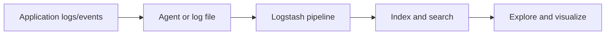

# ELK Stack Integration Guide

> **Quick reference:** [ELK Stack Cheatsheet](./cheatsheet.mdx)

The ELK stack is a developer-facing observability and search platform built from three tools:

- **Elasticsearch** stores, indexes, searches, and aggregates JSON documents.
- **Logstash** ingests events, transforms them, and routes them to Elasticsearch or other outputs.
- **Kibana** explores indexed data through dashboards, saved searches, and operational views.

Use this stack when an application needs centralized logs, event analytics, audit search, troubleshooting dashboards, or operational monitoring.

## Integration Flow

## Developer Responsibilities

1. **Emit structured events** from the application. Prefer JSON logs with stable field names such as `timestamp`, `level`, `service.name`, `trace.id`, `message`, and domain-specific identifiers.
2. **Normalize and enrich events** in Logstash. Parse timestamps, convert numeric fields, redact secrets, and add environment metadata before indexing.
3. **Design Elasticsearch indices** around query patterns. Use predictable index names such as `logs-web-api-dev-YYYY.MM.dd` and define mappings for dates, keywords, numbers, and text fields.
4. **Build Kibana views** for developers and operators. Create data views, dashboards, and alerts around latency, error rate, throughput, and business events.

## Local Development Checklist

- Run the stack locally with Docker Compose or a managed development environment.
- Keep credentials and cloud endpoints in `.env` files or secret stores, never in committed docs or code.
- Validate that one application request produces a searchable event in Elasticsearch.
- Confirm Kibana dashboards use the same fields documented in application logging contracts.

## Tool Guides

- [Cheatsheet](./cheatsheet.mdx): commands, Query DSL, ES|QL, KQL, gotchas and latest versions.
- [Elasticsearch](./elasticsearch.md): index design, APIs, mappings, queries, and operational checks.
- [Logstash](./logstash.md): pipeline structure, filters, outputs, and local validation.
- [Kibana](./kibana.md): data views, dashboards, developer workflows, and troubleshooting.
