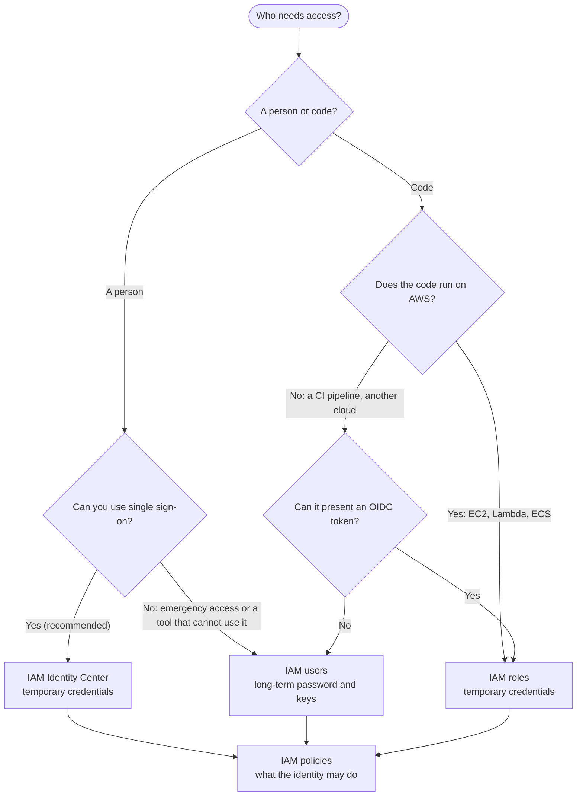

import Tabs from "@theme/Tabs";
import TabItem from "@theme/TabItem";

# Identity

Identity answers two questions for every AWS call: who is asking (a person or code), and what are they allowed to do (policies).

## Decision chart

Start at the top and answer each question. Click a box to jump to its setup steps.



AWS recommends that people use federation and temporary credentials, and that code use roles. Long-term keys for an IAM user are the last resort, for the few cases that cannot use either. Whichever identity you pick, its permissions come from policies.

## Compare the options

| Option | You manage | Scales | Cost shape | AWS | Azure | GCP |
|---|---|---|---|---|---|---|
| Person, single sign-on | Users and groups (or an external identity provider), permission sets, and which accounts each group can use | Many people across many accounts from one place | No charge for the service itself; AWS KMS charges apply to a multi-Region instance | [IAM Identity Center](#iam-identity-center) | Microsoft Entra ID | IAM principals |
| Person or tool, long-term login | Each user's password, MFA device and access keys, plus rotating the keys | Up to 5,000 users per account; every account needs its own users | IAM is offered at no additional charge | [IAM users](#iam-users) | Entra ID users | IAM principals |
| Code, temporary credentials | The role's trust policy and its permissions; there is no password or key to store | A role can be used by any number of sessions; 1,000 roles per account by default | IAM is offered at no additional charge | [IAM roles](#iam-roles) | Managed identity | Service account |
| Permissions | The policy documents: actions, resources and conditions, kept to least privilege | 1,500 customer managed policies per account by default; 20 managed policies per role by default | IAM is offered at no additional charge | [IAM policies](#iam-policies) | RBAC role assignments | IAM roles bound on a resource |

## Set it up on AWS

### IAM Identity Center {#iam-identity-center}

- **What it is**: the AWS recommendation for people. You manage users once in IAM Identity Center (or connect your own identity provider), and they sign in to the AWS access portal and get temporary credentials for the accounts and roles you assign.
- **Enable it**: open the IAM Identity Center console and choose **Enable**. The recommended **organization instance** needs AWS Organizations; from a standalone account, the console offers to create an organization with your account as its management account. An **account instance** (standalone account or a member account) only covers application assignments within that account.
- **Pick the Region carefully**: an organization can have IAM Identity Center in a single Region. To change the Region later you must delete the instance and create a new one in the other Region.
- **Next steps**: confirm the identity source (the built-in directory or an external provider), then create users or groups, create permission sets, and assign groups to accounts. This page does not cover those console screens step by step (verify them in the IAM Identity Center User Guide).
- **Use it from the CLI**: run `aws configure sso` then `aws sso login`, as in [Set up the AWS CLI](./foundations.mdx#sign-in).
- **Free tier note**: creating an AWS organization from a free-tier account upgrades it to a paid plan with pay-as-you-go pricing, and its free tier credits expire immediately.

### IAM users {#iam-users}

<Tabs groupId="aws-setup">
<TabItem value="console" label="Console" default>

1. Open the IAM console, choose **Users**, then **Create user**, and enter a user name.

2. Decide whether the user needs the AWS Management Console. If so, create a password and select **User must create a new password at next sign-in (recommended)**. Create only the credentials the user needs: a user who only uses the console needs no access keys.

3. Set permissions. Put the user in a group and attach policies to the group instead of to each user. See [IAM policies](#iam-policies).

4. Choose **Create user**, then open the user and use the **Security credentials** tab to add an MFA device.

   :::caution
   If you keep a user at all, require MFA for it. AWS recommends phishing-resistant MFA such as passkeys and security keys where possible.
   :::

5. Only if code outside AWS must call AWS and cannot use a role: on the **Security credentials** tab, in **Access keys**, choose **Create access key**. On the **Access key best practices and alternatives** page, choose **Other**, then **Next**, then **Create access key**. Save the secret access key now.

   :::caution
   Long-lived access keys leak; prefer SSO / OIDC federation and short-lived credentials. The secret access key can be retrieved only when you create it, and a user can have at most two access keys.
   :::

6. Rotate keys without downtime: create the second key, update every application to use it, check the **Last used** column of the old key, deactivate the old key, confirm nothing broke, and only then delete it.

   :::caution
   Do not delete the old key straight away, even if it shows no recent use. Deactivate it first: an application that still uses it stops working, and you can reactivate the key while you fix that application.
   :::

</TabItem>
<TabItem value="cli" label="CLI">

Create a user, put it in a group and give the group a managed policy:

```bash
aws iam create-user --user-name dev-alice
aws iam create-group --group-name developers
aws iam add-user-to-group --group-name developers --user-name dev-alice
aws iam attach-group-policy --group-name developers \
  --policy-arn arn:aws:iam::aws:policy/ReadOnlyAccess
```

Give the user a console password. Put the password in a JSON file and use `--cli-input-json`, as the AWS docs recommend for passwords with special characters:

```bash
aws iam create-login-profile --generate-cli-skeleton > create-login-profile.json
# edit the file: {"UserName": "dev-alice", "Password": "...", "PasswordResetRequired": true}
aws iam create-login-profile --cli-input-json file://create-login-profile.json
```

If the password breaks the account password policy, the call fails with `PasswordPolicyViolation`. Use `update-login-profile` to change a password later.

Create an access key only for the last-resort cases above, and rotate it in this order:

```bash
aws iam create-access-key --user-name dev-alice            # second key, active by default
aws iam get-access-key-last-used --access-key-id AKIAEXAMPLEOLDKEY
aws iam update-access-key --user-name dev-alice \
  --access-key-id AKIAEXAMPLEOLDKEY --status Inactive      # not delete yet
aws iam delete-access-key --user-name dev-alice \
  --access-key-id AKIAEXAMPLEOLDKEY                        # after you confirm nothing broke
```

MFA is set up in the console (see the Console tab).

</TabItem>
<TabItem value="terraform" label="Terraform">

```hcl
resource "aws_iam_user" "alice" {
  name = "dev-alice"
}

resource "aws_iam_group" "developers" {
  name = "developers"
}

resource "aws_iam_user_group_membership" "alice" {
  user   = aws_iam_user.alice.name
  groups = [aws_iam_group.developers.name]
}

resource "aws_iam_group_policy_attachment" "read_only" {
  group      = aws_iam_group.developers.name
  policy_arn = "arn:aws:iam::aws:policy/ReadOnlyAccess"
}
```

Manage group membership either entirely in Terraform or entirely in the console: mixing the two can cause drift or conflicts. `aws_iam_user` has a `force_destroy` argument that lets Terraform destroy a user that still has access keys, a login profile or MFA devices it does not manage.

Avoid `aws_iam_access_key` and `aws_iam_user_login_profile` unless you must. The secret access key and a generated password are written to the state file in plain text unless you pass a `pgp_key`, which then prevents using the secret in automation. If you use them, protect the state backend.

</TabItem>
</Tabs>

### IAM roles {#iam-roles}

<Tabs groupId="aws-setup">
<TabItem value="console" label="Console" default>

1. Open the IAM console, choose **Roles**, then **Create role**.

2. For **Trusted entity type**, choose **AWS service**. For **Service or use case**, choose the service that will use the role (**EC2** for a server, **Lambda** for a function), then choose **Next**. The use case sets the trust policy for you.

3. For **Permissions policies**, select what the code needs. For an EC2 instance you reach with Session Manager, `AmazonSSMManagedInstanceCore`. For a Lambda function, `AWSLambdaBasicExecutionRole` lets it write logs to CloudWatch Logs.

   :::caution
   Start small and add permissions for what the code actually calls. Attach only the policies the workload needs, not an administrator policy. See [IAM policies](#iam-policies).
   :::

4. Enter a **Role name**, then choose **Create role**.

   :::caution
   You cannot rename a role after it is created, because other things may refer to it by name. Role names must be unique in the account and are not distinguished by case.
   :::

5. Use the role:

   - **EC2**: when you launch an instance, set **IAM instance profile** under **Advanced details**. See [EC2](./compute.mdx#ec2).
   - **Lambda**: the console creates a default execution role (with `AWSLambdaBasicExecutionRole`) when you create a function. To use a role you made, choose **Use another role** in the **Permissions** section. See [Lambda](./compute.mdx#lambda).

   :::caution
   When you create a role for EC2 in the console, it also creates an instance profile with the same name, and the EC2 launch screen lists instance profile names. A role made with the CLI or Terraform has no instance profile until you create one.
   :::

6. To change the permissions of a running EC2 instance, replace its instance profile. Removing a role from an instance profile can take up to an hour to take effect.

</TabItem>
<TabItem value="cli" label="CLI">

An EC2 role needs a trust policy, a permissions policy and an instance profile (a separate step in the CLI):

```bash
aws iam create-role --role-name web-ec2 --assume-role-policy-document '{
  "Version": "2012-10-17",
  "Statement": [{"Effect": "Allow", "Principal": {"Service": "ec2.amazonaws.com"}, "Action": "sts:AssumeRole"}]
}'
aws iam attach-role-policy --role-name web-ec2 \
  --policy-arn arn:aws:iam::aws:policy/AmazonSSMManagedInstanceCore
aws iam create-instance-profile --instance-profile-name web-ec2
aws iam add-role-to-instance-profile --instance-profile-name web-ec2 --role-name web-ec2
```

A Lambda execution role trusts `lambda.amazonaws.com` instead:

```bash
aws iam create-role --role-name lambda-ex --assume-role-policy-document '{
  "Version": "2012-10-17",
  "Statement": [{"Effect": "Allow", "Principal": {"Service": "lambda.amazonaws.com"}, "Action": "sts:AssumeRole"}]
}'
aws iam attach-role-policy --role-name lambda-ex \
  --policy-arn arn:aws:iam::aws:policy/service-role/AWSLambdaBasicExecutionRole
```

Give a running instance a profile, or check what a command is running as:

```bash
aws ec2 associate-iam-instance-profile --instance-id i-0123456789abcdef0 \
  --iam-instance-profile Name=web-ec2
aws sts get-caller-identity
```

Assume a role yourself (for example across accounts) to get temporary credentials:

```bash
aws sts assume-role \
  --role-arn arn:aws:iam::123456789012:role/web-ec2 \
  --role-session-name my-session \
  --duration-seconds 3600
```

An instance profile can hold only one role. A new role or profile can take a moment to be usable everywhere (IAM is eventually consistent), so retry if a launch or `create-function` says it cannot find or assume it.

</TabItem>
<TabItem value="terraform" label="Terraform">

```hcl
data "aws_iam_policy_document" "ec2_assume" {
  statement {
    actions = ["sts:AssumeRole"]
    principals {
      type        = "Service"
      identifiers = ["ec2.amazonaws.com"]
    }
  }
}

resource "aws_iam_role" "web" {
  name               = "web-ec2"
  assume_role_policy = data.aws_iam_policy_document.ec2_assume.json
}

resource "aws_iam_role_policy_attachment" "ssm" {
  role       = aws_iam_role.web.name
  policy_arn = "arn:aws:iam::aws:policy/AmazonSSMManagedInstanceCore"
}

resource "aws_iam_instance_profile" "web" {
  name = "web-ec2"
  role = aws_iam_role.web.name
}

data "aws_iam_policy_document" "lambda_assume" {
  statement {
    actions = ["sts:AssumeRole"]
    principals {
      type        = "Service"
      identifiers = ["lambda.amazonaws.com"]
    }
  }
}

resource "aws_iam_role" "lambda" {
  name               = "lambda-ex"
  assume_role_policy = data.aws_iam_policy_document.lambda_assume.json
}

resource "aws_iam_role_policy_attachment" "lambda_logs" {
  role       = aws_iam_role.lambda.name
  policy_arn = "arn:aws:iam::aws:policy/service-role/AWSLambdaBasicExecutionRole"
}
```

Use `aws_iam_role_policy_attachment` (and `aws_iam_role_policy` for inline policies) to manage a role's policies. Do not mix them with the `managed_policy_arns` or `inline_policy` arguments of `aws_iam_role`, or Terraform shows a permanent difference. The `name` of an `aws_iam_instance_profile` must be unique across the account, whatever its role or path. `max_session_duration` on the role takes seconds, from 1 hour to 12 hours.

</TabItem>
</Tabs>

#### Which role for which service {#role-types}

- **EC2**: an instance profile carries the role. The code on the instance (through the AWS SDK) gets its temporary credentials without any key on disk.
- **Lambda**: the execution role. Lambda assumes it for you when the function is invoked, so avoid calling `sts:AssumeRole` yourself in the function. The trust policy must name `lambda.amazonaws.com`.
- **ECS on Fargate**: two roles, not one. The **task execution role** (managed policy `AmazonECSTaskExecutionRolePolicy`) is used by the ECS and Fargate agents to pull the image from ECR and send logs to CloudWatch Logs; your containers cannot use it. The **task role** is what your application code uses to call AWS services. Both trust `ecs-tasks.amazonaws.com`. See [ECS on Fargate](./compute.mdx#ecs-fargate).
- **Outside AWS**: a role can also be assumed with a web identity token, a SAML assertion or an X.509 certificate (IAM Roles Anywhere). See the next section for GitHub Actions.

#### CI deploy without keys {#ci-without-keys}

This is the AWS side of "GitHub OIDC -> IAM role" in the [Common patterns](./foundations.mdx#common-patterns) table: a GitHub Actions workflow trades its OIDC token for temporary AWS credentials, so no access key is stored in GitHub.

1. Create an IAM OIDC identity provider with the URL `https://token.actions.githubusercontent.com` and the audience `sts.amazonaws.com`.
2. Create a role whose trust policy lets that provider assume it, limited to your repository.
3. Let the workflow request the token and assume the role.

```bash
aws iam create-open-id-connect-provider \
  --url https://token.actions.githubusercontent.com \
  --client-id-list sts.amazonaws.com
```

The role's trust policy (create it like any role, with `aws iam create-role --assume-role-policy-document file://github-trust.json`):

```json title="github-trust.json"
{
  "Version": "2012-10-17",
  "Statement": [
    {
      "Effect": "Allow",
      "Principal": {
        "Federated": "arn:aws:iam::123456789012:oidc-provider/token.actions.githubusercontent.com"
      },
      "Action": "sts:AssumeRoleWithWebIdentity",
      "Condition": {
        "StringEquals": {
          "token.actions.githubusercontent.com:aud": "sts.amazonaws.com",
          "token.actions.githubusercontent.com:sub": "repo:octo-org/octo-repo:ref:refs/heads/main"
        }
      }
    }
  ]
}
```

The same thing in Terraform:

```hcl
resource "aws_iam_openid_connect_provider" "github" {
  url            = "https://token.actions.githubusercontent.com"
  client_id_list = ["sts.amazonaws.com"]
}

data "aws_iam_policy_document" "github_trust" {
  statement {
    actions = ["sts:AssumeRoleWithWebIdentity"]
    principals {
      type        = "Federated"
      identifiers = [aws_iam_openid_connect_provider.github.arn]
    }
    condition {
      test     = "StringEquals"
      variable = "token.actions.githubusercontent.com:aud"
      values   = ["sts.amazonaws.com"]
    }
    condition {
      test     = "StringEquals"
      variable = "token.actions.githubusercontent.com:sub"
      values   = ["repo:octo-org/octo-repo:ref:refs/heads/main"]
    }
  }
}

resource "aws_iam_role" "github_deploy" {
  name               = "github-deploy"
  assume_role_policy = data.aws_iam_policy_document.github_trust.json
}
```

The workflow needs `id-token: write` to request the token (it grants no write access to resources), and `contents: read` for `actions/checkout`:

```yaml title=".github/workflows/deploy.yml"
permissions:
  id-token: write
  contents: read

steps:
  - uses: aws-actions/configure-aws-credentials@e3dd6a429d7300a6a4c196c26e071d42e0343502 # commit pinned in GitHub's guide; check for a newer release
    with:
      role-to-assume: arn:aws:iam::123456789012:role/github-deploy
      aws-region: ap-southeast-1
```

:::caution
Scope the `sub` condition. A wildcard such as `repo:octo-org/octo-repo:*` lets any branch, pull request merge branch or environment of that repository assume the role. For a GitHub environment the value looks like `repo:ORG/REPO:environment:NAME`.
:::

:::caution
The `aws_iam_openid_connect_provider` resource treats `thumbprint_list` as optional, and for GitHub AWS validates the provider with its own library of trusted root certificate authorities, so a configured thumbprint is not used. An account can have 100 OIDC providers by default, and two providers cannot share a URL.
:::

#### Session lifetime {#session-lifetime}

- `aws sts assume-role` returns credentials for 1 hour by default. Ask for 900 seconds (15 minutes) up to 43,200 seconds (12 hours) with `--duration-seconds`, never more than the role's own maximum session duration (1 to 12 hours).
- With role chaining (a role that assumes another role), the session is limited to 1 hour.
- The maximum session duration of a role does not limit sessions that AWS services assume for you, such as an instance profile or a Lambda execution role.

### IAM policies {#iam-policies}

<Tabs groupId="aws-setup">
<TabItem value="console" label="Console" default>

1. Open the IAM console, choose **Policies**, then **Create policy**.

2. In the **Policy editor**, choose **JSON** and enter the policy. This one lets the identity read objects from one bucket and nothing else:

   ```json
   {
     "Version": "2012-10-17",
     "Statement": [
       {
         "Effect": "Allow",
         "Action": ["s3:GetObject"],
         "Resource": "arn:aws:s3:::my-app-bucket/*"
       }
     ]
   }
   ```

   :::caution
   Name the exact actions and the exact resources. `"Action": "*"` with `"Resource": "*"` is the whole account. When you edit in the console, IAM Access Analyzer gives recommendations before you save: read them.
   :::

3. Choose **Next**, enter a **Policy name** and an optional **Description**, review the permissions, then choose **Create policy**.

   :::caution
   A customer managed policy can be at most 6,144 characters (white space is not counted), and IAM keeps up to 5 versions of it before you must overwrite one.
   :::

4. Attach it: open the role (or the group), choose **Add permissions**, then **Attach policies**, and select the policy (verify the exact labels in the current console).

   :::caution
   By default a role can have 20 managed policies attached and a user 10. Give a role only the policies it needs, and write one tighter policy instead of attaching many broad ones.
   :::

</TabItem>
<TabItem value="cli" label="CLI">

```bash
cat > s3-read.json <<'EOF'
{
  "Version": "2012-10-17",
  "Statement": [
    { "Effect": "Allow", "Action": ["s3:GetObject"], "Resource": "arn:aws:s3:::my-app-bucket/*" }
  ]
}
EOF

aws iam create-policy --policy-name s3-read-app-bucket --policy-document file://s3-read.json
aws iam attach-role-policy --role-name web-ec2 \
  --policy-arn arn:aws:iam::123456789012:policy/s3-read-app-bucket
```

Or write the permissions straight into the role as an inline policy, which exists only for that role:

```bash
aws iam put-role-policy --role-name web-ec2 \
  --policy-name s3-read-app-bucket --policy-document file://s3-read.json
```

Check what the CLI is running as with `aws sts get-caller-identity` before you debug a policy. An access error means the policy that applies to that identity does not allow the call.

</TabItem>
<TabItem value="terraform" label="Terraform">

```hcl
data "aws_iam_policy_document" "s3_read" {
  statement {
    effect    = "Allow"
    actions   = ["s3:GetObject"]
    resources = ["arn:aws:s3:::my-app-bucket/*"]
  }
}

resource "aws_iam_policy" "s3_read" {
  name        = "s3-read-app-bucket"
  description = "Read objects from the app bucket"
  policy      = data.aws_iam_policy_document.s3_read.json
}

# aws_iam_role.web is the role from the IAM roles section
resource "aws_iam_role_policy_attachment" "s3_read" {
  role       = aws_iam_role.web.name
  policy_arn = aws_iam_policy.s3_read.arn
}
```

`policy` is the only required argument of `aws_iam_policy`; build it with `aws_iam_policy_document` or `jsonencode()` rather than a hand-written JSON string. Add `aws_iam_group_policy_attachment` or `aws_iam_user_policy_attachment` to attach the same policy to a group or a user.

</TabItem>
</Tabs>

#### Policy types {#policy-types}

- **Identity-based policies** are attached to a user, group or role and say what that identity may do. They are either AWS managed (for common cases, but not always least privilege), customer managed (yours, reusable) or inline (embedded in one identity).
- **Resource-based policies** are attached to a resource and name who may use it, for example an S3 bucket policy. See Storage (bucket policies) {/* TODO-LINK ./storage.mdx#s3 */}. A role's trust policy is a resource-based policy too.
- **Permissions boundaries** set the most an identity-based policy can grant a user or role. They grant nothing on their own.
- **Service control policies (SCPs) and resource control policies (RCPs)** in AWS Organizations set guardrails for the accounts below them. They grant nothing on their own.
- **Session policies** limit a role session or federated user session further when you ask for temporary credentials.

#### How a request is evaluated {#policy-evaluation}

By default every request is denied (an implicit deny), except the root user of the account. A request is allowed only if the policies that apply allow it and nothing denies it. The checks run in this order:

1. **Explicit deny**: AWS looks in all applicable policies (SCPs, RCPs, resource-based, identity-based, boundaries, session policies) for a `Deny` that matches. One match and the answer is Deny.
2. **RCPs**: if RCPs apply and none allows the action, Deny.
3. **SCPs**: if SCPs apply and none allows the action, Deny.
4. **Resource-based policies**: in the same account, an `Allow` here can be enough on its own. A role trust policy and a KMS key policy are the exceptions: they must explicitly allow the principal.
5. **Identity-based policies**: if no statement allows the action, Deny.
6. **Permissions boundary**: if one exists and does not allow the action, Deny.
7. **Session policy**: if one was passed and does not allow the action, Deny. Otherwise, Allow.

Short version: an explicit deny always wins; then everything that applies (organization guardrails, boundary, session policy) must also allow it; and inside one account, for most resources an allow from either an identity-based or a resource-based policy is enough.

:::caution
Within one account, a resource-based policy that names an IAM user or a role session directly can allow access even when the identity-based policy does not, so check both when a call is allowed and you did not expect it. This page covers the single-account case: cross-account requests follow their own rules (see the cross-account policy evaluation logic page in the IAM User Guide).
:::

#### Least privilege {#least-privilege}

- Grant only the actions needed, on the specific resources, under conditions where you can (for example, require TLS).
- Start from AWS managed policies for common cases, then replace them with customer managed policies cut to your workload.
- Let IAM Access Analyzer generate a policy from the access activity logged in CloudTrail for a role, test it, then use it.
- Use last accessed information to find and remove users, roles, permissions and credentials you no longer use.
- Use a permissions boundary to let others create roles for their workloads without letting them exceed a ceiling you set.

#### Limits {#iam-limits}

Defaults for each Region (the adjustable ones can be raised through Service Quotas):

- **Users per account**: 5,000 (not adjustable). **Access keys per user**: 2. **MFA devices per user**: 8. **Groups per user**: 10.
- **Roles per account**: 1,000. **Role trust policy length**: 2,048 characters (up to 8,192). **Instance profiles per account**: 1,000. **Role name**: 64 characters.
- **Customer managed policies per account**: 1,500. **Managed policy size**: 6,144 characters. **Versions per managed policy**: 5.
- **Managed policies attached**: 20 per role, 10 per user, 10 per group.
- **Inline policies, total per identity**: user 2,048 characters, role 10,240, group 5,120.

## Connects to

- Compute: [Compute](./compute.mdx#ec2) is where an instance profile or a Lambda execution role is attached to the thing that runs your code.
- Storage: Storage (bucket policies) {/* TODO-LINK ./storage.mdx#s3 */} are resource-based policies that decide who can read or write a bucket.
- Foundations: [Workload identity](./foundations.mdx#workload-identity) explains why code gets a role instead of keys.
- [Authentication flows](../key-notes/authentication.md): OAuth, JWT and refresh tokens, the ideas behind the OIDC token a CI job trades for AWS credentials.
- [Authentication cheatsheet](../key-notes/authentication-cheatsheet.mdx): a quick reference for those flows.
