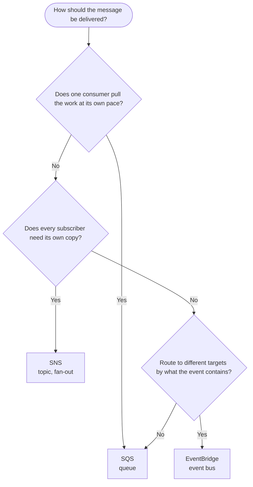

# Messaging

Messaging lets one part of an app hand work or news to another without waiting for it: a queue holds work, a topic copies it to many, and an event bus routes it by content.

## Decision chart

Start at the top and answer each question. Click a service box to jump to its notes.

If none of the questions fits, start with a queue: it is the simplest way to hand work from one part of the app to another.

## Compare the options

| Option | You manage | Scales | Cost shape | AWS | Azure | GCP |
|---|---|---|---|---|---|---|
| Queue | The consumer that polls and deletes messages, plus retries and a dead-letter queue | Standard queues support nearly unlimited API calls per second; FIFO queues have a lower limit | Pay per request; each 64 KB chunk of a payload is billed as one request; 1 million requests a month are free | [SQS](#sqs) | Service Bus queues, Queue Storage | Pub/Sub |
| Topic (publish and subscribe) | The topic, its subscriptions and the permissions that let it reach each subscriber | You add subscribers; the topic delivers to all of them | Pay for messages published, notifications delivered and API calls; delivery price varies by endpoint type | [SNS](#sns) | Service Bus topics | Pub/Sub |
| Event bus | Rules (event patterns), their targets, and retry and dead-letter settings | You add rules and targets; no capacity to plan | Pay for the events published and delivered; on the classic bus each 64 KB chunk of a payload is one event and events from AWS services are ingested for free | [EventBridge](#eventbridge) | Event Grid | Eventarc |

## Set it up on AWS

### SQS {#sqs}

- **What it is**: Amazon SQS holds messages until a consumer polls for them. Standard queues give at-least-once delivery with best-effort ordering, so a message can arrive more than once or out of order and the consumer must cope with that. FIFO queues keep strict order and add no duplicates, but have a limited number of transactions per second (high throughput mode raises the limit). The queue type cannot be changed after the queue is created.
- **Create one**: in the SQS console choose **Create queue**, keep the **Standard** type unless order matters, and enter a name. The console defaults are a visibility timeout of 30 seconds (0 seconds to 12 hours), a message retention period of 4 days (1 minute to 14 days) and a maximum message size of 1,024 KiB.
- **Visibility timeout**: a received message stays in the queue but is hidden. If the consumer does not delete it before the timeout ends, it becomes visible again and is delivered again. Set the timeout to the time the consumer needs, and use `ChangeMessageVisibility` to extend it. The limit is 12 hours from when the message is first received.
- **Use long polling**: the console default for **Receive message wait time** is 0 seconds, which is short polling. Any non-zero value (up to 20 seconds) is long polling, which cuts empty responses and cost.
- **Dead-letter queue**: create the dead-letter queue first, then point the source queue's redrive policy at it with a `maxReceiveCount`, the number of receives before a message is moved. The dead-letter queue must be in the same account and Region, and for a standard queue its retention period should be longer than the source queue's, because the original enqueue timestamp is kept.
- **With Lambda**: Lambda polls the queue through an event source mapping and deletes a batch after the function succeeds. Set the queue's visibility timeout to at least six times the function timeout, set `maxReceiveCount` to at least 5, attach the `AWSLambdaSQSQueueExecutionRole` managed policy to the function's role, and configure the event source mapping for partial batch responses so only the failed messages return to the queue. See [Compute (Lambda)](./compute.mdx#lambda).

### SNS {#sns}

- **What it is**: Amazon SNS delivers a published message to every subscriber of a topic. Subscribers can be SQS queues, Lambda functions, HTTP(S) endpoints, email, mobile push, SMS and Amazon Data Firehose. By default every subscriber receives every message.
- **Create a topic**: in the SNS console choose **Topics**, **Create topic**, pick **Standard** or **FIFO** and enter a name (a FIFO topic name must end in `.fifo`). The type and name cannot be changed after creation. With the CLI: `aws sns create-topic --name my-topic`, then `aws sns subscribe --topic-arn <topic-arn> --protocol email --notification-endpoint <address>` and `aws sns publish --topic-arn <topic-arn> --message "Hello World!"`. An email subscription stays pending until the recipient confirms it.
- **Fan-out to queues**: subscribe several SQS queues to one topic so each consumer gets its own copy and the messages wait in its queue. The queue needs an access policy that allows `sqs:SendMessage` for the `sns.amazonaws.com` service principal, with an `aws:SourceArn` condition set to the topic ARN. If the queue owner creates the subscription, it is confirmed automatically.
- **Filter policies**: a subscription without a filter policy receives every message. Add a JSON filter policy to a subscription so it receives only matching messages, matched on message attributes or on the message body.
- **Size**: to accept messages larger than 256 KiB, raise the **Maximum message size** setting, which goes up to 1,024 KiB.
- **Names are not private**: topic names are visible to other AWS services such as CloudWatch Logs, so leave personal or confidential data out of them.

### EventBridge {#eventbridge}

- **What it is**: Amazon EventBridge receives events from AWS services, your own apps and SaaS tools and sends each to the targets whose rule matches it. A rule holds an event pattern, and one rule can send an event to several targets that run in parallel. The user guide recommends the Custom Event Bus for new applications; Custom Event Bus - Classic (rules and targets) remains available.
- **Event patterns**: a pattern has the same shape as the event it matches and can test the `source`, the `detail-type` and fields inside `detail`. For example, `source` set to `aws.ec2`, `detail-type` set to `EC2 Instance State-change Notification` and `detail.state` set to `terminated` selects EC2 instance terminations. The EventBridge Sandbox tests a pattern against a sample event before you create the rule.
- **Retries and dead-letter queue**: if delivery to a target fails, EventBridge retries for 24 hours and up to 185 times by default, then drops the event. Attach a dead-letter queue to the target to keep failed events. It must be a standard SQS queue in the Region of the rule. When you add it in the console the queue policy is set for you, but when you use the API you must add a policy that lets the `events.amazonaws.com` service send to the queue.
- **Schedules**: scheduled rules are a legacy feature. For cron, rate and one-time schedules use EventBridge Scheduler, which also has flexible time windows and retry limits.
- **Pipes**: EventBridge Pipes connects one source to one target with optional filtering and enrichment, for example a DynamoDB stream into an event bus.
- **Avoid rule loops**: a rule whose target changes the thing the rule watches (for example a rule on S3 bucket ACL changes that resets the ACL) fires again and again, with higher charges and throttling. Write precise patterns.

## Connects to

- Compute: [Compute (Lambda)](./compute.mdx#lambda) is the usual consumer of an SQS queue, an SNS topic or an EventBridge rule through triggers.
- Identity: [Identity (IAM policies)](./identity.mdx#iam-policies) holds the permissions that let a topic write to a queue and a function read from one.
- Monitoring: [Monitoring (CloudWatch)](./monitoring.mdx#cloudwatch) alarms on SQS metrics such as the number of in-flight messages, and an alarm can send its alert to an SNS topic.
- [Microservices](../key-notes/microservices.mdx): queues and events are how services stay loosely coupled.
