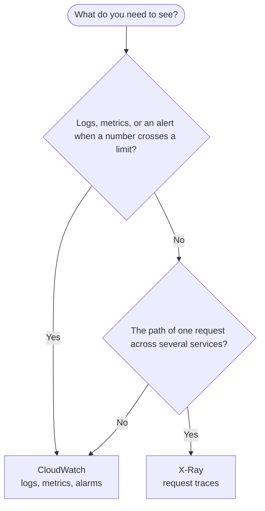

# Monitoring

Monitoring shows what your app is doing: logs say what happened, metrics and alarms say how much and when to wake you, and traces follow one request across services.

## Decision chart

Start at the top and answer each question. Click a service box to jump to its notes.

If none of the questions fits, start with CloudWatch: most AWS services already send it logs or metrics, so it shows something without any setup.

## Compare the options

| Option | You manage | Scales | Cost shape | AWS | Azure | GCP |
|---|---|---|---|---|---|---|
| Logs, metrics and alarms | Log retention per log group, alarm thresholds and actions, dashboards, and the CloudWatch agent on EC2 | No limit on the number of alarms or on the log streams in a log group | Basic metrics from AWS services are free; custom metrics, alarms, dashboards and log ingestion and storage are billed beyond a small free tier | [CloudWatch](#cloudwatch) | Azure Monitor | Cloud Monitoring, Cloud Logging |
| Request traces | Instrumentation in your code (or active tracing on a supported service) and sampling rules | Sampling keeps the volume down: by default the first request each second and five percent of the rest | Billed per trace (rates `verify` on the X-Ray pricing page) | [X-Ray](#xray) | Application Insights | Cloud Trace |

## Set it up on AWS

### CloudWatch {#cloudwatch}

- **What it is**: Amazon CloudWatch collects metrics and logs, draws dashboards and runs alarms. Many AWS services send basic metrics for free, and you can publish your own custom metrics.
- **Logs**: logs live in log groups, and a log group is a set of log streams that share retention, monitoring and access settings. Lambda sends its logs to a log group named `/aws/lambda/<function-name>` when its execution role allows `logs:CreateLogGroup`, `logs:CreateLogStream` and `logs:PutLogEvents` (the `AWSLambdaBasicExecutionRole` managed policy has them). ECS tasks use the `awslogs` log driver. Logs can take 5 to 10 minutes to appear, and `aws logs tail /aws/lambda/my-fn --follow` follows them from the CLI.
- **Set retention**: by default log data is stored indefinitely, and stored log data is billed. In the CloudWatch console open **Logs**, **Log groups**, and in the **Retention** column choose how long to keep it. A log group cannot be renamed.
- **Alarms**: a metric alarm watches one metric against a threshold over a number of periods and then runs actions, such as sending a message to an SNS topic (see [Messaging (SNS)](./messaging.mdx#sns)). The states are `OK`, `ALARM` and `INSUFFICIENT_DATA`; an alarm runs its actions only when it changes state. Choose how each alarm treats missing data, because a resource that is idle can show `INSUFFICIENT_DATA` without a problem.
- **EC2 memory and disk**: for detailed system metrics about processes, CPU, memory, disk usage and network, install the CloudWatch agent on the instance.
- **Free tier and cost**: the free tier covers 5 GB of log data (ingestion, archive storage and Logs Insights scans together), 10 custom or detailed-monitoring metrics, 10 alarm metrics and 3 custom dashboards a month. Terraform: `aws_cloudwatch_log_group` and `aws_cloudwatch_metric_alarm` (verify the arguments against the hashicorp/aws provider docs).

### X-Ray {#xray}

- **What it is**: AWS X-Ray groups the segments each service reports for one request into a trace, and builds a service graph (the trace map) that shows where time goes and where errors happen. Trace and service graph data are kept for 30 days.
- **Turn it on for Lambda**: Lambda tracing is `PassThrough` by default, which passes the tracing header on but sends no traces. Set `Active` tracing: in the Lambda console open **Configuration**, **Monitoring and operations tools**, **Additional monitoring tools**, **Edit**, and enable **Lambda service traces**. With the CLI, run `aws lambda update-function-configuration --function-name my-function --tracing-config Mode=Active`. The execution role needs `xray:PutTraceSegments` and `xray:PutTelemetryRecords`, which the `AWSXRayDaemonWriteAccess` managed policy includes (the console adds them for you).
- **Sampling**: X-Ray does not trace every request. By default it records the first request each second and five percent of additional requests, and for Lambda you cannot change that rate.
- **Queues**: traces from an upstream producer such as SQS are linked to the traces of the Lambda function that consumes the message, so one trace can span the queue (see [Messaging (SQS)](./messaging.mdx#sqs)).
- **Pick the instrumentation carefully**: since 25 February 2026 the X-Ray SDKs and daemon are in maintenance mode (security fixes only), and AWS recommends migrating to OpenTelemetry, for example the AWS Distro for OpenTelemetry. Check the X-Ray SDK and Daemon support timeline before adding the SDK to new code.

## Connects to

- Compute: [Compute (Lambda)](./compute.mdx#lambda) and [ECS on Fargate](./compute.mdx#ecs-fargate) send their logs to CloudWatch and can send traces to X-Ray.
- Messaging: [Messaging (SNS)](./messaging.mdx#sns) delivers a CloudWatch alarm's alert to email, SMS, a Lambda function or another subscriber.
- [ELK Stack](../devops/observability/elk-stack/index.md): centralized logging you can run yourself on any cloud, when CloudWatch Logs is not the place you want logs to live.
- [Microservices](../key-notes/microservices.mdx): once a request crosses services, logs alone are not enough and traces show the path.
