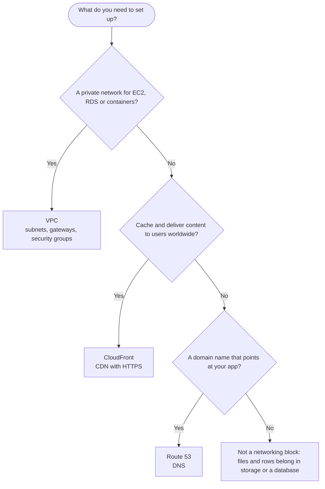

import Tabs from "@theme/Tabs";
import TabItem from "@theme/TabItem";

# Networking

Networking decides who can reach your servers and databases, how fast users get your content, and which name they type to find you.

## Decision chart

Start at the top and answer each question. Click a service box to jump to its setup steps.



If the last answer is no, see [Storage](./storage.mdx#s3) for files or [Databases](./databases.mdx#rds) for rows. A real app usually needs all three: the VPC holds the servers, CloudFront sits in front of them, and Route 53 gives them a name.

## Compare the options

| Option | You manage | Scales | Cost shape | AWS | Azure | GCP |
|---|---|---|---|---|---|---|
| Private network | The IP ranges, subnets (public and private), route tables, gateways, and the security groups and network ACLs that filter traffic | You add subnets, one Availability Zone each. A NAT gateway supports 5 Gbps and scales automatically up to 100 Gbps | Security groups, network ACLs and internet gateways have no charge. A NAT gateway costs each hour it is available plus each GB it processes | [VPC](#vpc) | Virtual Network (VNet) | VPC network |
| Content delivery (CDN) | The origins, cache behaviors (per URL path), the HTTPS certificate and the alternate domain names | Automatic: content is served from a global network of edge locations | Pay for requests and data transferred out to viewers (see the CloudFront pricing page); invalidation paths over the first 1,000 a month cost extra | [CloudFront](#cloudfront) | Front Door | Cloud CDN |
| DNS | The hosted zones and the records in them | Managed by AWS: a highly available, scalable DNS service | Pay for each hosted zone and for the DNS queries answered; alias queries to AWS resources are free | [Route 53](#route53) | Azure DNS | Cloud DNS |

## Set it up on AWS

### VPC {#vpc}

<Tabs groupId="aws-setup">
<TabItem value="console" label="Console" default>

1. Create the VPC and its subnets. Open the VPC console, choose **Create VPC**, and under **Resources to create** choose **VPC and more**. Keep **Name tag auto-generation** on and enter the **IPv4 CIDR block**, for example `10.0.0.0/16`. Set **Number of Availability Zones (AZs)** to 2, then set **Number of public subnets** and **Number of private subnets** (2 each). For **NAT gateways**, choose in how many AZs to create one (see step 3), and optionally add **VPC endpoints**, **S3 Gateway**. Leave **DNS options** alone (both are on by default), then choose **Create VPC**. The **Preview** pane shows how the pieces connect, and the **Resource map** tab shows it again later.

   :::caution
   A subnet CIDR block can be anywhere from `/28` to `/16`, and the subnets in one VPC cannot overlap. In every subnet, AWS reserves five addresses: the first four and the last one. By default you can have 5 VPCs per Region and 200 subnets per VPC.
   :::

   :::caution
   AWS recommends subnets in at least two Availability Zones for production, so that one zone failing does not take the whole app down. Each subnet lives in a single zone.
   :::

2. Know what makes a subnet public. A subnet is public when its route table has a route that sends `0.0.0.0/0` to an internet gateway, and private when it has no such route. The wizard builds these for you. If you build by hand, choose **Internet gateways**, **Create internet gateway**, then **Actions**, **Attach to VPC**. Next choose **Route tables**, select the subnet's table, choose **Routes**, **Edit routes**, **Add route**, enter `0.0.0.0/0` as the **Destination**, pick the internet gateway as the **Target**, and choose **Save changes**.

   :::caution
   A route to the internet gateway is not enough: an instance also needs a public IPv4 address or an Elastic IP to talk to the Internet. Instances in a private subnet cannot reach the Internet at all, even with a public IP, because there is no route to the gateway.
   :::

   :::caution
   Default VPC and public IPs make things reachable; lock down security groups. Every Region has a default VPC (`172.31.0.0/16`) with a public `/20` subnet in each Availability Zone, an internet gateway and a `0.0.0.0/0` route. An instance launched into a default subnet receives a public IPv4 address, while one launched into a non-default subnet does not. So a quick launch into the default VPC is as reachable as its security group allows: tighten it in step 4, and build your own VPC with private subnets for anything real. The Azure and GCP versions of this gotcha (NSGs and firewall rules) are in the [Gotchas](./foundations.mdx#gotchas) on Foundations.
   :::

3. Let private subnets reach the Internet, one way out. Choose **NAT gateways**, **Create NAT gateway**, enter an optional name, select a **public** subnet, leave **Connectivity type** on **Public**, and under **Elastic IP allocation ID** pick an Elastic IP or choose **Allocate Elastic IP**. When the status changes from `Pending` to `Available`, open **Route tables**, select the private subnet's table, choose **Routes**, **Edit routes**, **Add route**, enter `0.0.0.0/0`, choose **NAT Gateway** as the **Target**, and select the gateway. Connections must start inside the VPC: a NAT gateway lets private instances call out, and nothing on the Internet can open a connection in. A newer **Regional** option under **Availability mode** expands across Availability Zones by itself and needs no public subnet, but it supports public connectivity only. These steps use the zonal one.

   :::caution
   Egress is not free. NAT gateways add per-GB fees: you pay for each hour a NAT gateway is available and each gigabyte it processes. To lower the bill, keep resources in the same Availability Zone as the NAT gateway they use (or create one gateway per zone that has resources), and send traffic to AWS services that have a gateway or interface endpoint through that endpoint, such as the **S3 Gateway** option in step 1. The general data-out gotcha for all clouds is in the [Gotchas](./foundations.mdx#gotchas) on Foundations.
   :::

   :::caution
   A zonal NAT gateway lives in one Availability Zone. If several zones share it and that zone goes down, the other zones lose Internet access. For resilience, create a NAT gateway in each zone and route each private subnet to the one in its own zone.
   :::

   :::caution
   Deleting a NAT gateway disassociates its Elastic IP but does not release it, so release the address yourself if you no longer need it. The routes that pointed at the gateway stay as `blackhole` routes until you delete or update them. The gateway's entry stays visible in the console for about an hour after you delete it.
   :::

4. Create the security groups. Choose **Security groups**, **Create security group**, enter a name and description, and choose the **VPC**. Under **Inbound rules** choose **Add rule** and set the protocol, port and source. A common chain for a web app uses three groups: the load balancer's group allows HTTP (80) and HTTPS (443) from `0.0.0.0/0`, the app's group allows the app port only from the load balancer's group, and the database's group allows the database port only from the app's group (as in [Databases](./databases.mdx#rds)).

   :::caution
   A new security group has no inbound rules, so nothing gets in until you add a rule, and it has one outbound rule that allows all traffic. Rules only allow, there is no deny rule. Security groups are stateful: the reply to an allowed request is allowed back out whatever the outbound rules say. You cannot change a security group's name or description after you create it.
   :::

   :::caution
   When you name another security group as the source, the rule covers every instance in that group, over their private IP addresses, and counts as one rule however large the group is. Prefer that to listing IP ranges.
   :::

   :::caution
   For SSH (22) or RDP (3389), authorize only specific IP address ranges. `0.0.0.0/0` lets anyone on the Internet try to sign in.
   :::

   :::caution
   Every VPC has a default security group named `default`. You can change its rules but cannot delete it. By default it allows inbound traffic from other members of itself, and a resource launched without a security group gets it. Create dedicated groups instead.
   :::

   :::caution
   Quotas: 60 inbound and 60 outbound rules per security group, and 5 security groups per network interface (up to 16). Both can be raised, but the two numbers multiplied cannot exceed 1,000.
   :::

5. Decide whether you need a network ACL. Every subnet is associated with exactly one, and the default network ACL allows all traffic in and out, so many setups never touch it. Add a custom one only when you want subnet-level rules, including deny rules. Number the rules in steps of 10 or 100 so you can insert more later. The two filters differ like this:

   | | Security group | Network ACL |
   |---|---|---|
   | Applies to | A resource, such as an instance | A whole subnet |
   | State | Stateful: replies are allowed back | Stateless: allow the replies yourself |
   | Rules | Allow only | Allow and deny |
   | Evaluation | All rules are combined | Lowest rule number first; the first match wins |

   :::caution
   A custom network ACL ends with a rule `*` that denies anything no numbered rule allows. Because it is stateless, every rule needs a matching rule for the response traffic, on the ephemeral ports. Open `1024-65535` to cover clients such as a NAT gateway, Elastic Load Balancing and Lambda. A deny rule for all traffic from `0.0.0.0/0` or the subnet's CIDR stops a load balancer from health-checking its instances. The default quota is 20 rules per network ACL for each direction.
   :::

6. Put an Application Load Balancer (ALB) in front of your app. This is the AWS side of the Container web API pattern in [Common patterns](./foundations.mdx#common-patterns): the ALB takes the requests and spreads them across your instances or ECS tasks. Open the EC2 console, choose **Load Balancers**, **Create load balancer**, and under **Application Load Balancer** choose **Create**. Enter a **Load balancer name**, choose **Internet-facing** as the **Scheme**, **IPv4** as the **IP address type**, and the **VPC**. Under **Availability Zones and subnets**, select the public subnets from at least two zones. Under **Security groups**, pick the load balancer's group from step 4. Under **Listeners and routing**, keep the HTTP listener on port 80 and choose a target group as the **Default action** (choose **Create target group** if you have none). Choose **Create load balancer**. Then open the target group, check that a target is healthy, and open the load balancer's DNS name in a browser.

   :::caution
   The load balancer name has at most 32 characters (letters, numbers and hyphens) and cannot be changed after you create it. For an internet-facing load balancer, only VPCs that have an internet gateway can be selected.
   :::

   :::caution
   The targets' security groups must allow traffic from the load balancer on the health check port, and on the listener port when targets are registered by IP address, as ECS tasks are (see [ECS on Fargate](./compute.mdx#ecs-fargate)). A load balancer is ready for requests only when each enabled zone has at least one healthy target.
   :::

   :::caution
   For HTTPS, add a second listener and choose **From ACM** for the certificate. That certificate must be in the same Region as the load balancer. A CloudFront certificate is a different one, and it must be in us-east-1 (see the CloudFront section).
   :::

7. Reach a private instance or database from your laptop. The best way needs no open port: use Session Manager, with port forwarding for a database (see [EC2](./compute.mdx#ec2) and step 8 of [RDS](./databases.mdx#rds)). The other way is a bastion host: a small instance in a public subnet that you sign in to, and from which you reach the private resources. Give the bastion its own security group that allows SSH (22) only from your own IP address, and let the private resource's security group accept its port from the bastion's group.

   :::caution
   A bastion is a door into the VPC that is open to the Internet, so every rule above about SSH ranges applies to it. If Session Manager works for you, you do not need one.
   :::

</TabItem>
<TabItem value="cli" label="CLI">

Create the VPC, then one public and one private subnet in the first Availability Zone, and a second public subnet in another zone for the load balancer (it needs subnets in at least two zones). Repeat the pattern for a second private subnet if you want one:

```bash
VPC_ID=$(aws ec2 create-vpc --cidr-block 10.0.0.0/16 --query Vpc.VpcId --output text)

PUB_A=$(aws ec2 create-subnet --vpc-id $VPC_ID --cidr-block 10.0.1.0/24 \
  --availability-zone ap-southeast-1a --query Subnet.SubnetId --output text)
PRIV_A=$(aws ec2 create-subnet --vpc-id $VPC_ID --cidr-block 10.0.11.0/24 \
  --availability-zone ap-southeast-1a --query Subnet.SubnetId --output text)
PUB_B=$(aws ec2 create-subnet --vpc-id $VPC_ID --cidr-block 10.0.2.0/24 \
  --availability-zone ap-southeast-1b --query Subnet.SubnetId --output text)

# Give instances in the public subnet a public IPv4 address at launch
aws ec2 modify-subnet-attribute --subnet-id $PUB_A --map-public-ip-on-launch
aws ec2 modify-subnet-attribute --subnet-id $PUB_B --map-public-ip-on-launch
```

Add the internet gateway and a route table that makes the first subnet public:

```bash
IGW_ID=$(aws ec2 create-internet-gateway --query InternetGateway.InternetGatewayId --output text)
aws ec2 attach-internet-gateway --vpc-id $VPC_ID --internet-gateway-id $IGW_ID

PUB_RT=$(aws ec2 create-route-table --vpc-id $VPC_ID --query RouteTable.RouteTableId --output text)
aws ec2 create-route --route-table-id $PUB_RT --destination-cidr-block 0.0.0.0/0 --gateway-id $IGW_ID
aws ec2 associate-route-table --route-table-id $PUB_RT --subnet-id $PUB_A
aws ec2 associate-route-table --route-table-id $PUB_RT --subnet-id $PUB_B
```

Create a NAT gateway in the public subnet and send the private subnet's Internet traffic through it:

```bash
EIP_ALLOC=$(aws ec2 allocate-address --domain vpc --query AllocationId --output text)
NAT_ID=$(aws ec2 create-nat-gateway --subnet-id $PUB_A --allocation-id $EIP_ALLOC \
  --query NatGateway.NatGatewayId --output text)
aws ec2 wait nat-gateway-available --nat-gateway-ids $NAT_ID

PRIV_RT=$(aws ec2 create-route-table --vpc-id $VPC_ID --query RouteTable.RouteTableId --output text)
aws ec2 create-route --route-table-id $PRIV_RT --destination-cidr-block 0.0.0.0/0 --nat-gateway-id $NAT_ID
aws ec2 associate-route-table --route-table-id $PRIV_RT --subnet-id $PRIV_A
```

Or create one regional NAT gateway for the whole VPC (it needs no subnet and no Elastic IP of yours in automatic mode), and point every private route table at it:

```bash
aws ec2 create-nat-gateway --vpc-id $VPC_ID --availability-mode regional
```

Create the security groups. The app group accepts traffic only from the load balancer's group:

```bash
ALB_SG=$(aws ec2 create-security-group --group-name alb --description "Load balancer" \
  --vpc-id $VPC_ID --query GroupId --output text)
APP_SG=$(aws ec2 create-security-group --group-name app --description "App servers" \
  --vpc-id $VPC_ID --query GroupId --output text)

aws ec2 authorize-security-group-ingress --group-id $ALB_SG --protocol tcp --port 443 --cidr 0.0.0.0/0
aws ec2 authorize-security-group-ingress --group-id $APP_SG --protocol tcp --port 8080 --source-group $ALB_SG
```

Create an internet-facing Application Load Balancer across the two public subnets, a target group and a listener:

```bash
ALB_ARN=$(aws elbv2 create-load-balancer --name my-alb --type application \
  --subnets $PUB_A $PUB_B --security-groups $ALB_SG \
  --query 'LoadBalancers[0].LoadBalancerArn' --output text)

TG_ARN=$(aws elbv2 create-target-group --name my-app --protocol HTTP --port 8080 \
  --vpc-id $VPC_ID --target-type instance \
  --query 'TargetGroups[0].TargetGroupArn' --output text)

aws elbv2 register-targets --target-group-arn $TG_ARN --targets Id=i-0123456789abcdef0

aws elbv2 create-listener --load-balancer-arn $ALB_ARN --protocol HTTP --port 80 \
  --default-actions Type=forward,TargetGroupArn=$TG_ARN
```

Use `--target-type ip` for ECS tasks. For an HTTPS listener add `--protocol HTTPS --port 443 --certificates CertificateArn=<ACM certificate ARN>`, with a certificate in the load balancer's Region.

Clean up in reverse order. Delete the load balancer first, then its target group once the load balancer is gone. Deleting a NAT gateway is asynchronous (its entry stays in the list for about an hour), so wait until it is deleted before you release its Elastic IP and detach the internet gateway:

```bash
aws elbv2 delete-load-balancer --load-balancer-arn $ALB_ARN
aws elbv2 wait load-balancers-deleted --load-balancer-arns $ALB_ARN
aws elbv2 delete-target-group --target-group-arn $TG_ARN

aws ec2 delete-nat-gateway --nat-gateway-id $NAT_ID
aws ec2 wait nat-gateway-deleted --nat-gateway-ids $NAT_ID
aws ec2 release-address --allocation-id $EIP_ALLOC

aws ec2 detach-internet-gateway --internet-gateway-id $IGW_ID --vpc-id $VPC_ID
aws ec2 delete-internet-gateway --internet-gateway-id $IGW_ID
```

Then delete the subnets and route tables you created, and finally the VPC with `aws ec2 delete-vpc --vpc-id $VPC_ID`. Deleting the load balancer does not touch its registered targets, so your instances keep running.

</TabItem>
<TabItem value="terraform" label="Terraform">

A VPC with two public and two private subnets, an internet gateway, and one NAT gateway. This one NAT gateway sits in one zone, so see the notes below for a per-zone version:

```hcl
data "aws_availability_zones" "available" {
  state = "available"
}

resource "aws_vpc" "main" {
  cidr_block = "10.0.0.0/16"

  tags = { Name = "main" }
}

resource "aws_subnet" "public" {
  count                   = 2
  vpc_id                  = aws_vpc.main.id
  cidr_block              = cidrsubnet(aws_vpc.main.cidr_block, 8, count.index)
  availability_zone       = data.aws_availability_zones.available.names[count.index]
  map_public_ip_on_launch = true # default is false

  tags = { Name = "public-${count.index}" }
}

resource "aws_subnet" "private" {
  count             = 2
  vpc_id            = aws_vpc.main.id
  cidr_block        = cidrsubnet(aws_vpc.main.cidr_block, 8, count.index + 10)
  availability_zone = data.aws_availability_zones.available.names[count.index]

  tags = { Name = "private-${count.index}" }
}

resource "aws_internet_gateway" "main" {
  vpc_id = aws_vpc.main.id
}

resource "aws_route_table" "public" {
  vpc_id = aws_vpc.main.id

  route {
    cidr_block = "0.0.0.0/0"
    gateway_id = aws_internet_gateway.main.id
  }
}

resource "aws_route_table_association" "public" {
  count          = 2
  subnet_id      = aws_subnet.public[count.index].id
  route_table_id = aws_route_table.public.id
}

resource "aws_eip" "nat" {
  domain     = "vpc"
  depends_on = [aws_internet_gateway.main]
}

resource "aws_nat_gateway" "main" {
  allocation_id = aws_eip.nat.id
  subnet_id     = aws_subnet.public[0].id

  # Recommended by the provider docs: create the NAT gateway after the internet gateway
  depends_on = [aws_internet_gateway.main]
}

resource "aws_route_table" "private" {
  vpc_id = aws_vpc.main.id

  route {
    cidr_block     = "0.0.0.0/0"
    nat_gateway_id = aws_nat_gateway.main.id
  }
}

resource "aws_route_table_association" "private" {
  count          = 2
  subnet_id      = aws_subnet.private[count.index].id
  route_table_id = aws_route_table.private.id
}
```

Security groups for the load balancer and the app. Rules are separate resources, and the app's group accepts traffic only from the load balancer's group:

```hcl
resource "aws_security_group" "alb" {
  name        = "alb"
  description = "Load balancer"
  vpc_id      = aws_vpc.main.id
}

resource "aws_security_group" "app" {
  name        = "app"
  description = "App servers"
  vpc_id      = aws_vpc.main.id
}

resource "aws_vpc_security_group_ingress_rule" "alb_https" {
  security_group_id = aws_security_group.alb.id
  cidr_ipv4         = "0.0.0.0/0"
  from_port         = 443
  to_port           = 443
  ip_protocol       = "tcp"
}

resource "aws_vpc_security_group_ingress_rule" "app_from_alb" {
  security_group_id            = aws_security_group.app.id
  referenced_security_group_id = aws_security_group.alb.id
  from_port                    = 8080
  to_port                      = 8080
  ip_protocol                  = "tcp"
}

# Terraform removes the default allow-all outbound rule, so add it back where you want it
resource "aws_vpc_security_group_egress_rule" "app_all" {
  security_group_id = aws_security_group.app.id
  cidr_ipv4         = "0.0.0.0/0"
  ip_protocol       = "-1"
}
```

The Application Load Balancer, its target group and an HTTPS listener (the certificate is an ACM certificate in the load balancer's Region):

```hcl
resource "aws_lb" "web" {
  name               = "my-alb"
  load_balancer_type = "application"
  internal           = false
  security_groups    = [aws_security_group.alb.id]
  subnets            = aws_subnet.public[*].id
}

resource "aws_lb_target_group" "app" {
  name        = "my-app"
  port        = 8080
  protocol    = "HTTP"
  target_type = "instance" # "ip" for ECS tasks
  vpc_id      = aws_vpc.main.id
}

variable "alb_certificate_arn" {
  description = "ARN of an ACM certificate in the load balancer's Region"
  type        = string
}

resource "aws_lb_listener" "https" {
  load_balancer_arn = aws_lb.web.arn
  port              = 443
  protocol          = "HTTPS"
  certificate_arn   = var.alb_certificate_arn

  default_action {
    type             = "forward"
    target_group_arn = aws_lb_target_group.app.arn
  }
}
```

Notes on these resources:

- `aws_subnet` has `map_public_ip_on_launch` set to `false` unless you change it. `aws_vpc` sets `enable_dns_support` to `true` and `enable_dns_hostnames` to `false` by default.
- Do not mix the `ingress` and `egress` arguments of `aws_security_group` with the `aws_vpc_security_group_*_rule` resources on the same group: rules can conflict or be overwritten. The provider docs recommend the separate rule resources, with one CIDR block per rule.
- `name`, `description` and `vpc_id` on `aws_security_group` cannot be changed in place, so a change recreates the group. A group that is in use cannot be deleted, so use `create_before_destroy` in a `lifecycle` block where you must replace one.
- For one NAT gateway per zone, use `count = 2` on `aws_eip` and `aws_nat_gateway` (each in `aws_subnet.public[count.index]`) and one private route table per zone that points at the NAT gateway in the same zone.
- For a regional NAT gateway, use `availability_mode = "regional"` and `vpc_id` instead of `subnet_id` and `allocation_id`. It defaults to `zonal`, and `connectivity_type` must be `public` in regional mode.
- Use `target_type = "ip"` on the target group for ECS tasks that use the `awsvpc` network mode.

</TabItem>
</Tabs>

### CloudFront {#cloudfront}

<Tabs groupId="aws-setup">
<TabItem value="console" label="Console" default>

1. Get the origin ready. For a static site, use a private S3 bucket that holds the files (see step 8 of [S3](./storage.mdx#s3), which also has the bucket policy). For a dynamic app, use an Application Load Balancer from [VPC](#vpc) step 6, or a Lambda function URL.

2. Create the distribution for an S3 origin with origin access control (OAC). Open the CloudFront console, choose **Distributions**, **Create distribution**, enter a **Distribution name**, and choose **Single website or app**, then **Next**. For **Origin type** choose **Amazon S3**, and for **S3 origin** choose **Browse S3** and select the bucket. Under **Settings** choose **Use recommended origin settings**: CloudFront sets up OAC and uses HTTPS redirects, the `GET` and `HEAD` methods, and the managed `CachingOptimized` cache policy with compression on. Choose **Next**, decide on the AWS WAF protections, choose **Next**, then **Create distribution**. The **Last modified** column shows **Deploying** until the change reaches the edge locations. Then open `https://<distribution domain>/index.html`, using the `d111111abcdef8.cloudfront.net` name shown on the distribution.

   :::caution
   CloudFront attempts to add the bucket policy for you, so open the bucket's **Permissions** tab and check that the policy allows `cloudfront.amazonaws.com` to read, with a condition on your distribution's ARN. If it is missing, paste the policy from [S3](./storage.mdx#s3). Without it every request returns an error.
   :::

   :::caution
   OAC needs **Object Ownership** on **Bucket owner enforced**, and it does not work with a bucket set up as an S3 website endpoint. If the objects use SSE-KMS, the KMS key policy must also let the distribution use the key.
   :::

   :::caution
   Delete the distribution before you delete its S3 bucket.
   :::

3. Set the default root object. Open the distribution, choose **Edit** for the general settings, and enter `index.html` as the **Default root object** (the name only, with no leading slash). It is what CloudFront asks the origin for when a viewer requests the root URL.

   :::caution
   The recommended cache policy keeps objects for 24 hours (a default TTL of 86,400 seconds) when the origin sends no `Cache-Control` header, so a changed file may not show for a day. Use step 7 or, better, file names that change when the content changes.
   :::

4. Add a dynamic origin and a cache behavior for it. Open the **Origins** tab and add an origin: choose the Application Load Balancer or paste a Lambda function URL domain such as `abc123.lambda-url.ap-southeast-1.on.aws`. For an ALB, the preconfigured settings use HTTPS only to the origin on port 443 and TLS 1.2, allow all HTTP methods, and use the `UseOriginCacheControlHeaders` cache policy and the `AllViewer` origin request policy. Then open the **Behaviors** tab and add a behavior with a **Path pattern** such as `/api/*`, that origin, **Redirect HTTP to HTTPS**, and, for API calls that must not be cached, the `CachingDisabled` cache policy.

   :::caution
   CloudFront compares each request with the path patterns in the order listed, and the first match wins. The default behavior (`*`) is always last and cannot be changed. Path patterns are case-sensitive, `*` matches zero or more characters, and the query string and cookies are ignored when matching. Every origin you want to use needs at least one behavior that points at it.
   :::

   :::caution
   HTTPS from CloudFront to an ALB needs an HTTPS listener whose certificate matches the domain name that is routed to the ALB. CloudFront also forwards the viewer's `Host` header only if the origin request policy says so (the `AllViewer` policy does). The ALB's certificate lives in the ALB's Region, while the viewer-facing certificate for CloudFront lives in us-east-1.
   :::

   :::caution
   Direct access to the ALB stays open unless you close it. Either have CloudFront add a custom header (**Origin Custom Headers**, with a random name and value that you treat like a password) and let the ALB listener forward only requests that carry it, with a default rule that returns a fixed `403`, or limit the ALB's security group to the AWS-managed prefix list for CloudFront. A third way is a VPC origin, which lets CloudFront reach an internal ALB in a private subnet.
   :::

   :::caution
   A Lambda function URL used as an origin must be reachable by CloudFront. With OAC, set the function URL's `AuthType` to `AWS_IAM` and allow `lambda:InvokeFunctionUrl` and `lambda:InvokeFunction` in the function's resource-based policy. Without OAC, use `AuthType` `NONE` with a resource-based policy that allows `lambda:InvokeFunctionUrl`. A secret custom header that the function code checks keeps people from calling the URL directly. For a Lambda origin, use the `AllViewerExceptHostHeader` origin request policy, because the function URL expects its own domain in the `Host` header.
   :::

5. Serve HTTPS on your own domain. Open the distribution and, under **Settings**, **Alternate domain names**, choose **Add a domain**. Enter up to five domains and choose **Next**. For **TLS certificate**, CloudFront looks for an existing ACM certificate for your domain in your account in `us-east-1`. If it finds none, you can create one there: with Route 53, CloudFront creates the certificate for you. When the certificate is provisioned, add the DNS records that prove you own the domain (with Route 53, CloudFront updates your DNS records for you), then choose **Validate certificate**. Choose **Next**, review the changes, and choose **Add domains**. If you would rather request the certificate yourself, open the ACM console in `us-east-1`, choose **Request a certificate**, enter the domain names, choose **DNS validation - recommended** as the **Validation method**, and request it. It shows `Pending validation` until you add the CNAME record ACM gives you, and then `Issued`.

   :::caution
   A certificate for CloudFront must be in the US East (N. Virginia) Region, `us-east-1`, wherever your bucket and servers are. A wildcard such as `*.example.com` covers one subdomain level and not the apex name `example.com`, so add both names to one request. ACM keeps trying to validate for 72 hours, then times out.
   :::

6. Point your domain at the distribution. In Route 53 create an alias record that targets the distribution (see [Route 53](#route53)). With another DNS provider, use a CNAME record for a subdomain such as `www`. An apex name such as `example.com` cannot be a CNAME, so use Route 53 alias records for it.

7. Clear stale content. Open the distribution, choose the **Invalidations** tab, **Create invalidation**, enter one path per line (for example `/index.html` or `/*`), and choose **Create invalidation**.

   :::caution
   The first 1,000 invalidation paths each month are free, counted across all your distributions. A path with a `*` counts as one path, however many files it clears. Beyond 1,000 you pay for each path. You cannot cancel an invalidation once it starts. For files that change often, versioned file names are cheaper and avoid stale copies in browsers.
   :::

</TabItem>
<TabItem value="cli" label="CLI">

Create the origin access control from a small file:

```json title="oac.json"
{
  "Name": "assets",
  "SigningProtocol": "sigv4",
  "SigningBehavior": "always",
  "OriginAccessControlOriginType": "s3"
}
```

```bash
aws cloudfront create-origin-access-control --origin-access-control-config file://oac.json
```

Note the `Id` in the output. Then create the distribution. This config has one S3 origin with that OAC, the `CachingOptimized` managed cache policy (ID `658327ea-f89d-4fab-a63d-7e88639e58f6`) and HTTPS redirects:

```json title="dist.json"
{
  "CallerReference": "my-site-2026-01-01",
  "Comment": "My site",
  "Enabled": true,
  "DefaultRootObject": "index.html",
  "Origins": {
    "Quantity": 1,
    "Items": [
      {
        "Id": "s3-assets",
        "DomainName": "my-app-assets-123456789012.s3.ap-southeast-1.amazonaws.com",
        "S3OriginConfig": { "OriginAccessIdentity": "" },
        "OriginAccessControlId": "E2EXAMPLEOAC"
      }
    ]
  },
  "DefaultCacheBehavior": {
    "TargetOriginId": "s3-assets",
    "ViewerProtocolPolicy": "redirect-to-https",
    "CachePolicyId": "658327ea-f89d-4fab-a63d-7e88639e58f6"
  }
}
```

```bash
aws cloudfront create-distribution --distribution-config file://dist.json
aws cloudfront wait distribution-deployed --id EDFDVBD6EXAMPLE
```

`CallerReference` must be unique for each create request. Attach the bucket policy from [S3](./storage.mdx#s3) with the new distribution's ID, then request the certificate. It must be in us-east-1:

```bash
aws acm request-certificate --region us-east-1 \
  --domain-name www.example.com --validation-method DNS

aws acm describe-certificate --region us-east-1 --certificate-arn <certificate ARN> \
  --query 'Certificate.DomainValidationOptions[0].ResourceRecord'
```

Add the CNAME record from the output to your DNS. When the certificate is `Issued`, add the domain to the distribution. Save the `DistributionConfig` part of `get-distribution-config`, set `Aliases` and `ViewerCertificate`, and update with the `ETag` from the same output:

```bash
aws cloudfront get-distribution-config --id EDFDVBD6EXAMPLE
aws cloudfront update-distribution --id EDFDVBD6EXAMPLE \
  --if-match <ETag> --distribution-config file://edited-dist.json
```

```json title="ViewerCertificate and Aliases (inside edited-dist.json)"
{
  "Aliases": { "Quantity": 1, "Items": ["www.example.com"] },
  "ViewerCertificate": {
    "ACMCertificateArn": "<certificate ARN>",
    "SSLSupportMethod": "sni-only",
    "MinimumProtocolVersion": "TLSv1.2_2021"
  }
}
```

`SSLSupportMethod` `sni-only` is the recommended setting: virtually all modern browsers and clients support SNI. `vip` serves older clients without SNI from a dedicated IP address and adds a monthly charge.

Invalidate files. Put quotes around a path with a wildcard:

```bash
aws cloudfront create-invalidation --distribution-id EDFDVBD6EXAMPLE --paths "/index.html" "/images/*"
```

For an ALB origin, add a second item in `Origins` with a `CustomOriginConfig` (`HTTPPort` 80, `HTTPSPort` 443, `OriginProtocolPolicy` `https-only`) and a `CacheBehaviors` entry with a `PathPattern` such as `/api/*`. For dynamic requests use the `CachingDisabled` cache policy (`4135ea2d-6df8-44a3-9df3-4b5a84be39ad`) and the `AllViewer` origin request policy (`216adef6-5c7f-47e4-b989-5492eafa07d3`). The `AllViewerExceptHostHeader` policy is `b689b0a8-53d0-40ab-baf2-68738e2966ac`.

</TabItem>
<TabItem value="terraform" label="Terraform">

An S3 origin with OAC, an ALB origin for `/api/*`, and a us-east-1 certificate for the custom domain. The certificate needs a provider alias for us-east-1. The bucket (`aws_s3_bucket.assets`) and the ALB (`aws_lb.web`, from the VPC tab) are assumed to exist elsewhere in the configuration:

```hcl
variable "origin_secret" {
  description = "Secret value of the X-Origin-Secret header that CloudFront adds to origin requests"
  type        = string
  sensitive   = true
}

provider "aws" {
  alias  = "us_east_1"
  region = "us-east-1"
}

resource "aws_acm_certificate" "site" {
  provider          = aws.us_east_1
  domain_name       = "www.example.com"
  validation_method = "DNS"

  lifecycle {
    create_before_destroy = true
  }
}

data "aws_route53_zone" "example" {
  name         = "example.com"
  private_zone = false
}

resource "aws_route53_record" "cert_validation" {
  for_each = {
    for dvo in aws_acm_certificate.site.domain_validation_options : dvo.domain_name => {
      name   = dvo.resource_record_name
      record = dvo.resource_record_value
      type   = dvo.resource_record_type
    }
  }

  allow_overwrite = true
  name            = each.value.name
  records         = [each.value.record]
  ttl             = 60
  type            = each.value.type
  zone_id         = data.aws_route53_zone.example.zone_id
}

resource "aws_acm_certificate_validation" "site" {
  provider                = aws.us_east_1
  certificate_arn         = aws_acm_certificate.site.arn
  validation_record_fqdns = [for record in aws_route53_record.cert_validation : record.fqdn]
}

resource "aws_cloudfront_origin_access_control" "assets" {
  name                              = "assets"
  origin_access_control_origin_type = "s3"
  signing_behavior                  = "always"
  signing_protocol                  = "sigv4"
}

resource "aws_cloudfront_distribution" "site" {
  enabled             = true
  is_ipv6_enabled     = true
  default_root_object = "index.html"
  aliases             = ["www.example.com"]

  origin {
    origin_id                = "s3-assets"
    domain_name              = aws_s3_bucket.assets.bucket_regional_domain_name
    origin_access_control_id = aws_cloudfront_origin_access_control.assets.id
  }

  origin {
    origin_id   = "alb"
    domain_name = aws_lb.web.dns_name

    custom_origin_config {
      http_port              = 80
      https_port             = 443
      origin_protocol_policy = "https-only"
      origin_ssl_protocols   = ["TLSv1.2"]
    }

    custom_header {
      name  = "X-Origin-Secret"
      value = var.origin_secret
    }
  }

  default_cache_behavior {
    target_origin_id       = "s3-assets"
    viewer_protocol_policy = "redirect-to-https"
    allowed_methods        = ["GET", "HEAD"]
    cached_methods         = ["GET", "HEAD"]
    cache_policy_id        = "658327ea-f89d-4fab-a63d-7e88639e58f6" # CachingOptimized
  }

  # Precedence 0: checked before the default behavior
  ordered_cache_behavior {
    path_pattern             = "/api/*"
    target_origin_id         = "alb"
    viewer_protocol_policy   = "redirect-to-https"
    allowed_methods          = ["DELETE", "GET", "HEAD", "OPTIONS", "PATCH", "POST", "PUT"]
    cached_methods           = ["GET", "HEAD"]
    cache_policy_id          = "4135ea2d-6df8-44a3-9df3-4b5a84be39ad" # CachingDisabled
    origin_request_policy_id = "216adef6-5c7f-47e4-b989-5492eafa07d3" # AllViewer
  }

  restrictions {
    geo_restriction {
      restriction_type = "none"
    }
  }

  viewer_certificate {
    acm_certificate_arn      = aws_acm_certificate_validation.site.certificate_arn
    ssl_support_method       = "sni-only"
    minimum_protocol_version = "TLSv1.2_2021"
  }
}
```

The S3 bucket policy that lets this distribution read the bucket is in [S3](./storage.mdx#s3). Notes on these resources:

- The `X-Origin-Secret` header protects nothing by itself. The ALB must reject requests that lack it: change the listener's default action (the `forward` in the `aws_lb_listener` above) to a fixed `403` response, and add an `aws_lb_listener_rule` with an `http_header` condition that forwards only requests carrying the header. As written, anyone can still call the ALB directly. Keep the value secret and rotate it.
- `aws_cloudfront_distribution` waits for the distribution to move from `InProgress` to `Deployed`, which takes a while. Set `wait_for_deployment = false` to skip the wait.
- `default_cache_behavior` needs either `cache_policy_id` (preferred) or `forwarded_values` (deprecated). `ordered_cache_behavior` blocks are listed in order of precedence, the topmost first.
- `acm_certificate_arn` must point to a certificate in us-east-1. `ssl_support_method = "vip"` uses a dedicated IP address and may cost extra.
- `restrictions` is required, even when you restrict nothing.
- `origin_access_control_origin_type` accepts `s3`, `lambda`, `mediapackagev2` and `mediastore`. Use `lambda` for a Lambda function URL origin.
- To route the domain to the distribution, create an `aws_route53_record` with an `alias` block (see [Route 53](#route53)).

</TabItem>
</Tabs>

### Route 53 {#route53}

- **What it is**: Route 53 is AWS's highly available, scalable DNS service. It can register domain names, route Internet traffic to your resources, and check their health.
- **Create a hosted zone**: in the Route 53 console choose **Hosted zones**, **Create hosted zone**, enter the domain name, keep **Public hosted zone** as the **Type**, and choose **Create**. The zone is not in use until the domain's name servers point at it. For a domain registered elsewhere, follow "Making Amazon Route 53 the DNS service for an existing domain" in the Route 53 guide.
- **Point a name at CloudFront**: open the hosted zone, choose **Create record**, enter the **Record name** (leave it empty for the apex), choose **A - IPv4 address**, turn on **Alias**, and under **Route traffic to** choose **Alias to CloudFront distribution** and your distribution. Leave **Evaluate target health** on **No** and choose **Create records**. If the distribution has IPv6 enabled, add a second record of type **AAAA - IPv6 address**. The distribution must already list the name as an alternate domain name. Changes generally reach all Route 53 servers within 60 seconds.
- **Alias or CNAME**: an alias record works at the apex (`example.com`) and on subdomains, while a CNAME works only on subdomains. Route 53 does not charge for alias queries to CloudFront distributions or other AWS resources. An ALB works the same way, with an **A** or **AAAA** alias record.
- **Certificate validation**: for DNS validation, ACM gives you a CNAME record to add to the zone. In Terraform, that is the `aws_route53_record` with `for_each` over `domain_validation_options`, as in the CloudFront tab.
- **CLI and Terraform**: `aws route53 create-hosted-zone --name example.com --caller-reference $(date +%s)`, then `aws route53 change-resource-record-sets` with a JSON change batch. In Terraform use `aws_route53_zone` for the zone and `aws_route53_record` for records. For a CloudFront alias, set `type = "A"` and an `alias` block with `name = aws_cloudfront_distribution.site.domain_name`, `zone_id = aws_cloudfront_distribution.site.hosted_zone_id` and `evaluate_target_health = false`.

## Connects to

- Compute: [Compute (EC2)](./compute.mdx#ec2) and [ECS on Fargate](./compute.mdx#ecs-fargate) run in the VPC's subnets, behind its security groups and the ALB.
- Storage: [S3](./storage.mdx#s3) is the private origin behind CloudFront, and [EFS](./storage.mdx#efs) reaches your instances through mount targets in the VPC.
- Databases: [RDS](./databases.mdx#rds) sits in the private subnets and accepts connections only from the app's security group.
- Identity: [Identity (IAM roles)](./identity.mdx#iam-roles) gives instances and functions permissions, while security groups decide which network traffic reaches them.
- Monitoring: [CloudWatch](./monitoring.mdx#cloudwatch) shows NAT gateway metrics such as port allocation errors and dropped packets.
- [Nginx](../technologies/nginx.mdx): a reverse proxy you run yourself on an instance, when a managed ALB is more than you need.
