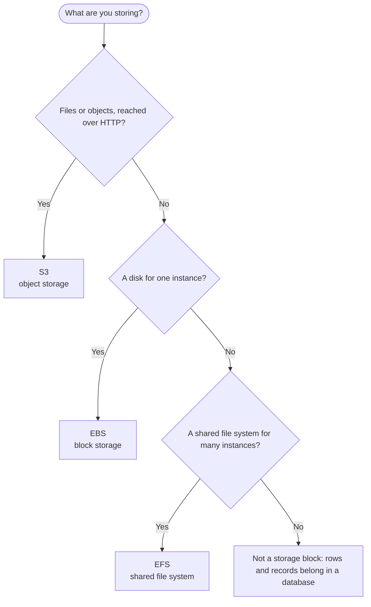

import Tabs from "@theme/Tabs";
import TabItem from "@theme/TabItem";

# Storage

Storage holds your data outside the code: objects in a bucket, a disk for one server, or a file system many servers share.

## Decision chart

Start at the top and answer each question. Click a service box to jump to its setup steps.



If the last answer is no, the data is probably rows and records: see [Databases](./databases.mdx#rds).

## Compare the options

| Option | You manage | Scales | Cost shape | AWS | Azure | GCP |
|---|---|---|---|---|---|---|
| Object storage | Buckets, who can read or write them, versioning and lifecycle rules | No capacity to plan: a bucket holds any number of objects | Pay for what you store (the rate depends on the storage class), plus requests and data transferred out | [S3](#s3) | Blob Storage | Cloud Storage |
| Block storage (a disk) | The volume (size, type, IOPS), the file system on it, and snapshots | You resize or change the volume; it attaches to an instance in the same Availability Zone | Pay for the volume you create, plus snapshots by the data they store | [EBS](#ebs) | Managed Disks | Persistent Disk, Hyperdisk |
| File system | The mount targets, their security groups, and the NFS permissions | Grows and shrinks on its own as you add and remove files | No capacity to provision; pay for the data stored (see the EFS pricing page) | [EFS](#efs) | Azure Files | Filestore |

## Set it up on AWS

### S3 {#s3}

<Tabs groupId="aws-setup">
<TabItem value="console" label="Console" default>

1. Open the S3 console, choose the Region, choose **General purpose buckets**, then **Create bucket**, and enter a **Bucket name**.

   :::caution
   Bucket names are global: a general purpose bucket name must be unique across all AWS accounts in all Regions of a partition, so a name like `data` is almost certainly taken. A name is 3 to 63 characters of lowercase letters, numbers, periods and hyphens, and begins and ends with a letter or number. After you create the bucket you cannot change its name or Region. The name shows up in object URLs, so keep sensitive information out of it. The Azure and GCS equivalents are in the [Gotchas](./foundations.mdx#gotchas) on Foundations.
   :::

   :::caution
   Once you delete a bucket, another account may be able to create a bucket with the same name and receive requests meant for yours. AWS recommends emptying a bucket and keeping it rather than deleting it when you want to keep the name. To make sure no other account can ever own your names, create the bucket in your account regional namespace (choose the account regional namespace when you create the bucket; the console appends the suffix `-<account ID>-<Region>-an` to the prefix you enter automatically, while the API and CLI need the full name).
   :::

2. Leave **Object Ownership** on **Bucket owner enforced** (the default: ACLs are disabled and policies control access), and leave all four **Block Public Access** settings on (also the default).

   :::caution
   Block Public Access does not change existing policies or ACLs, so turning a setting off makes a bucket with a public policy public again. Turning any setting off needs the `s3:PutBucketPublicAccessBlock` permission. Keep all four on and serve public content through CloudFront (see the last step), not through a public bucket.
   :::

3. Leave **Default encryption** as it is: new objects are encrypted with SSE-S3 as the base level. Choose SSE-KMS only when you need your own key.

   :::caution
   With SSE-KMS (or DSSE-KMS) default encryption, the bucket is subject to the AWS KMS requests-per-second quota.
   :::

4. Choose **Create bucket**. Then open the bucket, choose **Properties**, find **Bucket Versioning**, choose **Edit**, choose **Enable**, then **Save changes**.

   :::caution
   After you first enable versioning, AWS recommends waiting 15 minutes before writing to the bucket: reads of objects written in that time can return a `404 NoSuchKey` error. Versioning can later be suspended but not switched off.
   :::

5. Add a lifecycle rule. Choose the **Management** tab, then **Create lifecycle rule**, name it, choose the scope (a prefix, a tag, or all objects), and tick the actions: transition current or previous versions to another storage class, expire current versions, permanently delete previous versions, and delete expired delete markers and incomplete multipart uploads. Choose **Create rule**.

   :::caution
   On a versioned bucket, add a rule for noncurrent versions: a lifecycle rule keeps old versions from piling up, which AWS says can slow request performance. In a bucket without versioning, expiring current versions permanently deletes the objects; with versioning, it adds a delete marker instead.
   :::

   :::caution
   By default, objects smaller than 128 KB are not transitioned to another storage class unless the rule has an object size filter. Lifecycle actions run asynchronously, so an expiry can happen days or weeks after the rule is satisfied (billing changes as soon as the rule is satisfied).
   :::

6. Decide who can reach the bucket. For a bucket policy, choose the **Permissions** tab, then under **Bucket policy** choose **Edit**. This one lets one role read objects:

   ```json
   {
     "Version": "2012-10-17",
     "Statement": [
       {
         "Sid": "AppRoleRead",
         "Effect": "Allow",
         "Principal": { "AWS": "arn:aws:iam::123456789012:role/web-ec2" },
         "Action": "s3:GetObject",
         "Resource": "arn:aws:s3:::my-app-assets-123456789012/*"
       }
     ]
   }
   ```

   :::caution
   Bucket policy or IAM policy? AWS suggests a bucket policy for one bucket or a few buckets, or when the permissions are alike from bucket to bucket. An identity-based IAM policy (see [IAM policies](./identity.mdx#iam-policies)) fits better when you have many buckets with different permissions and only a few roles, or when the same policy also covers other AWS resources. Inside one account, an allow from either one is enough: see [How a request is evaluated](./identity.mdx#policy-evaluation). A bucket policy is limited to 20 KB.
   :::

   :::caution
   With the `BlockPublicPolicy` setting on, S3 rejects a bucket policy that allows public access. A policy that names fixed principals, or a fixed value for a key such as `aws:SourceArn`, is not public.
   :::

7. Share one object for a limited time with a presigned URL: select the object, choose **Object actions**, then **Share with a presigned URL**, set how long it stays valid, and choose **Create presigned URL**.

   :::caution
   A presigned URL carries the permissions of whoever created it, and anyone who has the URL can use it until it expires. It also stops working when the credentials that signed it expire, even if you asked for a longer time: a URL signed with role or temporary credentials ends when that session ends. The console allows 1 minute to 12 hours; the CLI and SDKs allow up to 7 days, but never longer than the signing credentials last.
   :::

8. Serve the bucket through CloudFront (the AWS side of the static site pattern in [Common patterns](./foundations.mdx#common-patterns)). Keep the bucket private, make the CloudFront distribution's S3 origin the bucket's regular endpoint, and give the distribution an origin access control (OAC). Then add a bucket policy that lets only that distribution read objects:

   ```json
   {
     "Version": "2012-10-17",
     "Statement": [
       {
         "Sid": "AllowCloudFrontServicePrincipalReadOnly",
         "Effect": "Allow",
         "Principal": { "Service": "cloudfront.amazonaws.com" },
         "Action": "s3:GetObject",
         "Resource": "arn:aws:s3:::my-app-assets-123456789012/*",
         "Condition": {
           "StringEquals": {
             "AWS:SourceArn": "arn:aws:cloudfront::123456789012:distribution/EDFDVBD6EXAMPLE"
           }
         }
       }
     ]
   }
   ```

   Create the distribution, the OAC and the cache settings in [CloudFront](./networking.mdx#cloudfront).

   :::caution
   OAC does not work with a bucket set up as an S3 website endpoint, because that has to be a custom origin. It also needs Object Ownership on **Bucket owner enforced**. If the objects use SSE-KMS, add a statement to the KMS key policy that lets the distribution use the key.
   :::

</TabItem>
<TabItem value="cli" label="CLI">

Create the bucket (`LocationConstraint` names the Region; without it the bucket is created in `us-east-1`). Pick a unique name:

```bash
aws s3api create-bucket \
  --bucket my-app-assets-123456789012 \
  --region ap-southeast-1 \
  --create-bucket-configuration LocationConstraint=ap-southeast-1
```

Turn on all four Block Public Access settings (new buckets already have them on; this makes it explicit) and versioning:

```bash
aws s3api put-public-access-block --bucket my-app-assets-123456789012 \
  --public-access-block-configuration "BlockPublicAcls=true,IgnorePublicAcls=true,BlockPublicPolicy=true,RestrictPublicBuckets=true"

aws s3api put-bucket-versioning --bucket my-app-assets-123456789012 \
  --versioning-configuration Status=Enabled
```

Add a lifecycle configuration. The CLI takes JSON, not XML, and a new configuration replaces the old one:

```json title="lifecycle.json"
{
  "Rules": [
    {
      "ID": "tidy-up",
      "Filter": { "Prefix": "" },
      "Status": "Enabled",
      "Transitions": [{ "Days": 90, "StorageClass": "STANDARD_IA" }],
      "NoncurrentVersionExpiration": { "NoncurrentDays": 30, "NewerNoncurrentVersions": 5 },
      "AbortIncompleteMultipartUpload": { "DaysAfterInitiation": 7 }
    }
  ]
}
```

```bash
aws s3api put-bucket-lifecycle-configuration \
  --bucket my-app-assets-123456789012 --lifecycle-configuration file://lifecycle.json
aws s3api get-bucket-lifecycle-configuration --bucket my-app-assets-123456789012
```

Attach a bucket policy from a file (the role read policy or the CloudFront policy from the Console tab), then copy a file in and share it:

```bash
aws s3api put-bucket-policy --bucket my-app-assets-123456789012 --policy file://policy.json

aws s3 cp ./index.html s3://my-app-assets-123456789012/
aws s3 presign s3://my-app-assets-123456789012/index.html --expires-in 3600
```

`aws s3 presign` defaults to 3600 seconds and allows at most 604800 (7 days). For a Region launched after March 20, 2019, also pass `--region` and `--endpoint-url`.

To remove the bucket, it must be completely empty, including every object version and delete marker. `aws s3 rb --force` deletes the objects in a bucket without versioning, but not versioned objects, which you remove with `aws s3api delete-object --version-id`:

```bash
aws s3api delete-bucket --bucket my-app-assets-123456789012
```

</TabItem>
<TabItem value="terraform" label="Terraform">

`aws_s3_bucket` creates the bucket. Its settings live in separate `aws_s3_bucket_*` resources (the matching inline arguments on `aws_s3_bucket` are deprecated):

```hcl
resource "aws_s3_bucket" "assets" {
  bucket = "my-app-assets-123456789012"
}

resource "aws_s3_bucket_public_access_block" "assets" {
  bucket = aws_s3_bucket.assets.id

  block_public_acls       = true
  block_public_policy     = true
  ignore_public_acls      = true
  restrict_public_buckets = true
}

resource "aws_s3_bucket_versioning" "assets" {
  bucket = aws_s3_bucket.assets.id

  versioning_configuration {
    status = "Enabled"
  }
}

resource "aws_s3_bucket_lifecycle_configuration" "assets" {
  # Needs versioning enabled first
  depends_on = [aws_s3_bucket_versioning.assets]

  bucket = aws_s3_bucket.assets.id

  rule {
    id     = "tidy-up"
    status = "Enabled"

    filter {}

    transition {
      days          = 90
      storage_class = "STANDARD_IA"
    }

    noncurrent_version_expiration {
      noncurrent_days           = 30
      newer_noncurrent_versions = 5
    }

    abort_incomplete_multipart_upload {
      days_after_initiation = 7
    }
  }
}
```

Serve it through CloudFront with an origin access control and a bucket policy. The distribution `aws_cloudfront_distribution.site` is assumed to exist elsewhere in your configuration, with the OAC set on its S3 origin:

```hcl
resource "aws_cloudfront_origin_access_control" "assets" {
  name                              = "assets"
  origin_access_control_origin_type = "s3"
  signing_behavior                  = "always"
  signing_protocol                  = "sigv4"
}

data "aws_iam_policy_document" "assets" {
  statement {
    actions   = ["s3:GetObject"]
    resources = ["${aws_s3_bucket.assets.arn}/*"]

    principals {
      type        = "Service"
      identifiers = ["cloudfront.amazonaws.com"]
    }

    condition {
      test     = "StringEquals"
      variable = "AWS:SourceArn"
      values   = [aws_cloudfront_distribution.site.arn]
    }
  }
}

resource "aws_s3_bucket_policy" "assets" {
  bucket = aws_s3_bucket.assets.id
  policy = data.aws_iam_policy_document.assets.json
}
```

Notes on these resources:

- `bucket` is optional but cannot be changed later (it forces a new bucket). Without it Terraform picks a random unique name; `bucket_prefix` builds a unique name from a prefix. For a bucket only your account can own, set `bucket_namespace = "account-regional"` and a name that ends with the account ID, the Region and `-an`.
- A bucket supports one lifecycle configuration, so declare only one `aws_s3_bucket_lifecycle_configuration` per bucket. Declare one `aws_s3_bucket_policy` per bucket too: each one replaces the whole policy.
- Build the policy with `aws_iam_policy_document`, as above. It has to specify a principal.
- `force_destroy = true` on `aws_s3_bucket` lets `terraform destroy` delete a bucket that still holds objects; they are not recoverable. The flag must be applied before the destroy.
- AWS recommends waiting 15 minutes after first enabling versioning before writing objects, so do not create a bucket, enable versioning and write critical objects in the same apply.

</TabItem>
</Tabs>

### EBS {#ebs}

- **What it is**: Amazon EBS gives an EC2 instance a durable block device that you use like a hard drive. The volume and the instance must be in the same Availability Zone, and a volume lives on after the instance stops. See [EC2](./compute.mdx#ec2).
- **Pick a volume type**: `gp3` (General Purpose SSD) fits most workloads, including boot volumes: 1 GiB to 64 TiB, up to 80,000 IOPS and 2,000 MiB/s. `io2` Block Express (Provisioned IOPS SSD) is for sustained IOPS above that (up to 256,000 IOPS on Nitro-based instances) or sub-millisecond latency. `st1` and `sc1` are HDD types for large streaming reads and cold data, and cannot be boot volumes.
- **Snapshots are your backup**: AWS does not back up EBS volumes for you. A snapshot is an incremental copy stored in S3 (not visible in your S3 console), and its data is replicated across the Availability Zones of the Region, so you can restore it into any zone there. Automate them with Amazon Data Lifecycle Manager or AWS Backup. Deleting one snapshot may not lower your storage bill, because other snapshots can reference its data.
- **Cleanup**: you cannot delete a volume that is attached; detach it first. Most instances are set up so their volumes are deleted when they terminate, but an instance can be set to keep its volume, so check the **Volumes** pane for volumes you no longer need.
- **CLI and Terraform**: `aws ec2 create-volume --availability-zone ap-southeast-1a --size 40 --volume-type gp3`, then `aws ec2 attach-volume --volume-id vol-0123456789abcdef0 --instance-id i-0123456789abcdef0 --device /dev/sdh`. In Terraform: `aws_ebs_volume` (set `availability_zone`, `size` and `type`; the default type is `gp2`, so set `type = "gp3"`) with `aws_volume_attachment`.

### EFS {#efs}

- **What it is**: Amazon EFS is a serverless, elastic file system you mount over NFS (versions 4.1 and 4.0), so many instances read and write the same files. It works with EC2, ECS, EKS, Lambda and Fargate, but not with Windows-based EC2 instances.
- **Regional or One Zone**: Regional file systems (recommended) store data across several Availability Zones. One Zone file systems keep data in one zone, so losing that zone can lose the data.
- **Network setup**: you reach the file system through mount targets, one per Availability Zone. The mount target's security group must allow inbound TCP 2049 (NFS) from the instances' security group, and each instance's security group must allow outbound 2049 to the mount target. Mount targets cannot have public IP addresses. See [Networking (security groups)](./networking.mdx#vpc).
- **Mount it**: install `amazon-efs-utils`, then `sudo mount -t efs -o tls fs-abcd123456789ef0:/ efs/` (replace the ID; `tls` encrypts in transit). Only the root user has read-write-execute permissions at first, so set NFS-level ownership and permissions on the directory.
- **Terraform**: `aws_efs_file_system`, then `aws_efs_mount_target` for each subnet (one per Availability Zone), with `security_groups` set to the group that allows port 2049.

## Connects to

- Networking: [CloudFront](./networking.mdx#cloudfront) puts a private bucket behind a CDN and a custom domain.
- Identity: [Identity (IAM policies)](./identity.mdx#iam-policies) sits next to bucket policies: both decide who can read or write a bucket.
- Compute: [Compute (EC2)](./compute.mdx#ec2) is where an EBS volume attaches, and where an instance role reads S3 objects.
- Databases: [Databases](./databases.mdx#rds) is the better home for rows and records than files in a bucket.
- [Azure Blob SDK](../technologies/dotnet/azure-blob-sdk.md): the same object-storage ideas on Azure, with the .NET SDK.
