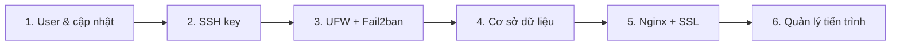
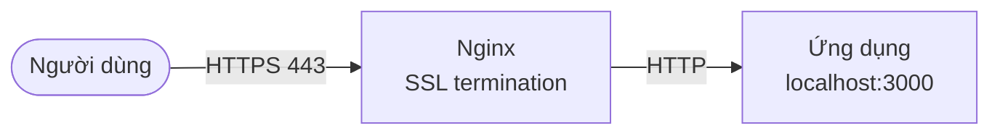

import Tabs from "@theme/Tabs";
import TabItem from "@theme/TabItem";

# Thiết lập máy chủ Ubuntu

> **Quick reference:** [Ubuntu Server Cheatsheet](./ubuntu-server-cheatsheet.mdx)

Các bước đưa một VPS Ubuntu trống (24.04/26.04 LTS) thành máy chủ chạy ứng dụng: khóa truy cập trước, rồi mới cài cơ sở dữ liệu, reverse proxy và trình quản lý tiến trình.



## 1. Chuẩn bị: user và cập nhật

Không làm việc trực tiếp bằng `root`. Tạo một user có quyền `sudo`, cập nhật hệ thống và bật cập nhật bảo mật tự động:

```bash
adduser deploy
usermod -aG sudo deploy

sudo apt update && sudo apt upgrade -y
sudo apt install unattended-upgrades -y
sudo dpkg-reconfigure --priority=low unattended-upgrades
```

## 2. SSH key

Xác thực bằng khóa an toàn và tiện hơn mật khẩu, chặn được các cuộc dò mật khẩu tự động.

**Trên máy của bạn (client)** — tạo cặp khóa rồi chép khóa công khai lên server:

```bash
ssh-keygen -t ed25519 -C "email_cua_ban@example.com" # hệ thống cũ: -t rsa -b 4096
ssh-copy-id deploy@dia_chi_ip_may_chu
```

`ssh-copy-id` tự thêm khóa vào `~/.ssh/authorized_keys` với quyền truy cập đúng.

**Trên server** — sau khi đã đăng nhập được bằng khóa, tắt đăng nhập bằng mật khẩu và đăng nhập `root`:

```bash title="/etc/ssh/sshd_config.d/00-hardening.conf"
PasswordAuthentication no
PubkeyAuthentication yes
PermitRootLogin no
```

```bash
sudo sshd -t                     # kiểm tra cú pháp
sudo sshd -T | grep -E 'passwordauthentication|permitrootlogin' # xem giá trị thực tế
sudo systemctl restart ssh
```

:::warning

- Với sshd, **giá trị đọc được đầu tiên sẽ thắng**. Ảnh cloud của Ubuntu thường có `/etc/ssh/sshd_config.d/50-cloud-init.conf` đặt `PasswordAuthentication yes`, nên file của bạn phải đặt tên xếp trước (`00-…`) hoặc sửa thẳng file đó. Luôn kiểm tra bằng `sshd -T`.
- Giữ nguyên phiên SSH đang mở và thử đăng nhập ở một terminal khác trước khi đóng, để không tự khóa mình ở ngoài.

:::

## 3. Tường lửa và chống brute-force

### UFW

Nguyên tắc: chặn mọi kết nối vào theo mặc định, chỉ mở những gì cần.

```bash
sudo ufw default deny incoming
sudo ufw default allow outgoing
sudo ufw allow OpenSSH       # mở SSH TRƯỚC khi bật tường lửa
sudo ufw enable

sudo ufw allow 'Nginx Full'  # 80 + 443, sau khi cài Nginx
sudo ufw status verbose
```

:::danger Docker bỏ qua UFW

Port publish bằng Docker (`-p 5432:5432`, `ports:` trong Compose) được Docker mở thẳng trong iptables, **không đi qua luật UFW** — cơ sở dữ liệu có thể lộ ra Internet dù `ufw status` không cho phép. Bind vào localhost (`127.0.0.1:5432:5432`) hoặc không publish port của các service nội bộ.

:::

### Fail2ban

Theo dõi log và tự cấm IP có hành vi đáng ngờ, ví dụ đăng nhập SSH sai nhiều lần. Trên Ubuntu, jail `sshd` được bật sẵn sau khi cài.

```bash
sudo apt install fail2ban -y
sudo fail2ban-client status sshd
```

Tùy chỉnh trong `/etc/fail2ban/jail.local` (không sửa `jail.conf`, file này bị ghi đè khi cập nhật):

```ini title="/etc/fail2ban/jail.local"
[sshd]
maxretry = 5
findtime = 10m
bantime  = 1h
```

## 4. Cơ sở dữ liệu

Luôn tạo user riêng cho ứng dụng thay vì dùng tài khoản quản trị, và giữ cơ sở dữ liệu chỉ lắng nghe trên `localhost` trừ khi thật sự cần truy cập từ xa.

<Tabs groupId="database">
<TabItem value="mysql" label="MySQL / MariaDB">

```bash
sudo apt install mysql-server -y
sudo mysql_secure_installation # xóa user ẩn danh, database test, chặn root đăng nhập từ xa
sudo mysql                     # root trên Ubuntu đăng nhập qua auth_socket, không cần mật khẩu
```

```sql
CREATE DATABASE my_app_db;
CREATE USER 'my_app_user'@'localhost' IDENTIFIED BY 'mat_khau_manh';
GRANT ALL PRIVILEGES ON my_app_db.* TO 'my_app_user'@'localhost';
```

`FLUSH PRIVILEGES` không cần thiết khi dùng `CREATE USER` / `GRANT`. Xem thêm: [MySQL](../technologies/database/relational/mysql.md).

</TabItem>
<TabItem value="postgres" label="PostgreSQL">

```bash
sudo apt install postgresql postgresql-contrib -y

# PostgreSQL dùng "role": tạo role có mật khẩu và database do role đó sở hữu
sudo -u postgres createuser --pwprompt my_app_user
sudo -u postgres createdb -O my_app_user my_app_db
```

Chỉ khi cần truy cập từ máy khác: đặt `listen_addresses` trong `postgresql.conf`, thêm một dòng cho đúng IP vào `pg_hba.conf` (trong `/etc/postgresql/<version>/main/`), mở port 5432 trên UFW **chỉ cho IP đó**, rồi `sudo systemctl restart postgresql`.

```bash title="pg_hba.conf"
# TYPE  DATABASE   USER         ADDRESS        METHOD
host    my_app_db  my_app_user  10.0.0.5/32    scram-sha-256
```

Xem thêm: [PostgreSQL](../technologies/database/relational/postgre.md).

</TabItem>
<TabItem value="mongodb" label="MongoDB">

MongoDB không có trong kho apt của Ubuntu — cài theo [hướng dẫn chính thức](https://www.mongodb.com/docs/manual/tutorial/install-mongodb-on-ubuntu/) (thêm repo của MongoDB), rồi khởi động dịch vụ:

```bash
sudo systemctl enable --now mongod
```

Tạo user quản trị trong `mongosh` **trước** khi bật xác thực:

```js
use admin
db.createUser({
  user: "myAdminUser",
  pwd: passwordPrompt(),
  roles: [{ role: "userAdminAnyDatabase", db: "admin" }, "readWriteAnyDatabase"],
})
```

Mặc định MongoDB **không bật xác thực**. Bật trong `/etc/mongod.conf` rồi `sudo systemctl restart mongod`:

```yaml title="/etc/mongod.conf"
security:
  authorization: enabled
net:
  bindIp: 127.0.0.1 # giữ mặc định, chỉ lắng nghe localhost
```

Xem thêm: [MongoDB](../technologies/database/no-sql/mongodb.md).

</TabItem>
</Tabs>

## 5. Nginx và SSL

[Nginx](../technologies/nginx.mdx) nhận traffic ở port 80/443, xử lý SSL rồi chuyển tiếp đến ứng dụng chạy trên port nội bộ. Nhờ đó một server chạy được nhiều ứng dụng, và ứng dụng không cần quyền mở port thấp.



```bash
sudo apt install nginx certbot python3-certbot-nginx -y
```

Tạo file cấu hình trong `/etc/nginx/sites-available/your_domain.com`:

<Tabs groupId="app-runtime">
<TabItem value="nodejs" label="Node.js">

```nginx
server {
    listen 80;
    server_name your_domain.com www.your_domain.com;

    location / {
        proxy_pass http://localhost:3000;
        proxy_http_version 1.1;
        proxy_set_header Upgrade $http_upgrade; # cho WebSocket
        proxy_set_header Connection "upgrade";
        proxy_set_header Host $host;
        proxy_set_header X-Forwarded-For $proxy_add_x_forwarded_for;
        proxy_set_header X-Forwarded-Proto $scheme;
    }
}
```

</TabItem>
<TabItem value="java" label="Java Spring Boot">

```nginx
server {
    listen 80;
    server_name your_domain.com www.your_domain.com;

    location / {
        proxy_pass http://localhost:8080;
        proxy_set_header Host $host;
        proxy_set_header X-Real-IP $remote_addr;
        proxy_set_header X-Forwarded-For $proxy_add_x_forwarded_for;
        proxy_set_header X-Forwarded-Proto $scheme;
    }
}
```

</TabItem>
<TabItem value="php" label="PHP-FPM">

```nginx
server {
    listen 80;
    server_name your_domain.com www.your_domain.com;
    root /var/www/your_project/public;
    index index.php index.html;

    location / {
        try_files $uri $uri/ /index.php?$query_string;
    }

    location ~ \.php$ {
        include snippets/fastcgi-php.conf;
        fastcgi_pass unix:/run/php/php8.3-fpm.sock; # đúng phiên bản: ls /run/php/
    }

    location ~ /\.(?!well-known) {
        deny all; # chặn .env, .git…
    }
}
```

</TabItem>
</Tabs>

Kích hoạt site, kiểm tra cấu hình, rồi để Certbot lấy chứng chỉ và tự thêm chuyển hướng HTTPS:

```bash
sudo ln -s /etc/nginx/sites-available/your_domain.com /etc/nginx/sites-enabled/
sudo nginx -t
sudo systemctl reload nginx
sudo certbot --nginx -d your_domain.com -d www.your_domain.com
sudo certbot renew --dry-run # kiểm tra gia hạn tự động
```

## 6. Quản lý tiến trình

Ứng dụng cần được tự khởi động lại khi crash và khi server reboot.

<Tabs groupId="process-manager">
<TabItem value="systemd" label="systemd (có sẵn)">

Có sẵn trên Ubuntu, chạy được mọi loại ứng dụng, không cần cài thêm.

```ini title="/etc/systemd/system/my-app.service"
[Unit]
Description=My app
After=network.target

[Service]
User=deploy
WorkingDirectory=/var/www/my-app
ExecStart=/usr/bin/java -jar app.jar
Restart=on-failure
EnvironmentFile=/var/www/my-app/.env

[Install]
WantedBy=multi-user.target
```

```bash
sudo systemctl daemon-reload
sudo systemctl enable --now my-app
journalctl -u my-app -f # xem log
```

</TabItem>
<TabItem value="pm2" label="PM2 (Node.js)">

Phổ biến cho Node.js: chế độ cluster, quản lý log, giám sát.

```bash
sudo npm install -g pm2

pm2 start app.js --name my-api -i max # cluster theo số CPU
pm2 list
pm2 logs my-api

pm2 startup # in ra một lệnh sudo — chạy lệnh đó
pm2 save    # lưu danh sách tiến trình để khôi phục khi reboot
```

</TabItem>
<TabItem value="supervisor" label="Supervisor">

Công cụ đa năng, quản lý được mọi tiến trình (Java, Python, worker, script).

```ini title="/etc/supervisor/conf.d/my-app.conf"
[program:my-java-app]
command=java -jar /path/to/app.jar
autostart=true
autorestart=true
user=deploy
```

```bash
sudo apt install supervisor -y
sudo supervisorctl reread
sudo supervisorctl update
sudo supervisorctl status
```

</TabItem>
<TabItem value="docker" label="Docker">

Đóng gói ứng dụng cùng phụ thuộc vào container; Docker Compose quản lý nhiều container (app + database). Dùng `restart: unless-stopped` trong Compose để container tự chạy lại.

```bash
docker compose up -d # build và chạy nền
docker compose logs -f
docker compose down
```

Xem thêm: [Docker](../technologies/docker-knowledge.md). Nhớ cảnh báo [Docker bỏ qua UFW](#ufw) ở trên.

</TabItem>
</Tabs>

## Tổng kết: các lớp phòng thủ

| Lớp | Biện pháp | Chống lại |
| --- | --- | --- |
| Truy cập | SSH key, tắt mật khẩu và đăng nhập root | Dò mật khẩu, lộ mật khẩu |
| Mạng | UFW chỉ mở 22, 80, 443 | Truy cập vào các dịch vụ nội bộ |
| Phát hiện | Fail2ban | Brute-force kéo dài |
| Hệ điều hành | `unattended-upgrades` | Lỗ hổng đã có bản vá |
| Web | Nginx + HTTPS (Certbot), chặn file ẩn | Nghe lén, lộ `.env`/`.git` |
| Dữ liệu | User riêng cho ứng dụng, chỉ lắng nghe localhost, bật xác thực | Truy cập trái phép vào CSDL |
