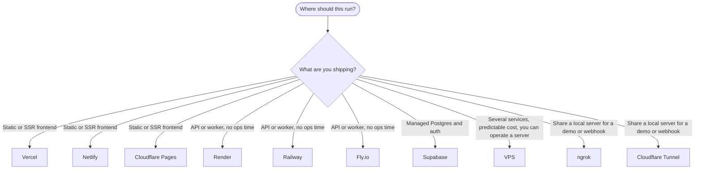

import LayerFlow from "@site/src/components/LayerFlow";
import MermaidFrame from "@site/src/components/MermaidFrame";

# DevOps

Pick where this project should run, then follow the setup for that path.

## Deploy path {#deploy-path}

Code is built in CI, shipped as an image or a platform build, run on a platform or a VPS, and then watched.

<LayerFlow
  ariaLabel="Deploy path from code to operations"
  layers={[
    {
      title: "Code",
      nodes: [{ label: "Code", to: "/docs/technologies/", detail: "the app" }],
    },
    {
      title: "Build",
      nodes: [{ label: "CI", to: "/docs/devops/ci-cd/", detail: "Actions" }],
    },
    {
      title: "Ship",
      nodes: [{ label: "Registry", to: "/docs/devops/ci-cd/#push-to-ghcr", detail: "GHCR" }],
    },
    {
      title: "Run",
      nodes: [
        { label: "Platforms", to: "/docs/devops/platforms/", detail: "PaaS, edge" },
        { label: "VPS", to: "/docs/devops/vps/self-host-a-docker-stack/", detail: "Docker" },
        { label: "Edge", to: "/docs/devops/platforms/cloudflare/", detail: "Workers" },
      ],
    },
    {
      title: "Operate",
      nodes: [
        { label: "Monitoring", to: "/docs/devops/observability/elk-stack/", detail: "logs" },
        { label: "Backups", to: "/docs/devops/vps/self-host-a-docker-stack/#backups-and-restore", detail: "dumps" },
        { label: "Secrets", to: "/docs/devops/vps/self-host-a-docker-stack/#secrets", detail: "sops" },
      ],
    },
  ]}
/>

"PaaS, edge" is the detail under Platforms. Monitoring is the ELK notes; a single VPS also runs a status page reached only through an SSH tunnel, covered in the [VPS playbook](./vps/self-host-a-docker-stack.mdx#monitoring).

## Where should this run? {#where-should-this-run}

<MermaidFrame>

</MermaidFrame>

The same choice, with the trade-offs written out, is the [platform decision chart](./platforms/index.mdx#decision-chart). Prices and free-tier limits on those pages were checked on 2026-11-01.

## Moving between options {#moving-between-options}

A frontend can stay on Vercel, Netlify or Cloudflare Pages while the APIs move. The move that these notes record is that shape: two API backends, each with a production and a staging instance, left a PaaS and landed on one VPS, with one Postgres instance (one database and one role per app) behind a reverse proxy. The frontends stayed on a platform. The checklist, from an empty server through DNS cutover, is [Self-host a Docker stack](./vps/self-host-a-docker-stack.mdx#moving-from-a-paas-to-the-vps).

## Connects to

- [Deployment platforms](./platforms/index.mdx): the comparison, grouped by service, and one page per platform.
- [Self-host a Docker stack](./vps/self-host-a-docker-stack.mdx): the VPS playbook.
- [CI/CD](./ci-cd.mdx): build the image, push it, deploy over SSH, roll back.
- [Cloud computing](../cloud-computing/index.mdx): when the next step is a cloud building block instead of a single server.
