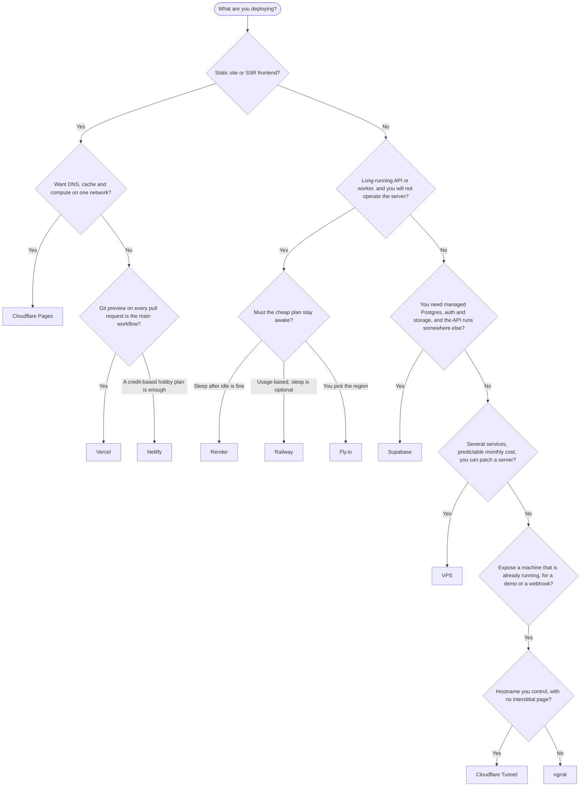

import styles from "./styles.module.css";
import MermaidFrame from "@site/src/components/MermaidFrame";

# Deployment platforms

Managed places to run a frontend, an API, a backend, or a tunnel. For a server you operate yourself, use the [VPS playbook](../vps/self-host-a-docker-stack.mdx) instead of a row below.

## Decision chart {#decision-chart}

<MermaidFrame>

</MermaidFrame>

Supabase is not an app host. It is the database, auth and file API. The Node or Python process still needs a platform row or the VPS.

## Comparison {#comparison}

Amounts below are from each vendor's own pricing page, checked 2026-11-01. A cell that says `verify` was not confirmed on that pass. Open the linked page before you rely on a number.

| Platform | Best for | Runtime model | Free tier (checked 2026-11-01) | Paid starts at (checked 2026-11-01) | Databases | Custom domains + TLS | Regions | Deploy from | Gotchas |
|---|---|---|---|---|---|---|---|---|---|
| [Vercel](./vercel.mdx) | Frontend and SSR, especially Next.js | Serverless and edge | Hobby $0. Includes 100 GB Fast Data Transfer and 1,000,000 function invocations. [Hobby](https://vercel.com/docs/plans/hobby) | Pro $20/month, includes $20 usage credit. [Pro](https://vercel.com/docs/plans/pro-plan) | No first-party Postgres on the Hobby page (`verify`). Blob is listed | Included. Hobby allows 50 domains per project | Fluid compute is priced per region. Full name list: `verify` | Git, CLI, dashboard | Function duration is capped. Pro bills usage after the credit |
| [Netlify](./netlify.mdx) | Static sites and JS frameworks | Static and serverless | Free $0, 300 credits/month. The project pauses when credits run out. [Pricing](https://www.netlify.com/pricing/) | Personal $9/month (1,000 credits) | Netlify Database and Blob are on Free. Engine and extra caps: `verify` | Custom domains with SSL on Free | Global CDN. Region list: `verify` | Git, CLI, dashboard | A production deploy costs 15 credits |
| [Cloudflare](./cloudflare.mdx) | Edge apps, static sites, object storage, tunnels | Static, edge, serverless | Workers Free: 100,000 requests/day. R2 Free: 10 GB-month. [Workers](https://developers.cloudflare.com/workers/platform/pricing/), [R2](https://developers.cloudflare.com/r2/pricing/) | Workers Paid minimum $5/month | KV and D1. D1 free limits: `verify`. R2 is object storage, not SQL | Pages custom domains. TLS at the edge | Global anycast. City list: `verify` | Git, Wrangler | Workers bill CPU time. Pages and Workers are different products |
| [Render](./render.mdx) | Web services, workers, cron | Container | Free web service: 750 instance hours/month, spins down after 15 minutes idle. [Free](https://render.com/docs/free) | Instance from $7/month (under 1 CPU, 512 MB). Workspace Pro is $25/month extra. [Pricing](https://render.com/pricing) | Free Postgres exists. Storage and expiry: `verify` | Custom domains and managed TLS on Free | `verify` the current region list | Git, CLI, `render.yaml` | Free services sleep. Free filesystem is ephemeral. Free rollbacks keep only the two previous deploys |
| [Railway](./railway.mdx) | App plus database in one project | Container | Trial: $5 one-time credit, 30 days. Free plan: $1/month usage. [Pricing](https://railway.com/pricing) | Hobby $5/month, includes $5 usage. Both official pages agree on this minimum | Managed Postgres is a service with a volume. Free and Trial volumes are 0.5 GB | `verify` the current domains doc | Marketing page says global regions. List: `verify` | Git, CLI | The marketing page and the docs disagree on CPU and RAM unit rates (`verify` the invoice). Serverless sleep is opt-in, not the default |
| [Fly.io](./fly-io.mdx) | Containers placed in a chosen region | VM (Machines) | No free tier for new organizations, and no monthly free allowance. [Pricing update](https://fly.io/pricing-update/) | shared-cpu-1x with 256 MB in Ashburn or Secaucus: $2.19 per 30 days, plus egress | Postgres is a Machine plus a volume | First 10 single-hostname certificates free, then $0.10/month each | Cheapest public example is iad or ewr. Full list: `fly platform regions` (`verify` the live list) | CLI, `fly.toml` | You pay while the Machine runs. Egress is billed |
| [Supabase](./supabase.mdx) | Postgres, auth, storage. Not the API process | BaaS | Free $0: 500 MB database, 50,000 MAU, pauses after 1 week inactive, 2 projects. [Pricing](https://supabase.com/pricing) | Pro $25/month, includes $10 compute credit | Postgres is the product. Enable row level security | API custom domain: `verify` | One region per project, chosen at creation. List: `verify` in the dashboard | CLI, dashboard | The service role bypasses row level security. Free projects have no automatic backups |
| [ngrok](./ngrok.mdx) | Expose a local port | Tunnel | Free $0 plus a $5 one-time credit (one year). 1 development domain, interstitial on HTTP. [Pricing](https://ngrok.com/pricing) | Hobbyist $10/month, or $8/month billed annually ($96/year) | None | Free plan: the development domain. Bring-your-own domains are Pay-as-you-go | `verify` the edge region list | Agent, `ngrok.yml` | Free HTTP shows an interstitial. Usage stops when the credit is gone |

## Connects to

- [DevOps](../index.mdx): the short version of this chart, plus the deploy-path map.
- [Self-host a Docker stack](../vps/self-host-a-docker-stack.mdx): when the chart ends at a VPS.
- [CI/CD](../ci-cd.mdx): what you still need when the platform does not build and deploy for you.
- [Compute](../../cloud-computing/compute.mdx): the same kind of choice on AWS.
