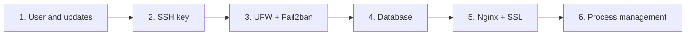
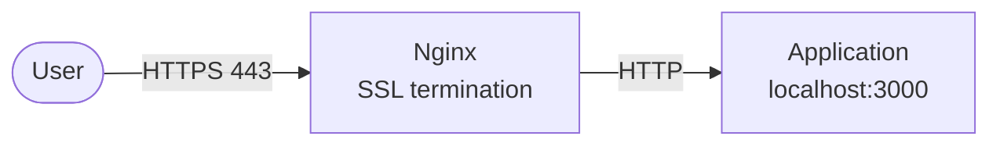

import Tabs from "@theme/Tabs";
import TabItem from "@theme/TabItem";

# Ubuntu server setup

> **Quick reference:** [Ubuntu Server Cheatsheet](./ubuntu-server-cheatsheet.mdx)

Steps that take a blank Ubuntu VPS (24.04/26.04 LTS) to a server that runs an app: lock down access first, then install the database, the reverse proxy, and the process manager.



## 1. Prepare: user and updates

Do not work directly as `root`. Create a user with `sudo`, update the system, and turn on automatic security updates:

```bash
adduser deploy
usermod -aG sudo deploy

sudo apt update && sudo apt upgrade -y
sudo apt install unattended-upgrades -y
sudo dpkg-reconfigure --priority=low unattended-upgrades
```

## 2. SSH key

Key authentication is safer and easier than a password, and it blocks automated password guessing.

**On your machine (the client)** — create a key pair, then copy the public key to the server:

```bash
ssh-keygen -t ed25519 -C "you@example.com" # older systems: -t rsa -b 4096
ssh-copy-id deploy@server_ip
```

`ssh-copy-id` adds the key to `~/.ssh/authorized_keys` with the right permissions.

**On the server** — once you can log in with the key, turn off password login and `root` login:

```bash title="/etc/ssh/sshd_config.d/00-hardening.conf"
PasswordAuthentication no
PubkeyAuthentication yes
PermitRootLogin no
```

```bash
sudo sshd -t                     # check the syntax
sudo sshd -T | grep -E 'passwordauthentication|permitrootlogin' # see the actual values
sudo systemctl restart ssh
```

:::warning

- With sshd, **the first value read wins**. Ubuntu cloud images often have `/etc/ssh/sshd_config.d/50-cloud-init.conf` setting `PasswordAuthentication yes`, so your file must be named to sort first (`00-…`) or you edit that file directly. Always check with `sshd -T`.
- Keep the current SSH session open and try a login from another terminal before you close it, so you do not lock yourself out.

:::

## 3. Firewall and brute-force protection

### UFW {#ufw}

Deny all incoming connections by default. Open only what you need.

```bash
sudo ufw default deny incoming
sudo ufw default allow outgoing
sudo ufw allow OpenSSH       # open SSH BEFORE you enable the firewall
sudo ufw enable

sudo ufw allow 'Nginx Full'  # 80 + 443, after you install Nginx
sudo ufw status verbose
```

:::danger Docker bypasses UFW

Ports published by Docker (`-p 5432:5432`, `ports:` in Compose) are opened by Docker directly in iptables and **do not pass through UFW rules** — a database can be exposed on the internet even when `ufw status` does not allow it. Bind to localhost (`127.0.0.1:5432:5432`) or do not publish ports for internal services.

:::

### Fail2ban

Watches logs and bans IPs that look suspicious, for example many failed SSH logins. On Ubuntu, the `sshd` jail is enabled after you install it.

```bash
sudo apt install fail2ban -y
sudo fail2ban-client status sshd
```

Customize it in `/etc/fail2ban/jail.local` (do not edit `jail.conf`; that file is overwritten on upgrade):

```ini title="/etc/fail2ban/jail.local"
[sshd]
maxretry = 5
findtime = 10m
bantime  = 1h
```

## 4. Database

Always create a separate user for the app instead of using an admin account, and keep the database listening only on `localhost` unless you really need remote access.

<Tabs groupId="database">
<TabItem value="mysql" label="MySQL / MariaDB">

```bash
sudo apt install mysql-server -y
sudo mysql_secure_installation # remove anonymous users, the test database, and block remote root login
sudo mysql                     # on Ubuntu, root logs in via auth_socket, no password
```

```sql
CREATE DATABASE my_app_db;
CREATE USER 'my_app_user'@'localhost' IDENTIFIED BY 'strong_password';
GRANT ALL PRIVILEGES ON my_app_db.* TO 'my_app_user'@'localhost';
```

`FLUSH PRIVILEGES` is not needed when you use `CREATE USER` / `GRANT`. See also: [MySQL](../../technologies/database/relational/mysql.md).

</TabItem>
<TabItem value="postgres" label="PostgreSQL">

```bash
sudo apt install postgresql postgresql-contrib -y

# PostgreSQL uses "roles": create a role with a password and a database owned by that role
sudo -u postgres createuser --pwprompt my_app_user
sudo -u postgres createdb -O my_app_user my_app_db
```

Only when you need access from another machine: set `listen_addresses` in `postgresql.conf`, add one line for that exact IP in `pg_hba.conf` (in `/etc/postgresql/<version>/main/`), open port 5432 on UFW **only for that IP**, then `sudo systemctl restart postgresql`.

```bash title="pg_hba.conf"
# TYPE  DATABASE   USER         ADDRESS        METHOD
host    my_app_db  my_app_user  10.0.0.5/32    scram-sha-256
```

See also: [PostgreSQL](../../technologies/database/relational/postgre.md).

</TabItem>
<TabItem value="mongodb" label="MongoDB">

MongoDB is not in Ubuntu's apt repositories — install it from the [official guide](https://www.mongodb.com/docs/manual/tutorial/install-mongodb-on-ubuntu/) (add MongoDB's repo), then start the service:

```bash
sudo systemctl enable --now mongod
```

Create the admin user in `mongosh` **before** you enable authentication:

```js
use admin
db.createUser({
  user: "myAdminUser",
  pwd: passwordPrompt(),
  roles: [{ role: "userAdminAnyDatabase", db: "admin" }, "readWriteAnyDatabase"],
})
```

By default MongoDB **does not enable authentication**. Turn it on in `/etc/mongod.conf`, then `sudo systemctl restart mongod`:

```yaml title="/etc/mongod.conf"
security:
  authorization: enabled
net:
  bindIp: 127.0.0.1 # keep the default, listen on localhost only
```

See also: [MongoDB](../../technologies/database/no-sql/mongodb.md).

</TabItem>
</Tabs>

## 5. Nginx and SSL

[Nginx](../web-servers/nginx.mdx) takes traffic on ports 80/443, handles SSL, then forwards to the app on an internal port. One server can then run several apps, and the app does not need permission to open a low port.



```bash
sudo apt install nginx certbot python3-certbot-nginx -y
```

Create the config file in `/etc/nginx/sites-available/your_domain.com`:

<Tabs groupId="app-runtime">
<TabItem value="nodejs" label="Node.js">

```nginx
server {
    listen 80;
    server_name your_domain.com www.your_domain.com;

    location / {
        proxy_pass http://localhost:3000;
        proxy_http_version 1.1;
        proxy_set_header Upgrade $http_upgrade; # for WebSocket
        proxy_set_header Connection "upgrade";
        proxy_set_header Host $host;
        proxy_set_header X-Real-IP $remote_addr;
        proxy_set_header X-Forwarded-For $proxy_add_x_forwarded_for;
        proxy_set_header X-Forwarded-Proto $scheme;
    }
}
```

</TabItem>
<TabItem value="java" label="Java Spring Boot">

```nginx
server {
    listen 80;
    server_name your_domain.com www.your_domain.com;

    location / {
        proxy_pass http://localhost:8080;
        proxy_set_header Host $host;
        proxy_set_header X-Real-IP $remote_addr;
        proxy_set_header X-Forwarded-For $proxy_add_x_forwarded_for;
        proxy_set_header X-Forwarded-Proto $scheme;
    }
}
```

</TabItem>
<TabItem value="php" label="PHP-FPM">

```nginx
server {
    listen 80;
    server_name your_domain.com www.your_domain.com;
    root /var/www/your_project/public;
    index index.php index.html;

    location / {
        try_files $uri $uri/ /index.php?$query_string;
    }

    location ~ \.php$ {
        include snippets/fastcgi-php.conf;
        fastcgi_pass unix:/run/php/php8.3-fpm.sock; # the right version: ls /run/php/
    }

    location ~ /\.(?!well-known) {
        deny all; # block .env, .git…
    }
}
```

</TabItem>
</Tabs>

Enable the site, test the config, then let Certbot obtain the certificate and add the HTTPS redirect itself:

```bash
sudo ln -s /etc/nginx/sites-available/your_domain.com /etc/nginx/sites-enabled/
sudo nginx -t
sudo systemctl reload nginx
sudo certbot --nginx -d your_domain.com -d www.your_domain.com
sudo certbot renew --dry-run # test automatic renewal
```

## 6. Process management

The app needs to start again on its own after a crash and after a server reboot.

<Tabs groupId="process-manager">
<TabItem value="systemd" label="systemd (built in)">

Already on Ubuntu. It can run any kind of app. Nothing extra to install.

```ini title="/etc/systemd/system/my-app.service"
[Unit]
Description=My app
After=network.target

[Service]
User=deploy
WorkingDirectory=/var/www/my-app
ExecStart=/usr/bin/java -jar app.jar
Restart=on-failure
EnvironmentFile=/var/www/my-app/.env

[Install]
WantedBy=multi-user.target
```

```bash
sudo systemctl daemon-reload
sudo systemctl enable --now my-app
journalctl -u my-app -f # view the log
```

</TabItem>
<TabItem value="pm2" label="PM2 (Node.js)">

Common for Node.js: cluster mode, log management, and monitoring.

```bash
sudo npm install -g pm2

pm2 start app.js --name my-api -i max # cluster by CPU count
pm2 list
pm2 logs my-api

pm2 startup # prints a sudo command — run that command
pm2 save    # save the process list so it is restored on reboot
```

</TabItem>
<TabItem value="supervisor" label="Supervisor">

A general-purpose tool. It can manage any process (Java, Python, workers, scripts).

```ini title="/etc/supervisor/conf.d/my-app.conf"
[program:my-java-app]
command=java -jar /path/to/app.jar
autostart=true
autorestart=true
user=deploy
```

```bash
sudo apt install supervisor -y
sudo supervisorctl reread
sudo supervisorctl update
sudo supervisorctl status
```

</TabItem>
<TabItem value="docker" label="Docker">

Packs the app and its dependencies into a container. Docker Compose manages several containers (app + database). Use `restart: unless-stopped` in Compose so the container starts again on its own.

```bash
docker compose up -d # build and run in the background
docker compose logs -f
docker compose down
```

See also: [Docker](../containers/docker-knowledge.md). Remember the [Docker bypasses UFW](#ufw) warning above.

</TabItem>
</Tabs>

## Summary: defense layers

| Layer | Measure | Against |
| --- | --- | --- |
| Access | SSH key, password login and root login off | Password guessing, leaked passwords |
| Network | UFW opens only 22, 80, 443 | Access to internal services |
| Detection | Fail2ban | Prolonged brute-force |
| Operating system | `unattended-upgrades` | Vulnerabilities that already have a patch |
| Web | Nginx + HTTPS (Certbot), block hidden files | Eavesdropping, leaked `.env`/`.git` |
| Data | A separate app user, listen on localhost only, authentication on | Unauthorized database access |
