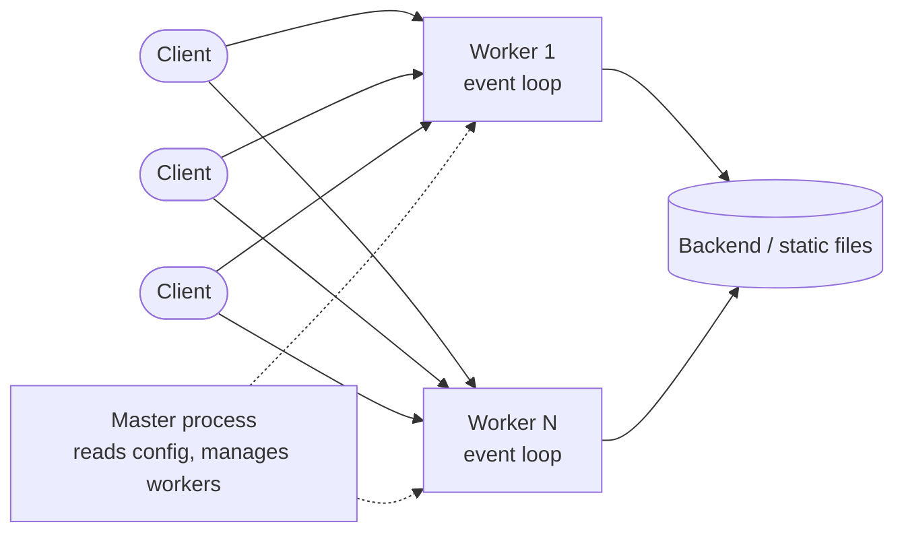

import Tabs from "@theme/Tabs";
import TabItem from "@theme/TabItem";
import LoadBalancerSimulator from "@site/src/components/LoadBalancerSimulator";

# Nginx

> **Quick reference:** [Nginx Cheatsheet](./nginx-cheatsheet.mdx)

Nginx is a high-performance web server. It is also often used as a **reverse proxy**, a **load balancer**, and the HTTPS termination point (SSL termination) in front of React, Next.js, Node.js, or Spring Boot apps.

:::info Use Nginx to

- Serve static files (an SPA build) quickly and with little overhead
- Sit in front of a backend: route, hide internal ports, set headers
- Spread load across several instances
- Manage HTTPS, security headers, compression, caching, and rate limits in one place

:::

## Event-driven architecture

Nginx does not start a new process for each request. A `master` process reads the config and manages the `worker` processes. Each `worker` runs an async event loop and handles thousands of connections at once, so it uses little RAM and holds up under load better than a process/thread-per-request model.



## Reverse proxy by application type

<Tabs groupId="app-type">
<TabItem value="react" label="React (Static)">

```nginx
server {
    listen 80;
    server_name your_react_app.com;

    root /var/www/your_react_app/build;
    index index.html;

    location / {
        try_files $uri $uri/ /index.html;
    }
}
```

The directive that matters is `try_files $uri $uri/ /index.html;`. Any request that matches neither a static file nor a directory returns `index.html`, so React Router can handle client-side routing.

</TabItem>
<TabItem value="nextjs" label="Next.js (SSR)">

```nginx
server {
    listen 80;
    server_name your_nextjs_app.com;

    location / {
        proxy_pass http://localhost:3000;
        proxy_set_header Host $host;
        proxy_set_header X-Real-IP $remote_addr;
        proxy_set_header X-Forwarded-For $proxy_add_x_forwarded_for;
        proxy_set_header X-Forwarded-Proto $scheme;
    }
}
```

`proxy_pass` forwards the request to the Next.js server on port 3000. The `proxy_set_header` lines tell the backend the real details of the original request (host, client IP, protocol).

</TabItem>
<TabItem value="nodejs" label="Node.js API">

```nginx
server {
    listen 80;
    server_name api.your_domain.com;

    location / {
        proxy_pass http://localhost:5000; # API port
        proxy_set_header Host $host;
        proxy_set_header X-Real-IP $remote_addr;
        proxy_set_header X-Forwarded-For $proxy_add_x_forwarded_for;
        proxy_set_header X-Forwarded-Proto $scheme;
    }
}
```

Nginx is the gateway for the Node.js API, so you can use its SSL termination, rate limiting, and caching.

</TabItem>
<TabItem value="springboot" label="Spring Boot API">

```nginx
server {
    listen 80;
    server_name api.your_domain.com;

    location / {
        proxy_pass http://localhost:8080; # Default port
        proxy_set_header Host $host;
        proxy_set_header X-Real-IP $remote_addr;
        proxy_set_header X-Forwarded-For $proxy_add_x_forwarded_for;
        proxy_set_header X-Forwarded-Proto $scheme;
    }
}
```

Forwards the request to Spring Boot on port 8080. Set `server.forward-headers-strategy=framework` so Spring reads the `X-Forwarded-*` headers correctly.

</TabItem>
</Tabs>

## Load balancing {#load-balancing}

Declare the instances in an `upstream` block, then point `proxy_pass http://backend;` at it. A directive inside `upstream` selects the algorithm. Try the simulator below: Server 3 is 3 times slower. Compare Round Robin with Least Connections.

<LoadBalancerSimulator />

| Algorithm         | Directive              | When to use                                                |
| ----------------- | ---------------------- | ---------------------------------------------------------- |
| Round Robin       | _(default)_            | Servers with similar specs, requests that finish about as fast |
| Least Connections | `least_conn;`          | Request processing times vary a lot                        |
| IP Hash           | `ip_hash;`             | You need session persistence (session stored in server memory) |
| Weighted          | `server ... weight=3;` | Servers differ in capacity                                 |

:::tip

`ip_hash` uses only the first 3 octets of an IPv4 address, so every client in the same `/24` (for example, behind one company NAT) lands on one server. To spread them more evenly, use `hash $remote_addr consistent;` — or, better, store the session in Redis so you do not need a sticky session.

:::

## Deployment

| How you deploy       | Pros                                              | Cons                                |
| -------------------- | ------------------------------------------------- | ----------------------------------- |
| Ubuntu Server (manual) | Full control, deep tuning at the OS level       | Complex, hard to keep consistent    |
| Docker (Dockerfile)  | Packages Nginx plus its config; consistent and portable | Each container is managed on its own |
| Docker Compose       | Manages the whole stack (frontend, backend, Nginx, DB) | One host only                  |

One full stack, where Nginx is the only entry point and routes by path:

```yaml title="docker-compose.yml"
services:
  frontend:
    build: ./frontend
  backend:
    build: ./backend
  nginx:
    image: nginx:stable-alpine
    ports:
      - "80:80"
    volumes:
      - ./nginx.conf:/etc/nginx/conf.d/default.conf:ro
    depends_on:
      - frontend
      - backend
```

```nginx title="nginx.conf"
server {
    listen 80;

    location /api/ {
        proxy_pass http://backend:5000/;
    }

    location / {
        proxy_pass http://frontend:3000;
    }
}
```

On the Compose network, the service name (`frontend`, `backend`) is the hostname, so you do not need an IP. Only `nginx` publishes a port to the outside.

## Security

### HTTPS with Let's Encrypt

`certbot` obtains a free SSL certificate, edits the Nginx config, and renews it on a schedule:

```bash
sudo certbot --nginx -d your_domain.com
```

Redirect all HTTP traffic to HTTPS:

```nginx
server {
    listen 80;
    server_name your_domain.com;
    return 301 https://$host$request_uri;
}
```

### HTTP security headers

```nginx
add_header Strict-Transport-Security "max-age=31536000; includeSubDomains" always; # Force HTTPS
add_header X-Frame-Options "SAMEORIGIN" always;                                     # Block clickjacking
add_header X-Content-Type-Options "nosniff" always;                                 # Block MIME sniffing
add_header Referrer-Policy "strict-origin-when-cross-origin" always;
```

:::warning

- Without `always`, the header is not sent on error responses (4xx, 5xx).
- If a `location` has its own `add_header`, it **does not inherit** the parent block's `add_header` lines — declare them all again. From Nginx 1.29.3 (included in stable 1.30) you can use `add_header_inherit merge;` to merge the parent headers.

:::

## Performance tuning

| Technique     | Directive                                  | Effect                                            |
| ------------- | ------------------------------------------ | ------------------------------------------------- |
| Caching       | `proxy_cache_path`, `proxy_cache`          | Store responses that are used often, cut backend load |
| Gzip compression | `gzip on;`, `gzip_types`                | Shrink HTML/CSS/JS so pages load faster           |
| Rate limiting | `limit_req_zone`, `limit_req`              | Slow brute-force and resource abuse               |
| Worker        | `worker_processes`, `worker_connections`   | Use every CPU core and the concurrent connections |

```nginx title="nginx.conf"
worker_processes auto; # equal to the number of CPU cores

events {
    worker_connections 1024;
}

http {
    gzip on;
    gzip_types text/css application/javascript application/json image/svg+xml; # text/html is always compressed

    proxy_cache_path /var/cache/nginx levels=1:2 keys_zone=app_cache:10m max_size=1g inactive=60m;
    limit_req_zone $binary_remote_addr zone=api_limit:10m rate=10r/s;

    server {
        location /api/ {
            limit_req zone=api_limit burst=20 nodelay;
            proxy_cache app_cache;
            proxy_cache_valid 200 10m;
            proxy_pass http://backend;
        }
    }
}
```

## Management tools

A text config is already enough, but a graphical UI is easier when you are starting out or you have many hosts.

| Tool                                                   | Best for        | Notes                                                           |
| ------------------------------------------------------ | --------------- | --------------------------------------------------------------- |
| [Nginx Proxy Manager](https://nginxproxymanager.com/)  | Proxy management | Web UI for reverse proxy, with Let's Encrypt built in          |
| [Portainer](https://www.portainer.io/)                 | Docker management | View logs; manage containers, images, volumes, and networks visually |
| [Webmin](https://webmin.com/)                          | Server administration | Linux control panel, with modules for Nginx, users, firewall… |
