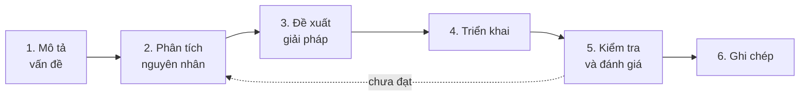

# Tư duy lập trình cốt lõi

Ngôn ngữ và framework thay đổi vài năm một lần; cách suy nghĩ thì theo bạn suốt sự nghiệp. Trang này tổng hợp các tư duy nền tảng, lộ trình phát triển theo cấp độ, cách rèn luyện và những cạm bẫy thường gặp.

## Sáu tư duy cốt lõi

| Tư duy | Là gì | Vì sao quan trọng | Rèn luyện |
| --- | --- | --- | --- |
| 🧠 **Logic** | Phân tích vấn đề có cấu trúc, từng bước có căn cứ | Nền tảng cho mọi tư duy phức tạp hơn; code rõ ràng, ít lỗi | Chia nhỏ vấn đề, giải bài toán logic, học cấu trúc dữ liệu |
| 💡 **Giải quyết vấn đề** | Xác định, phân tích và đưa ra giải pháp hiệu quả | Xử lý nhanh thách thức mới, thích ứng với công nghệ mới | Đi theo quy trình 6 bước bên dưới cho mọi vấn đề, kể cả nhỏ |
| ⚙️ **Thuật toán** | Mô tả giải pháp thành các bước cụ thể, lặp lại được | "Ngôn ngữ" chính xác để chuyển ý tưởng thành code | Binary search, quick sort, merge sort, quy hoạch động; phân tích độ phức tạp |
| 🧱 **Hướng đối tượng** | Mô hình hóa thế giới thực thành các đối tượng | Tái sử dụng, dễ bảo trì và mở rộng | Đóng gói, kế thừa, đa hình, trừu tượng; sau đó là SOLID và design pattern |
| 🌐 **Hệ thống** | Nhìn vấn đề như một phần của tổng thể, chú ý tương tác giữa các phần | Dự đoán tác động của thay đổi, thiết kế tốt hơn, phối hợp nhóm tốt hơn | Vẽ sơ đồ luồng dữ liệu của dự án đang làm; đọc về kiến trúc (ví dụ [microservices](./microservices.mdx)) |
| 🐞 **Debugging** | Xác định, phân tích và sửa lỗi một cách có hệ thống | Hiểu sâu cách chương trình chạy, kiểm soát mã nguồn | Dùng debugger thay vì đoán; đi theo quy trình bên dưới |

### Quy trình giải quyết vấn đề

Debug là một trường hợp riêng của quy trình này:

1. **Tái hiện** lỗi một cách ổn định — chưa tái hiện được thì chưa sửa được.
2. **Thu hẹp** phạm vi: lỗi nằm ở tầng nào, commit nào (`git bisect`), input nào.
3. **Đặt giả thuyết** và kiểm chứng bằng debugger, log, breakpoint — không sửa mò.
4. **Sửa** nguyên nhân gốc, không chỉ triệu chứng.
5. **Viết test** tái hiện lỗi để nó không quay lại; nhờ người khác review khi bế tắc.

## Lộ trình phát triển

Số năm chỉ mang tính tham khảo — cấp độ được quyết định bởi phạm vi trách nhiệm và mức độ tự chủ, không phải thời gian.

| Cấp độ | Phạm vi & trách nhiệm | Trọng tâm phát triển |
| --- | --- | --- |
| **Fresher** (0–1 năm) | Học và làm tác vụ cơ bản dưới sự hướng dẫn sát; làm quen ngôn ngữ, công cụ, quy trình | Tư duy logic cơ bản, giải quyết vấn đề nhỏ, làm quen thuật toán, debug cơ bản |
| **Junior** (1–3 năm) | Tự làm các tác vụ đã được định nghĩa rõ, viết unit test, sửa lỗi phức tạp hơn | Logic vững, OOP, áp dụng CSDL và thuật toán, bắt đầu có tư duy hệ thống |
| **Middle** (3–5 năm) | Tự xử lý tác vụ phức tạp, tham gia thiết kế, sở hữu một phần sản phẩm, hướng dẫn Junior | Thiết kế module, design pattern, tối ưu hiệu năng, tư duy hệ thống rõ ràng |
| **Senior** (5+ năm) | Dẫn dắt kỹ thuật, thiết kế kiến trúc, cố vấn đội nhóm; biến yêu cầu mơ hồ thành vấn đề rõ ràng | Kiến trúc hệ thống, giải quyết vấn đề chiến lược, mentoring, ra quyết định công nghệ |

Qua mỗi cấp, câu hỏi chính thay đổi: từ **"làm sao cho chạy?"** (Fresher) → **"làm sao cho đúng và dễ bảo trì?"** (Junior, Middle) → **"có nên làm không, và ảnh hưởng gì đến cả hệ thống?"** (Senior).

## Rèn luyện và giữ động lực

### Phương pháp luyện tập

| Phương pháp | Mang lại |
| --- | --- |
| 🏆 Giải bài trên LeetCode, Codeforces | Tư duy thuật toán, chuẩn bị [phỏng vấn kỹ thuật](./interviews/index.mdx) |
| 🚀 [Xây dự án cá nhân](./interviews/personal-project.mdx) | Áp dụng kiến thức vào thực tế, học công nghệ mới, có portfolio |
| 📚 Học theo tầng: nền tảng trước, framework sau | Kiến thức bền vững, chuyển framework dễ dàng |
| 📖 Đọc mã nguồn mở | Học giải pháp thực tế, phong cách code tốt, cách tổ chức dự án |
| ✍️ Dạy lại cho người khác | Viết blog, chia sẻ giúp hệ thống hóa và hiểu sâu hơn |

### Giữ động lực

| Chiến lược | Cách làm |
| --- | --- |
| 🧘 Phòng tránh burnout | Nhận ra dấu hiệu sớm (mệt kéo dài, mất hứng thú, khó tập trung); nghỉ ngơi thật sự, ngủ đủ, vận động |
| 🔥 Nuôi đam mê học hỏi | Nhớ lại lý do bắt đầu, chọn thử thách vừa sức, kết nối với cộng đồng |
| 🎯 Gắn với mục tiêu nghề nghiệp | Đặt mục tiêu SMART (cụ thể, đo được, khả thi, liên quan, có thời hạn) để việc học có hướng |
| 🤝 Môi trường tích cực | Không gian làm việc thoải mái, những người hỗ trợ nhau, chủ động chia sẻ |

## Sai lầm thường gặp

### Định hướng và cách học

| Sai lầm | Khắc phục |
| --- | --- |
| Chỉ xem video, không thực hành ("tutorial hell") | Học đi đôi với làm: áp dụng ngay vào một dự án nhỏ, tự làm lại không nhìn hướng dẫn |
| Học quá nhiều thứ cùng lúc | Làm chủ một hai công nghệ cốt lõi trước khi mở rộng |
| Bỏ qua kiến thức nền tảng | Ưu tiên cấu trúc dữ liệu & giải thuật, OOP, mạng máy tính, CSDL |

### Kỹ thuật và viết code

| Sai lầm | Khắc phục |
| --- | --- |
| Đặt tên biến, hàm không rõ nghĩa | Tên mô tả đúng chức năng, theo coding convention — xem [Naming](./naming.md) |
| Lặp code (vi phạm DRY) | Tách hàm, lớp, module để tái sử dụng — xem [các nguyên tắc lập trình](/blog/2024/12/06/programming-princibles) |
| Bỏ qua test | Coi test là một phần của quy trình, không phải việc làm thêm |
| Chép code mà không hiểu | Hiểu từng dòng trước khi dùng — kể cả code do AI sinh ra; xem nó là tham khảo, không phải đáp án |

### Kỹ năng mềm và phát triển cá nhân

| Sai lầm | Khắc phục |
| --- | --- |
| Bỏ bê kỹ năng mềm | Rèn giao tiếp, làm việc nhóm, quản lý thời gian — quan trọng không kém kỹ năng cứng |
| Sợ hỏi, sợ thất bại | Coi thất bại là dữ liệu để học; hỏi sau khi đã tự tìm hiểu và nói rõ mình đã thử gì |
| Tự cô lập | Tham gia cộng đồng, diễn đàn, meetup để học hỏi và được hỗ trợ |
