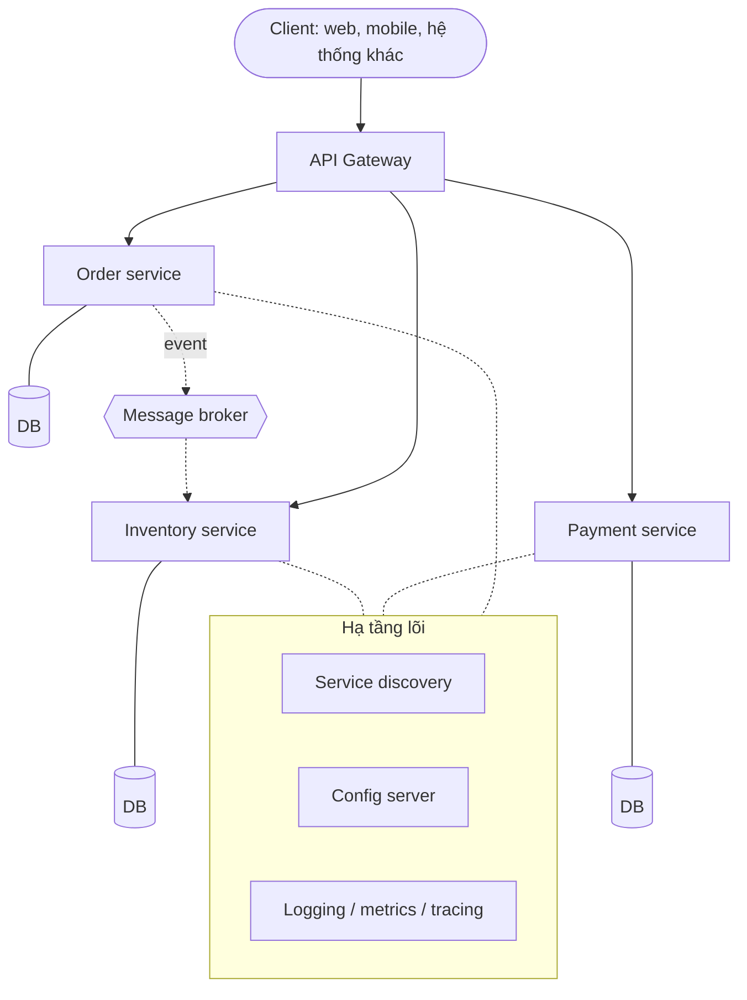
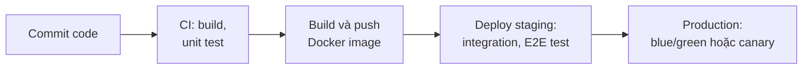

import WeightedChecklist from "@site/src/components/WeightedChecklist";

# Kiến trúc Microservices

> **Quick reference:** [Microservices Cheatsheet](./microservices-cheatsheet.mdx)

Microservices chia ứng dụng thành nhiều service nhỏ, mỗi service phụ trách một năng lực nghiệp vụ, có codebase và dữ liệu riêng, được triển khai và mở rộng độc lập. Đổi lại là độ phức tạp của một **hệ thống phân tán**: mạng có thể lỗi, dữ liệu nằm rải rác, và vận hành cần tự động hóa cao.

## So sánh các phong cách kiến trúc

| | Monolith | Modular monolith | Microservices |
| --- | --- | --- | --- |
| Đơn vị triển khai | Một | Một | Nhiều, độc lập |
| Mở rộng | Cả ứng dụng | Cả ứng dụng | Từng service |
| Dữ liệu | Một CSDL chung | Một CSDL, chia schema theo module | Mỗi service một CSDL |
| Độ phức tạp vận hành | Thấp | Thấp | Rất cao |
| Chịu lỗi | Thấp — một lỗi kéo sập cả app | Thấp | Cao — lỗi bị cô lập trong service |
| Linh hoạt công nghệ | Một stack | Một stack, ranh giới module rõ | Mỗi service tự chọn (polyglot) |

| Ưu điểm | Nhược điểm |
| --- | --- |
| Các đội phát triển và release độc lập, nhanh hơn | Độ phức tạp tăng vọt (mạng, phiên bản, debug) |
| Mở rộng đúng phần chịu tải | Chi phí hạ tầng và vận hành cao |
| Lỗi được cô lập | Khó giữ dữ liệu nhất quán giữa các service |
| Tự do chọn công nghệ cho từng service | Đòi hỏi văn hóa DevOps và kỹ năng cao |
| Codebase nhỏ, dễ hiểu cho từng đội | Bề mặt tấn công lớn hơn (nhiều endpoint, nhiều kết nối) |

:::tip

Modular monolith thường là bước đầu tốt: ranh giới module rõ ràng giúp tách thành service sau này dễ hơn, mà chưa phải trả chi phí của hệ phân tán.

:::

## Khi nào nên chọn microservices?

Chọn các tiêu chí đúng với dự án. CI/CD và DevOps trưởng thành là điều kiện tiên quyết — thiếu nó, microservices thường thành gánh nặng dù các tiêu chí khác đều đạt.

<WeightedChecklist
  items={[
    { text: "Miền nghiệp vụ phức tạp, chia được thành nhiều lĩnh vực con (bounded context) độc lập.", weight: 3 },
    { text: "Có nhiều đội nhỏ, tự chủ, cần triển khai độc lập với nhau.", weight: 3 },
    { text: "Các phần của ứng dụng có yêu cầu tải và mở rộng rất khác nhau.", weight: 2 },
    { text: "Cần nhiều công nghệ (ngôn ngữ, CSDL) khác nhau cho các chức năng khác nhau.", weight: 1 },
    { text: "Đã có văn hóa DevOps, CI/CD, monitoring trưởng thành.", weight: 4, required: true },
  ]}
  verdicts={[
    { min: 0, text: "Monolith hoặc modular monolith là lựa chọn tốt hơn ở giai đoạn này.", tone: "warn" },
    { min: 40, text: "Microservices đáng cân nhắc — đảm bảo đội ngũ sẵn sàng cho độ phức tạp của nó.", tone: "neutral" },
    { min: 75, text: "Dự án là ứng viên tốt cho microservices: lợi ích về mở rộng và tốc độ có thể rất lớn.", tone: "good" },
  ]}
  blockedVerdict="Các tiêu chí nghiệp vụ đã đạt, nhưng hãy xây dựng CI/CD và monitoring trước — bắt đầu bằng modular monolith."
/>

## Hệ sinh thái

Một hệ thống microservices không chỉ gồm các service nghiệp vụ mà còn cần nhiều thành phần hạ tầng hỗ trợ:

| Thành phần | Vai trò | Công cụ phổ biến |
| --- | --- | --- |
| **Client** | Điểm bắt đầu của request. Không nên biết cấu trúc service phía sau | Web, mobile, hệ thống khác |
| **API Gateway** | Điểm vào duy nhất: định tuyến, xác thực, rate limiting, tổng hợp response | Kong, [NGINX](../devops/web-servers/nginx.mdx), Spring Cloud Gateway |
| **Application service** | Một năng lực nghiệp vụ (đơn hàng, thanh toán, kho), codebase và CSDL riêng | Bất kỳ stack nào |
| **Message broker** | Giao tiếp bất đồng bộ, event-driven giữa các service | Kafka, RabbitMQ, NATS |
| **Service discovery** | Giúp service tìm địa chỉ của nhau trong môi trường động | Kubernetes Service (DNS có sẵn), Consul, Eureka |
| **Config server** | Cấu hình tập trung cho mọi service và môi trường, đổi không cần deploy lại | Spring Cloud Config, Consul KV; secret dùng HashiCorp Vault |
| **Observability** | Log tập trung, metrics, distributed tracing với correlation ID | [ELK stack](../devops/observability/elk-stack/index.md), Prometheus + Grafana, OpenTelemetry |

Ví dụ triển khai cụ thể: [Spring Cloud](../technologies/java/spring-framework/spring-microservices.md), [NestJS microservices](../technologies/js/be-frameworks/nest/in-depth.mdx#microservices).

## Mẫu thiết kế cốt lõi

| Mẫu | Giải quyết | Cách hoạt động |
| --- | --- | --- |
| **Database per service** | Ghép nối ở tầng dữ liệu | Mỗi service sở hữu CSDL riêng; service khác chỉ truy cập qua API hoặc event. Mỗi service tự chọn loại lưu trữ phù hợp |
| **API Gateway** | Client phải biết và gọi nhiều service | Một điểm vào xử lý định tuyến, xác thực, rate limiting và có thể gộp dữ liệu từ nhiều service |
| **Circuit breaker** | Lỗi dây chuyền khi một service chậm hoặc sập | 3 trạng thái: _Closed_ (gọi bình thường) → _Open_ (từ chối ngay khi lỗi liên tục) → _Half-open_ (thử lại vài lời gọi) |
| **Saga** | Giao dịch trải trên nhiều service, không có ACID chung | Chuỗi transaction cục bộ; bước nào lỗi thì chạy **transaction bù** để hoàn tác các bước trước |
| **CQRS** | Đọc và ghi có nhu cầu khác nhau, không `JOIN` được giữa các CSDL | Tách model ghi (command) và model đọc (query); model đọc là view phi chuẩn hóa, cập nhật từ event |
| **Event sourcing** | Cần lịch sử thay đổi đầy đủ, audit, truy vấn theo thời gian | Lưu mọi thay đổi trạng thái thành chuỗi event; trạng thái hiện tại có được bằng cách phát lại event |

## Vận hành và triển khai

Microservices chỉ khả thi khi mọi bước từ commit đến production được tự động hóa:

1. **Commit** — lập trình viên đẩy code lên một nhánh trong Git.
2. **CI** (GitHub Actions, GitLab CI, Jenkins) — tự chạy build và unit test.
3. **Build & push image** — đóng gói thành Docker image, gắn tag phiên bản, đẩy lên registry (Docker Hub, ECR, GHCR).
4. **Staging** — tự triển khai image mới, chạy integration và end-to-end test.
5. **Production** — sau khi duyệt, triển khai bằng chiến lược an toàn:

| Chiến lược | Cách làm | Đánh đổi |
| --- | --- | --- |
| Rolling | Thay dần từng instance cũ bằng bản mới | Đơn giản; hai phiên bản chạy song song trong lúc triển khai |
| Blue/Green | Dựng môi trường mới đầy đủ, chuyển traffic một lần | Rollback tức thì; tốn gấp đôi hạ tầng trong lúc chuyển |
| Canary | Chuyển một phần nhỏ traffic (ví dụ 5%) sang bản mới, tăng dần nếu metrics ổn | An toàn nhất; cần monitoring và định tuyến traffic tốt |

Vì các service release độc lập, API giữa chúng phải tương thích ngược — xem [API versioning](./api-versioning.md).

## Anti-pattern cần tránh

| Anti-pattern | Dấu hiệu | Cách tránh |
| --- | --- | --- |
| **Distributed monolith** | Sửa một tính năng phải deploy nhiều service cùng lúc | Chia theo bounded context, giao tiếp qua contract ổn định và event |
| **Shared database** | Nhiều service đọc/ghi chung bảng | Database per service; chia sẻ dữ liệu qua API hoặc event |
| **Chatty services** | Một request kéo theo hàng chục lời gọi đồng bộ nhỏ | Gộp API theo use case, cache, chuyển sang event bất đồng bộ |
| **Nanoservices** | Số service nhiều hơn số người trong đội | Gộp các service luôn thay đổi cùng nhau |
| **Hardcoded configuration** | Endpoint, credential nằm trong code | Config server, biến môi trường, secret manager |
| **Bỏ qua observability** | Không trả lời được "request này chậm ở service nào?" | Log tập trung, metrics, distributed tracing ngay từ đầu |
