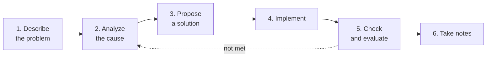

# Core programming mindset

Languages and frameworks change every few years; how you think stays with you for the whole career. This page collects the foundational mindsets, a level-by-level development path, how to practice, and the common pitfalls.

## Six core mindsets

| Mindset | What it is | Why it matters | How to practice |
| --- | --- | --- | --- |
| 🧠 **Logic** | Structured analysis of a problem, step by step, each step justified | The base for every more complex mindset; clearer code, fewer bugs | Break the problem down, solve logic problems, learn data structures |
| 💡 **Problem solving** | Identify, analyze, and produce an effective solution | Handle new challenges quickly, adapt to new technology | Follow the 6-step process below for every problem, including small ones |
| ⚙️ **Algorithms** | Describe a solution as concrete, repeatable steps | The precise "language" for turning an idea into code | Binary search, quick sort, merge sort, dynamic programming; analyze complexity |
| 🧱 **Object-oriented** | Model the real world as objects | Reuse, easier to maintain and extend | Encapsulation, inheritance, polymorphism, abstraction; then SOLID and design patterns |
| 🌐 **Systems** | See a problem as part of a whole, and watch how the parts interact | Predict the effect of a change, design better, coordinate better with the team | Draw the data-flow diagram of the project you are on; read about architecture (for example [microservices](./microservices.mdx)) |
| 🐞 **Debugging** | Find, analyze, and fix bugs systematically | A deeper understanding of how the program runs, and control over the code | Use a debugger instead of guessing; follow the process below |

### Problem-solving process

Debugging is a special case of this process:

1. **Reproduce** the bug reliably — if you cannot reproduce it, you cannot fix it.
2. **Narrow** the scope: which layer, which commit (`git bisect`), which input.
3. **State a hypothesis** and check it with a debugger, logs, and breakpoints — do not fix by guessing.
4. **Fix** the root cause, not only the symptom.
5. **Write a test** that reproduces the bug so it does not come back; ask someone else to review when you are stuck.

## Development path

The years are only a rough guide — level is set by the scope of responsibility and how independently you work, not by time.

| Level | Scope and responsibility | Development focus |
| --- | --- | --- |
| **Fresher** (0–1 year) | Learn and do basic tasks under close guidance; get used to the language, tools, and process | Basic logical thinking, small problems, a first look at algorithms, basic debugging |
| **Junior** (1–3 years) | Do clearly defined tasks on your own, write unit tests, fix harder bugs | Solid logic, OOP, apply databases and algorithms, start thinking in systems |
| **Middle** (3–5 years) | Handle complex tasks on your own, take part in design, own part of the product, guide Juniors | Module design, design patterns, performance optimization, a clear systems view |
| **Senior** (5+ years) | Lead technically, design architecture, advise the team; turn a vague requirement into a clear problem | System architecture, strategic problem solving, mentoring, technology decisions |

At each level the main question changes: from **"how do I make it run?"** (Fresher) → **"how do I make it correct and easy to maintain?"** (Junior, Middle) → **"should we do this, and what effect does it have on the whole system?"** (Senior).

## Practice and staying motivated

### How to practice

| Method | What you get |
| --- | --- |
| 🏆 Solve problems on LeetCode, Codeforces | Algorithmic thinking, preparation for [technical interviews](./interviews/index.mdx) |
| 🚀 [Build a personal project](./interviews/personal-project.mdx) | Apply what you know in practice, learn new technology, build a portfolio |
| 📚 Learn in layers: foundations first, frameworks later | Knowledge that lasts, and an easier move between frameworks |
| 📖 Read open-source code | Learn real solutions, good code style, how a project is organized |
| ✍️ Teach it back to someone else | Writing a blog or sharing helps you organize it and understand it more deeply |

### Staying motivated

| Strategy | How |
| --- | --- |
| 🧘 Prevent burnout | Notice the early signs (lasting fatigue, lost interest, trouble focusing); actually rest, sleep enough, exercise |
| 🔥 Keep the desire to learn | Remember why you started, pick challenges you can handle, connect with a community |
| 🎯 Tie it to a career goal | Set SMART goals (specific, measurable, achievable, relevant, time-bound) so learning has a direction |
| 🤝 A positive environment | A comfortable place to work, people who support each other, share on purpose |

## Common mistakes

### Direction and how you learn

| Mistake | Fix |
| --- | --- |
| Only watching videos, not practicing ("tutorial hell") | Learn by doing: apply it at once in a small project, then redo it without the guide |
| Learning too many things at once | Get solid at one or two core technologies before you widen |
| Skipping the foundations | Put data structures and algorithms, OOP, computer networks, and databases first |

### Technique and writing code

| Mistake | Fix |
| --- | --- |
| Vague variable and function names | Names that describe the job, following the coding convention — see [Naming](./naming.md) |
| Duplicated code (a DRY violation) | Extract functions, classes, and modules so they can be reused — see [programming principles](/blog/2024/12/06/programming-princibles) |
| Skipping tests | Treat tests as part of the process, not extra work |
| Copying code you do not understand | Understand each line before you use it — including code an AI generated; treat it as a reference, not the answer |

### Soft skills and personal growth

| Mistake | Fix |
| --- | --- |
| Neglecting soft skills | Practice communication, teamwork, and time management — they matter as much as hard skills |
| Afraid to ask, afraid to fail | Treat failure as data to learn from; ask after you have looked into it yourself, and say clearly what you already tried |
| Isolating yourself | Join communities, forums, and meetups to learn and to get help |
