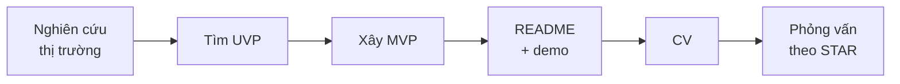

# Dự án cá nhân: từ ý tưởng đến phỏng vấn

Với lập trình viên junior, một dự án cá nhân làm tốt thường nói được nhiều hơn bất kỳ dòng kinh nghiệm nào. Điều nhà tuyển dụng tìm không chỉ là code chạy được, mà là **cách bạn suy nghĩ**: vì sao làm, chọn gì, gặp khó gì và giải quyết ra sao.

## Phần I: Nghiên cứu và xây dựng

| Bước | Mục tiêu | Làm thế nào |
| --- | --- | --- |
| **Phân tích thị trường** | Hiểu đối thủ và bối cảnh để tìm chỗ đứng cho dự án | Dùng thử 2–3 sản phẩm cùng loại, ghi lại điểm hay, điểm dở, giá, đối tượng người dùng |
| **Tìm UVP** (Unique Value Proposition) | Một lý do rõ ràng để dự án của bạn tồn tại | Viết một câu: "Dành cho \_\_\_, giải quyết \_\_\_, khác với \_\_\_ ở chỗ \_\_\_" |
| **Xây MVP** (Minimum Viable Product) | Hoàn thành được, có giá trị cốt lõi | Chọn 2–3 tính năng chính, làm xong và deploy trước khi thêm tính năng mới |
| **Đạo đức** | Phát triển chuyên nghiệp, không sao chép máy móc | "Lấy cảm hứng" về ý tưởng và trải nghiệm — không dùng tên, logo, hình ảnh hay code của sản phẩm gốc; kiểm tra license của thư viện và asset |

### Phân tích SWOT

Ví dụ cho dự án "Landing Page Tool" lấy cảm hứng từ Carrd:

| | Tích cực | Tiêu cực |
| --- | --- | --- |
| **Bên trong** (bản thân bạn) | **S — Strengths**: Thành thạo React và Next.js, xây được giao diện phức tạp | **W — Weaknesses**: Còn yếu về thiết kế UI/UX và tối ưu database |
| **Bên ngoài** (thị trường) | **O — Opportunities**: Công cụ hiện có quá đắt hoặc phức tạp cho người dùng cá nhân | **T — Threats**: Cạnh tranh từ các sản phẩm lớn, thương hiệu mạnh |

Điểm yếu là gợi ý cho phần **học thêm** trong dự án; cơ hội chính là nơi đặt UVP.

### Trước khi đưa vào CV

- [ ] Có **demo chạy được** (Vercel, Netlify, Render…) và tài khoản dùng thử nếu cần đăng nhập
- [ ] README có: mô tả một câu, ảnh chụp hoặc GIF, tính năng chính, công nghệ, cách chạy local, những quyết định kỹ thuật đáng chú ý
- [ ] Lịch sử commit sạch, không có secret (`.env`, API key) trong repo
- [ ] Có ít nhất một ít test cho phần logic quan trọng

## Phần II: Trình bày trong CV

Mỗi gạch đầu dòng theo công thức **động từ + làm gì + bằng cách nào + kết quả đo được**. Ví dụ:

> **Landing Page Builder** — Developer (dự án cá nhân), 04/2025 – 06/2025 · GitHub · Demo
>
> Ứng dụng kéo-thả tạo landing page lấy cảm hứng từ Carrd, xây để rèn kỹ năng full-stack với Next.js và hiểu kiến trúc một ứng dụng SaaS.
>
> - Thiết kế và triển khai 3 tính năng cốt lõi: kéo-thả khối, chỉnh sửa thuộc tính real-time, xuất file HTML/CSS.
> - Giảm 30% thời gian render khi trang có nhiều khối bằng `React.memo` và `useCallback`, đo bằng React Profiler.
> - Quản lý state bằng React Context; xác thực người dùng với NextAuth.js.
>
> **Công nghệ:** Next.js, React, TypeScript, Tailwind CSS, MongoDB, NextAuth.js, dnd-kit

| Phần | Nên viết | Tránh |
| --- | --- | --- |
| Bối cảnh | Vì sao làm, cho ai, học được gì | "Dự án clone Carrd" |
| Nhiệm vụ & thách thức | Tính năng bạn tự làm, vấn đề khó nhất | Liệt kê mọi tính năng nhỏ |
| Kết quả | Con số thật và cách đo (Profiler, Lighthouse, số người dùng) | Con số không giải thích được khi bị hỏi |
| Công nghệ | Những gì thực sự dùng và hiểu | Liệt kê công nghệ chỉ thử qua |

:::tip

Chọn thư viện còn được bảo trì: `react-beautiful-dnd` đã ngừng phát triển — dùng `dnd-kit` hoặc fork `@hello-pangea/dnd`. Nhà tuyển dụng có thể hỏi vì sao bạn chọn nó.

:::

## Phần III: Phỏng vấn về dự án

### Công thức STAR

| | Ý nghĩa | Ví dụ |
| --- | --- | --- |
| **S — Situation** | Bối cảnh, tình huống cụ thể | "Khi trang có hơn 50 khối, kéo-thả bắt đầu giật…" |
| **T — Task** | Nhiệm vụ, mục tiêu của bạn | "Em cần làm cho thao tác kéo-thả mượt trở lại mà không bỏ tính năng nào." |
| **A — Action** | Những bước cụ thể **bạn** đã làm | "Em dùng React Profiler tìm component render thừa, tách state, bọc khối bằng `React.memo`…" |
| **R — Result** | Kết quả đo được và bài học | "Thời gian render giảm 30%, và em hiểu rõ hơn khi nào React re-render." |

Dành phần lớn thời gian cho **Action** — đó là phần thể hiện năng lực của bạn. Nói "em" thay vì "chúng em" để rõ phần việc của mình.

### Câu hỏi thường gặp

Tại sao bạn chọn công nghệ X cho dự án này?

Nhấn mạnh sự phù hợp với yêu cầu dự án và mục tiêu học tập, không chỉ vì nó "phổ biến". Nêu được một lựa chọn thay thế bạn đã cân nhắc và lý do không chọn.

Khó khăn kỹ thuật lớn nhất bạn gặp là gì?

Cơ hội tốt nhất để thể hiện kỹ năng giải quyết vấn đề. Kể theo STAR, kèm cách bạn tìm ra nguyên nhân (debug, đọc tài liệu, đo đạc).

Nếu làm lại, bạn sẽ làm gì khác?

Thể hiện tư duy phản biện và mong muốn học hỏi: chỉ ra một điểm cụ thể (thiết kế database, cách quản lý state, thiếu test) và giải thích vì sao cách khác tốt hơn.

Dự án này khác gì sản phẩm gốc?

Quay lại UVP: bạn đã đơn giản hóa, thêm hay làm khác điều gì, và vì sao.

Xem thêm các từ khóa phỏng vấn kỹ thuật ở trang [Interviews](./index.mdx).
