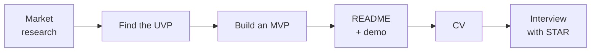

# A personal project: from idea to interview

For a junior developer, a personal project done well often says more than any line of work experience. What employers look for is not only code that runs, but **how you think**: why you built it, what you chose, what was hard, and how you solved it.

## Part I: Research and building

| Step | Goal | How |
| --- | --- | --- |
| **Market analysis** | Understand competitors and the context so the project has a place | Try 2–3 products of the same kind, and note what is good, what is bad, the price, and who the users are |
| **Find the UVP** (Unique Value Proposition) | One clear reason for your project to exist | Write one sentence: "For \_\_\_, it solves \_\_\_, and it differs from \_\_\_ in that \_\_\_" |
| **Build an MVP** (Minimum Viable Product) | Something you can finish, with the core value | Pick 2–3 main features, finish them, and deploy before you add anything new |
| **Ethics** | Build it professionally, not as a mechanical copy | Take "inspiration" from the idea and the experience — do not use the original product's name, logo, images, or code; check the license of libraries and assets |

### SWOT analysis

Example for a "Landing Page Tool" project inspired by Carrd:

| | Positive | Negative |
| --- | --- | --- |
| **Internal** (you) | **S — Strengths**: Strong in React and Next.js, able to build a complex UI | **W — Weaknesses**: Still weak at UI/UX design and database optimization |
| **External** (the market) | **O — Opportunities**: Existing tools are too expensive or too complex for individual users | **T — Threats**: Competition from large products with strong brands |

Weaknesses are a hint for what to **learn next** in the project; the main opportunity is where you place the UVP.

### Before it goes on the CV

- [ ] A **working demo** (Vercel, Netlify, Render…) and a trial account if login is required
- [ ] A README with: a one-sentence description, a screenshot or GIF, the main features, the technologies, how to run it locally, technical decisions worth noting
- [ ] A clean commit history, with no secrets (`.env`, API keys) in the repo
- [ ] At least some tests for the important logic

## Part II: Presenting it on the CV

Each bullet follows **verb + what you did + how + a measurable result**. Example:

> **Landing Page Builder** — Developer (personal project), 04/2025 – 06/2025 · GitHub · Demo
>
> A drag-and-drop app for building landing pages, inspired by Carrd, built to practice full-stack skills with Next.js and to understand the architecture of a SaaS application.
>
> - Designed and implemented 3 core features: drag-and-drop blocks, real-time property editing, and HTML/CSS file export.
> - Cut render time by 30% when a page has many blocks, using `React.memo` and `useCallback`, measured with React Profiler.
> - Managed state with React Context; user authentication with NextAuth.js.
>
> **Technologies:** Next.js, React, TypeScript, Tailwind CSS, MongoDB, NextAuth.js, dnd-kit

| Part | Write | Avoid |
| --- | --- | --- |
| Context | Why you built it, who it is for, what you learned | "A Carrd clone project" |
| Task and challenge | Features you built yourself, the hardest problem | Listing every small feature |
| Result | Real numbers and how you measured them (Profiler, Lighthouse, user count) | Numbers you cannot explain when asked |
| Technology | What you actually used and understand | Listing technology you only tried in passing |

:::tip

Pick libraries that are still maintained: `react-beautiful-dnd` is no longer developed — use `dnd-kit` or the `@hello-pangea/dnd` fork. An interviewer may ask why you chose it.

:::

## Part III: Interviewing about the project

### The STAR formula

| | Meaning | Example |
| --- | --- | --- |
| **S — Situation** | The context, a specific situation | "When the page had more than 50 blocks, drag-and-drop started to stutter…" |
| **T — Task** | Your task, your goal | "I needed drag-and-drop to feel smooth again without dropping any feature." |
| **A — Action** | The concrete steps **you** took | "I used React Profiler to find components that rendered extra, split the state, and wrapped the blocks with `React.memo`…" |
| **R — Result** | A measured result, and the lesson | "Render time dropped by 30%, and I understood more clearly when React re-renders." |

Spend most of the time on **Action** — that is the part that shows what you can do. Say "I", not "we", so your own work is clear.

### Common questions

Why did you choose technology X for this project?

Stress the fit with the project requirements and with what you wanted to learn, not only that it is "popular". Name one alternative you considered and why you did not choose it.

What was the biggest technical difficulty you ran into?

The best chance to show problem-solving. Tell it with STAR, including how you found the cause (debugging, reading the docs, measuring).

If you built it again, what would you do differently?

Show critical thinking and a wish to keep learning: point to one specific thing (database design, how you managed state, missing tests) and explain why another way is better.

How is this project different from the original product?

Come back to the UVP: what you simplified, added, or did differently, and why.

See more technical-interview keywords on the [Interviews](./index.mdx) page.
