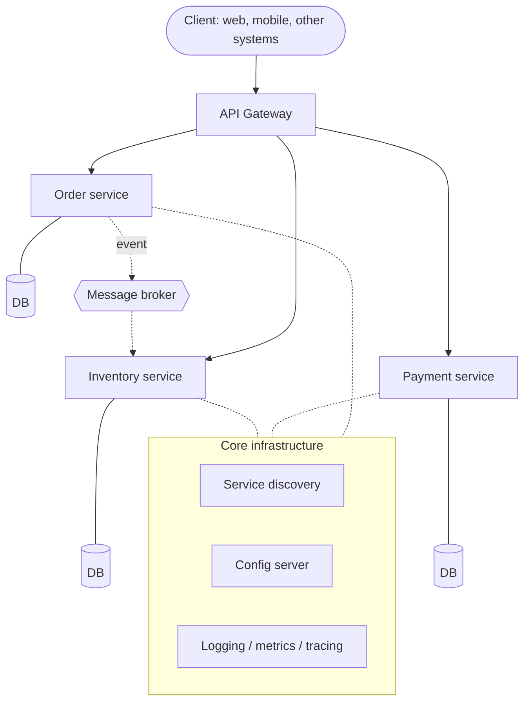

import WeightedChecklist from "@site/src/components/WeightedChecklist";

# Microservices architecture

> **Quick reference:** [Microservices Cheatsheet](./microservices-cheatsheet.mdx)

Microservices split an application into many small services. Each service owns one business capability, with its own codebase and data, and is deployed and scaled on its own. In return you take on the complexity of a **distributed system**: the network can fail, data is scattered, and operations need a high level of automation.

## Comparing architecture styles

| | Monolith | Modular monolith | Microservices |
| --- | --- | --- | --- |
| Deployment unit | One | One | Many, independent |
| Scaling | The whole application | The whole application | Per service |
| Data | One shared database | One database, schema split by module | One database per service |
| Operational complexity | Low | Low | Very high |
| Fault tolerance | Low — one failure takes down the whole app | Low | High — the failure stays inside the service |
| Technology flexibility | One stack | One stack, clear module boundaries | Each service chooses its own (polyglot) |

| Pros | Cons |
| --- | --- |
| Teams develop and release independently, and faster | Complexity jumps (network, versions, debugging) |
| Scale the part that is under load | High infrastructure and operations cost |
| Failures stay isolated | Hard to keep data consistent across services |
| Freedom to choose technology per service | Requires a DevOps culture and strong skills |
| A small codebase, easy for each team to understand | A larger attack surface (more endpoints, more connections) |

:::tip

A modular monolith is usually a good first step: clear module boundaries make a later split into services easier, without paying for a distributed system yet.

:::

## When should you choose microservices?

Check the criteria that match the project. Mature CI/CD and DevOps are a prerequisite — without that, microservices usually become a burden even when every other criterion is met.

<WeightedChecklist
  items={[
    { text: "The business domain is complex and can be split into several independent subdomains (bounded contexts).", weight: 3 },
    { text: "There are several small, autonomous teams that need to deploy independently of each other.", weight: 3 },
    { text: "Parts of the application have very different load and scaling requirements.", weight: 2 },
    { text: "Different features need different technologies (languages, databases).", weight: 1 },
    { text: "A mature DevOps culture, CI/CD, and monitoring are already in place.", weight: 4, required: true },
  ]}
  verdicts={[
    { min: 0, text: "A monolith or a modular monolith is the better choice at this stage.", tone: "warn" },
    { min: 40, text: "Microservices are worth considering — make sure the team is ready for its complexity.", tone: "neutral" },
    { min: 75, text: "The project is a good candidate for microservices: the benefits in scaling and speed can be very large.", tone: "good" },
  ]}
  blockedVerdict="The business criteria are met, but build CI/CD and monitoring first — start with a modular monolith."
/>

## Ecosystem

A microservices system is not only the business services. It also needs many supporting infrastructure pieces:

| Component | Role | Common tools |
| --- | --- | --- |
| **Client** | Where a request starts. It should not know the service structure behind it | Web, mobile, other systems |
| **API Gateway** | The single entry point: routing, authentication, rate limiting, response aggregation | Kong, [NGINX](../devops/web-servers/nginx.mdx), Spring Cloud Gateway |
| **Application service** | One business capability (orders, payments, inventory), with its own codebase and database | Any stack |
| **Message broker** | Asynchronous, event-driven communication between services | Kafka, RabbitMQ, NATS |
| **Service discovery** | Helps services find each other's addresses in a dynamic environment | Kubernetes Service (built-in DNS), Consul, Eureka |
| **Config server** | Central configuration for every service and environment, changed without a redeploy | Spring Cloud Config, Consul KV; secrets use HashiCorp Vault |
| **Observability** | Centralized logs, metrics, distributed tracing with a correlation ID | [ELK stack](../devops/observability/elk-stack/index.md), Prometheus + Grafana, OpenTelemetry |

Concrete implementation examples: [Spring Cloud](../technologies/java/spring-framework/spring-microservices.md), [NestJS microservices](../technologies/js/be-frameworks/nest/in-depth.mdx#microservices).

## Core design patterns

| Pattern | Problem it solves | How it works |
| --- | --- | --- |
| **Database per service** | Coupling at the data layer | Each service owns its own database; other services only reach it through an API or events. Each service picks the storage that fits |
| **API Gateway** | The client has to know and call many services | One entry point handles routing, authentication, rate limiting, and can combine data from several services |
| **Circuit breaker** | A cascade of failures when one service is slow or down | 3 states: _Closed_ (calls go through as normal) → _Open_ (reject immediately after repeated failures) → _Half-open_ (try a few calls again) |
| **Saga** | A transaction spread across services, with no shared ACID | A chain of local transactions; if a step fails, run a **compensating transaction** to undo the earlier steps |
| **CQRS** | Reads and writes have different needs, and you cannot `JOIN` across databases | Split the write model (command) and the read model (query); the read model is a denormalized view, updated from events |
| **Event sourcing** | You need the full change history, audit, and queries over time | Store every state change as a sequence of events; the current state comes from replaying the events |

## Operations and deployment

Microservices are only practical when every step from commit to production is automated:

1. **Commit** — the developer pushes code to a branch in Git.
2. **CI** (GitHub Actions, GitLab CI, Jenkins) — the build and unit tests run on their own.
3. **Build & push image** — package a Docker image, tag the version, push it to a registry (Docker Hub, ECR, GHCR).
4. **Staging** — deploy the new image automatically, and run integration and end-to-end tests.
5. **Production** — after approval, deploy with a safe strategy:

| Strategy | How | Tradeoff |
| --- | --- | --- |
| Rolling | Replace old instances with the new version, one by one | Simple; two versions run side by side during the deploy |
| Blue/Green | Stand up a full new environment, then switch traffic once | Instant rollback; costs twice the infrastructure during the switch |
| Canary | Send a small share of traffic (for example 5%) to the new version, and raise it if metrics stay healthy | Safest; needs good monitoring and traffic routing |

Because the services release independently, APIs between them must stay backward compatible — see [API versioning](./api-versioning.md).

## Anti-patterns to avoid

| Anti-pattern | Sign | How to avoid |
| --- | --- | --- |
| **Distributed monolith** | Changing one feature means deploying several services at the same time | Split by bounded context; communicate through stable contracts and events |
| **Shared database** | Several services read and write the same tables | Database per service; share data through an API or events |
| **Chatty services** | One request triggers dozens of small synchronous calls | Combine APIs by use case, cache, and move to asynchronous events |
| **Nanoservices** | There are more services than people on the team | Merge services that always change together |
| **Hardcoded configuration** | Endpoints and credentials live in the code | Config server, environment variables, a secret manager |
| **Skipping observability** | You cannot answer "which service made this request slow?" | Centralized logs, metrics, and distributed tracing from the start |
