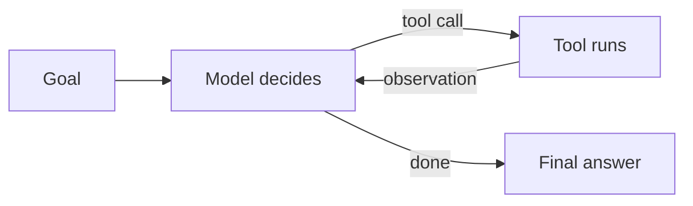

# Agents & MCP

## Agents

An **agent** is an LLM in a loop: it picks a tool, observes the result, and repeats until the goal is done (or a limit is hit).



| Pattern | Use when |
|---|---|
| **Single call** | The task fits one prompt - start here |
| **Workflow / chain** | Steps are known in advance (extract → transform → write) |
| **Router** | Classify input, send to a specialized prompt or cheaper model |
| **Agent loop** | Steps are unknown and depend on intermediate results |
| **Orchestrator + subagents** | Big tasks split into parallel, isolated subtasks |

Agent rules of thumb:

- Prefer the **simplest pattern that works**; agents cost more and fail in more ways.
- **Limit** iterations, tokens, wall-clock time and spend.
- Give the agent **good tools** (clear names, descriptions, error messages) - tool quality drives agent quality.
- **Human in the loop** for irreversible actions.
- **Log every step** (prompt, tool call, result) for debugging and evals.
- Manage context: summarize or drop old tool output in long runs.

## Model Context Protocol (MCP)

An open protocol (JSON-RPC based) that standardizes how AI applications connect to tools and data. Write a server once; use it from any MCP-capable client (IDEs, chat apps, agent frameworks).

| Concept | Meaning |
|---|---|
| **Host / client** | The AI app (e.g. an IDE or chat app) that connects to servers |
| **Server** | Your process exposing capabilities |
| **Tools** | Functions the model can call |
| **Resources** | Read-only data the app can load into context (files, records) |
| **Prompts** | Reusable prompt templates exposed to users |
| **Transports** | `stdio` for local processes, Streamable HTTP for remote servers |

### Minimal MCP server (TypeScript)

```bash
npm i @modelcontextprotocol/sdk zod
```

```ts
import { McpServer } from "@modelcontextprotocol/sdk/server/mcp.js";
import { StdioServerTransport } from "@modelcontextprotocol/sdk/server/stdio.js";
import { z } from "zod";

const server = new McpServer({ name: "notes", version: "1.0.0" });

server.registerTool(
  "search_notes",
  {
    title: "Search notes",
    description: "Full-text search over my notes. Returns matching titles.",
    inputSchema: { query: z.string() },
  },
  async ({ query }) => ({
    content: [{ type: "text", text: JSON.stringify(await searchNotes(query)) }],
  }),
);

await server.connect(new StdioServerTransport());
```

- Python: the official `mcp` package on PyPI (check its README for the current server API - it is on a 2.x major).
- Debug servers with the MCP Inspector: `npx @modelcontextprotocol/inspector`.

### MCP security

- A server runs with **your** permissions; install only trusted servers.
- Tool descriptions and tool outputs go into the model's context, so a malicious server can inject instructions.
- Use least-privilege credentials per server and require confirmation for writes.
- For remote servers, use the spec's OAuth-based authorization rather than shared static keys.
