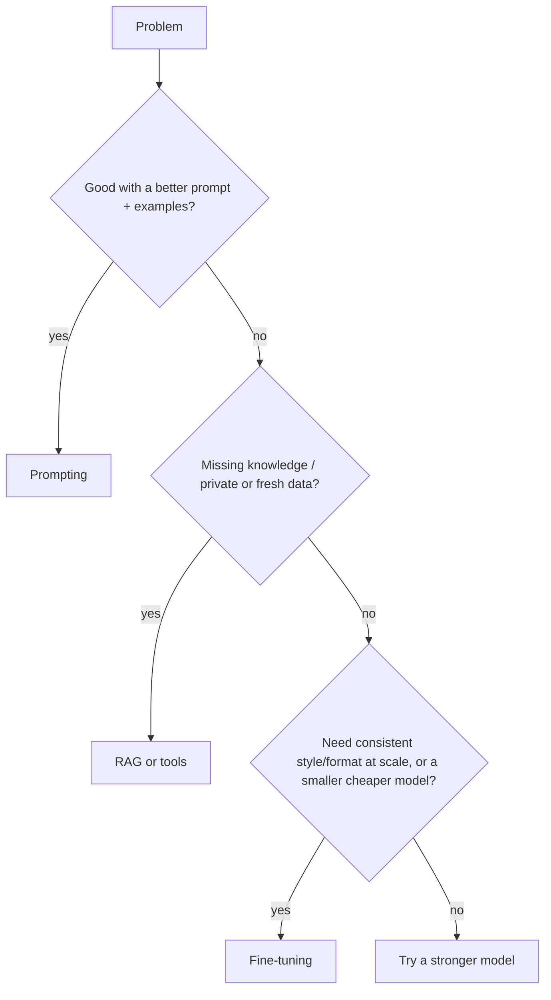

# Prompting vs RAG vs Fine-tuning

Start cheap, escalate only when evals show you must.

| | Prompting | RAG / tools | Fine-tuning |
|---|---|---|---|
| Adds new knowledge | Only what fits in the prompt | Yes, fresh and private data | Poorly; not for facts that change |
| Changes behavior/style | Yes, mostly | No | Yes, strongly |
| Effort | Minutes | Days (pipeline + index) | Weeks (data + training + evals) |
| Update cost | Edit text | Re-index docs | Re-train |
| Citations / traceability | No | Yes | No |
| Typical wins | Most tasks | Q&A over docs, support, search | Narrow high-volume tasks, distilling a big model into a small one |

## Rules of thumb

- **Prompting first** - most "we need fine-tuning" cases are fixed with clearer instructions and examples.
- **Knowledge problem → RAG**, **behavior problem → fine-tuning**.
- **Combine them**: a fine-tuned model can still use RAG.
- **Fine-tuning needs data**: hundreds to thousands of high-quality examples plus an eval set.
- **Check availability**: not every vendor/model offers fine-tuning; open-weight models can be fine-tuned yourself (e.g. LoRA/QLoRA).
- **New base models** often beat your old fine-tune - re-evaluate on upgrades.

## Related notes

- [Prompt engineering](./prompt-engineering.mdx) - the first option to try
- [RAG](./rag.mdx) - add private knowledge without training
- [Evals](./evals.mdx) - measure whether a change helped
- [Local models](./local-models.mdx) - open-weight models you can fine-tune
