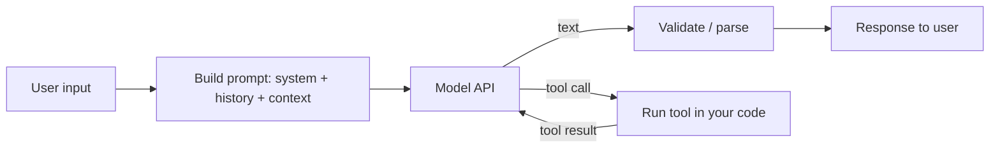

# Large Language Models (LLM)

> **Quick reference:** [LLM Cheatsheet](./cheatsheet.mdx)

An LLM is a next-token predictor trained on huge text corpora, then tuned to follow instructions. As a developer you call it over an HTTP API (or run open weights locally) and turn its text output into product features.

## What a developer must know

- **It is stateless**: every request must carry the whole conversation (system prompt + messages + tool results).
- **Everything is tokens**: input and output are billed, limited and timed in tokens, not characters.
- **Output is probabilistic**: same prompt, different answers. Design for variance (validation, retries, evals).
- **It does not know your data**: give it context (RAG, tools) instead of expecting it to remember.
- **It can be wrong confidently**: ground answers in sources and verify anything with consequences.
- **Untrusted text is code-like**: anything in the context can steer the model (prompt injection).
- **Measure, do not guess**: evals decide model choice, prompt changes and regressions.

## Request lifecycle

## Pages in this section

| Page | Covers |
|---|---|
| [Cheatsheet](./cheatsheet.mdx) | One-page refresh, SDK versions, current models |
| [Tokens, Context & Sampling](./tokens-context-sampling.mdx) | Tokens, context windows, temperature, top-p, max tokens |
| [Prompt Engineering](./prompt-engineering.mdx) | System prompts, structure, examples, iteration |
| [Structured Output & Tool Calling](./structured-output-tool-calling.mdx) | JSON schemas, function calling, the tool loop |
| [RAG](./rag.mdx) | Embeddings, chunking, vector DBs, hybrid search, reranking |
| [Agents & MCP](./agents-mcp.mdx) | Agent loops, Model Context Protocol servers and clients |
| [Evals](./evals.mdx) | Test sets, graders, LLM-as-judge, regression checks |
| [Security](./security.mdx) | Hallucination, prompt injection, data leakage |
| [Cost & Latency](./cost-latency.mdx) | Prompt caching, batching, streaming, model routing |
| [Prompting vs RAG vs Fine-tuning](./fine-tuning-vs-rag-vs-prompting.mdx) | Which lever to pull first |
| [Local Models](./local-models.mdx) | Ollama, llama.cpp, vLLM, open weights |
| [Model Landscape](./model-landscape.mdx) | Vendors and current model families |
