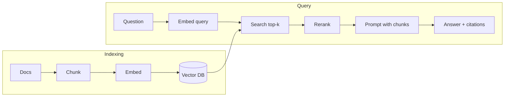

# RAG (Retrieval-Augmented Generation)

Retrieve relevant pieces of your data at query time and put them in the prompt, so the model answers from **your** sources instead of memory.



## Building blocks

| Piece | What to know |
|---|---|
| **Embeddings** | Model that maps text to a vector; similar meaning → nearby vectors. Use the same embedding model for indexing and querying |
| **Chunking** | Split docs into passages (by heading/paragraph, with some overlap). Too small loses context, too big dilutes relevance |
| **Metadata** | Store source, title, URL, date, ACL with each chunk for filtering and citations |
| **Vector DB** | pgvector, Qdrant, Weaviate, Milvus, Pinecone, Chroma, or a search engine with vector support (Elasticsearch/OpenSearch) |
| **Similarity** | Usually cosine similarity or dot product with approximate nearest-neighbor (ANN) indexes such as HNSW |
| **Hybrid search** | Combine vector search with keyword search (BM25) - catches exact names, codes, IDs |
| **Reranking** | A cross-encoder/reranker re-scores the top ~50 candidates; keep the best few |
| **Generation** | Prompt with chunks in tags + "answer only from the sources, cite them" |

## Minimal flow (TypeScript, pgvector)

```ts
// index time
for (const chunk of chunkMarkdown(doc, { maxTokens: 500, overlap: 50 })) {
  const vector = await embed(chunk.text); // any embedding API
  await sql`INSERT INTO chunks (doc_id, text, embedding) VALUES (${doc.id}, ${chunk.text}, ${toPgVector(vector)})`;
}

// query time
const q = await embed(question);
const rows = await sql`
  SELECT text, doc_id FROM chunks
  ORDER BY embedding <=> ${toPgVector(q)}   -- cosine distance
  LIMIT 8`;

const context = rows.map((r, i) => `<source id="${i}" doc="${r.doc_id}">${r.text}</source>`).join("\n");
const answer = await client.messages.create({
  model: "claude-sonnet-5-5",
  max_tokens: 800,
  system: "Answer only from the sources. Cite source ids. If unsure, say you don't know.",
  messages: [{ role: "user", content: `${context}\n\nQuestion: ${question}` }],
});
```

```sql
CREATE EXTENSION IF NOT EXISTS vector;
CREATE TABLE chunks (id bigserial PRIMARY KEY, doc_id text, text text, embedding vector(1024));
CREATE INDEX ON chunks USING hnsw (embedding vector_cosine_ops);
```

(The vector dimension must match your embedding model's output size.)

## Quality checklist

- **Evaluate retrieval separately** from generation: is the right chunk in the top-k (recall@k)?
- **Contextual chunks**: prepend the doc title/section to each chunk before embedding.
- **Query rewriting**: let the model turn a chat turn into a standalone search query.
- **Filter by metadata/ACL before ranking** - never leak documents the user cannot see.
- **Re-index on change**: keep a content hash per chunk.
- **Long context is an alternative** for small corpora: if everything fits (and caching makes it cheap), skip retrieval.

## Gotchas

- Changing the embedding model means re-embedding everything.
- Pure vector search misses exact identifiers; add keyword search.
- Retrieved text is untrusted - it can contain prompt injection (see [Security](./security.mdx)).
