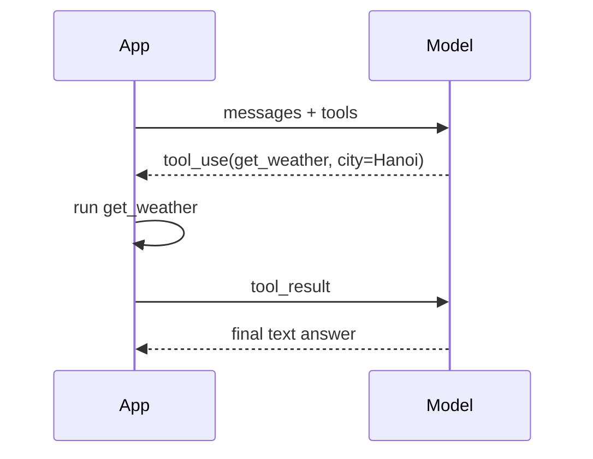

# Structured Output & Tool Calling

## Structured output (JSON schema)

Constrain the reply to a schema instead of regex-parsing prose.

```ts
import Anthropic from "@anthropic-ai/sdk";
const client = new Anthropic();

const msg = await client.messages.create({
  model: "claude-haiku-5-5",
  max_tokens: 1024,
  messages: [{ role: "user", content: "Extract: John Smith (john@example.com) wants the Enterprise plan." }],
  output_config: {
    format: {
      type: "json_schema",
      schema: {
        type: "object",
        properties: {
          name: { type: "string" },
          email: { type: "string" },
          plan: { type: "string" },
        },
        required: ["name", "email", "plan"],
        additionalProperties: false,
      },
    },
  },
});
const block = msg.content[0];
const data = block.type === "text" ? JSON.parse(block.text) : null;
```

- On the Claude API this is GA under `output_config.format`; the older beta `output_format` parameter is deprecated.
- OpenAI and Gemini have equivalent JSON-schema options; check their docs for the current parameter names.
- Still validate (e.g. with Zod or Pydantic): the schema guarantees shape, not truth.

## Tool calling (function calling)

The model never runs code. It returns a **tool call** (name + JSON args); your code runs it and sends back the **result**.



```ts
const tools: Anthropic.Tool[] = [{
  name: "get_weather",
  description: "Current weather for a city. Use when the user asks about weather.",
  strict: true,
  input_schema: {
    type: "object",
    properties: { city: { type: "string" } },
    required: ["city"],
    additionalProperties: false,
  },
}];

const messages: Anthropic.MessageParam[] = [{ role: "user", content: "Weather in Hanoi?" }];

while (true) {
  const res = await client.messages.create({ model: "claude-sonnet-5-5", max_tokens: 1024, tools, messages });
  messages.push({ role: "assistant", content: res.content });
  if (res.stop_reason !== "tool_use") break;

  const results: Anthropic.ToolResultBlockParam[] = [];
  for (const block of res.content) {
    if (block.type === "tool_use") {
      const output = await runTool(block.name, block.input); // your code
      results.push({ type: "tool_result", tool_use_id: block.id, content: JSON.stringify(output) });
    }
  }
  messages.push({ role: "user", content: results });
}
```

## Tool design tips

- **Descriptions are prompts**: say what the tool does, when to use it, and what each argument means.
- **Few, focused tools** beat many overlapping ones.
- **`strict: true`** guarantees tool names/inputs match the schema on the Claude API.
- **Return errors as results** (with a helpful message) so the model can recover instead of crashing the loop.
- **Validate and authorize** every call server-side; treat args as untrusted user input.
- **Confirm destructive actions** (delete, pay, send email) with a human.
- **Cap the loop** (max iterations, timeout, token budget).

## Related notes

- [Agents & MCP](./agents-mcp.mdx) - tool loops and MCP servers
- [Prompt engineering](./prompt-engineering.mdx) - instruct the model clearly
- [LLM security](./security.mdx) - treat tool arguments as untrusted
