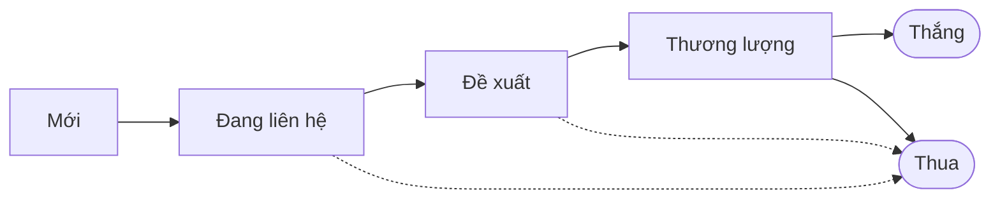
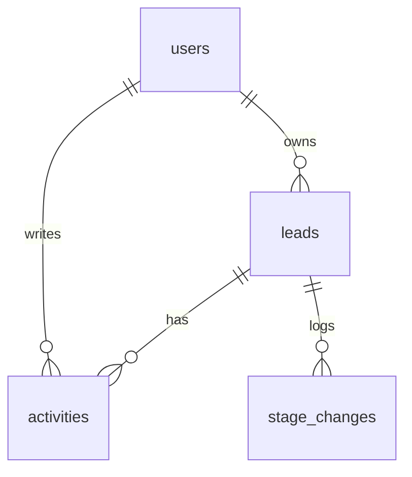
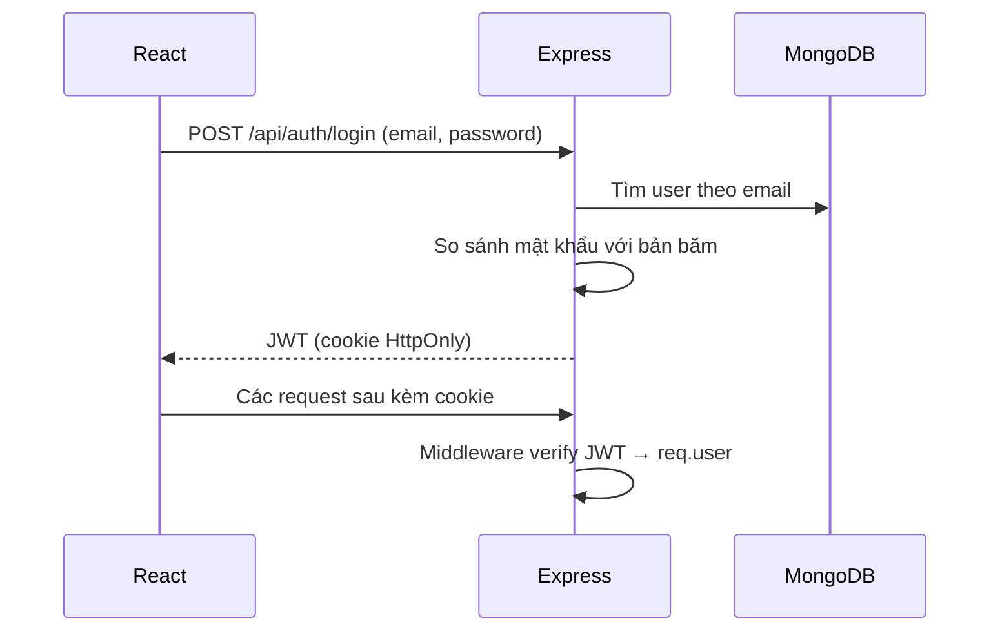

Một **Mini-CRM** gọn nhẹ xây trên MERN stack (MongoDB, Express, React, Node.js): quản lý khách hàng tiềm năng (lead) tập trung, theo dõi pipeline bán hàng dạng Kanban và xem báo cáo cơ bản — thay cho spreadsheet và ghi chú rời rạc của cá nhân kinh doanh, doanh nghiệp nhỏ và startup.


## Tổng quan

| Mục tiêu | Người dùng |
| --- | --- |
| Quản lý lead tập trung | Cá nhân kinh doanh tự do |
| Theo dõi tiến độ pipeline | Doanh nghiệp nhỏ và siêu nhỏ |
| Nâng cao hiệu suất làm việc | Đội bán hàng nhỏ |
| Báo cáo cơ bản | Startup giai đoạn đầu |
| Dễ dùng, không cần đào tạo | |

**Giá trị:** thay spreadsheet bằng một hệ thống tập trung, nhìn thấy cả quy trình bán hàng để không bỏ lỡ cơ hội, lưu lịch sử trao đổi với từng khách, và ra quyết định dựa trên số liệu — với chi phí thấp.

## Pipeline bán hàng

Mỗi lead đi qua các giai đoạn, hiển thị thành các cột Kanban; kéo thẻ sang cột khác để đổi giai đoạn.



Thẻ lead hiển thị tên, công ty và giá trị dự kiến; mở thẻ để xem chi tiết và lịch sử ghi chú.

## Mô hình dữ liệu



| Collection | Trường chính | Ghi chú |
| --- | --- | --- |
| `users` | `email`, `passwordHash`, `role` | Mật khẩu băm bằng bcrypt hoặc Argon2 |
| `leads` | `name`, `company`, `value`, `stage`, `ownerId` | `stage` là enum cố định; `value` lưu số nguyên (VNĐ), không dùng số thực |
| `activities` | `leadId`, `type` (ghi chú, cuộc gọi, email), `content`, `createdAt` | Lịch sử tương tác với khách |
| `stage_changes` | `leadId`, `from`, `to`, `changedAt` | Lưu mỗi lần đổi giai đoạn — đầu vào cho tỉ lệ chuyển đổi và thời gian chốt deal |

Đánh index `{ ownerId: 1, stage: 1 }` cho truy vấn Kanban.

## API

| Method | Endpoint | Mô tả |
| --- | --- | --- |
| `POST` | `/api/auth/login` | Đăng nhập, trả JWT |
| `GET` | `/api/leads?stage=&q=` | Danh sách lead của người dùng, lọc và tìm kiếm |
| `POST` | `/api/leads` | Tạo lead |
| `PATCH` | `/api/leads/:id` | Sửa lead, đổi giai đoạn (ghi thêm `stage_changes`) |
| `DELETE` | `/api/leads/:id` | Xóa lead |
| `POST` | `/api/leads/:id/activities` | Thêm ghi chú |
| `GET` | `/api/reports/pipeline` | Số lượng và tổng giá trị theo giai đoạn |

:::warning Kiểm tra quyền sở hữu

Mọi truy vấn theo `:id` phải lọc cả `ownerId` (`Lead.findOne({ _id: id, ownerId: req.user.id })`). Chỉ lọc theo `_id` thì người dùng đổi id trong URL là xem được lead của người khác (lỗi IDOR).

:::

## Luồng hoạt động

### Xác thực



Lưu JWT trong cookie `HttpOnly`, `Secure`, `SameSite` thay vì `localStorage` để script độc hại không đọc được.

### Tạo lead

1. Người dùng nhập thông tin lead trên form.
2. Frontend gửi `POST /api/leads` (cookie đi kèm tự động).
3. Backend xác thực token, validate dữ liệu, gán `ownerId = req.user.id`, lưu vào MongoDB.
4. Frontend thêm lead mới vào cột "Mới" trên Kanban.

## Dashboard báo cáo

Số liệu cho biểu đồ pipeline lấy bằng một aggregation:

```js title="reports.controller.js"
const pipeline = await Lead.aggregate([
  { $match: { ownerId: req.user._id } }, // hoặc cả đội, nếu là manager
  { $group: { _id: "$stage", count: { $sum: 1 }, totalValue: { $sum: "$value" } } },
]);
```

Từ `stage_changes` có thể tính thêm: tỉ lệ thắng, tỉ lệ chuyển đổi giữa các giai đoạn, thời gian trung bình để chốt deal.

## Hướng phát triển

| Tính năng | Mô tả |
| --- | --- |
| Email & lịch | Gửi email, đặt lịch hẹn ngay trong CRM |
| Quản lý công việc | Tạo và giao task gắn với từng lead |
| Phân quyền chi tiết | Vai trò Admin, Manager, Sales; manager xem lead của cả đội |
| Báo cáo nâng cao | Thêm bộ lọc theo thời gian, nhân viên và loại biểu đồ |
| Tự động hóa | Tự gửi email hoặc tạo task khi lead đổi giai đoạn |
| Docker & CI/CD | Đóng gói và tự động triển khai — xem [Thiết lập máy chủ Ubuntu](../cloud-computing/ubuntu-server-setup.mdx) |
