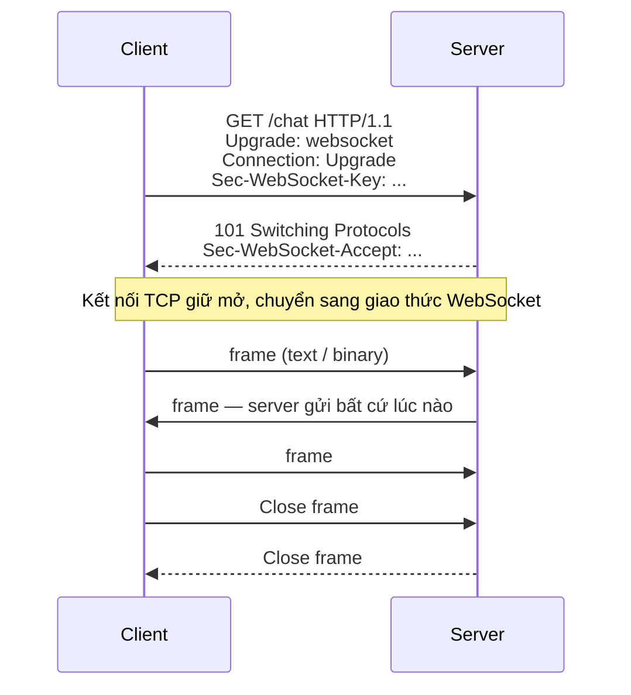
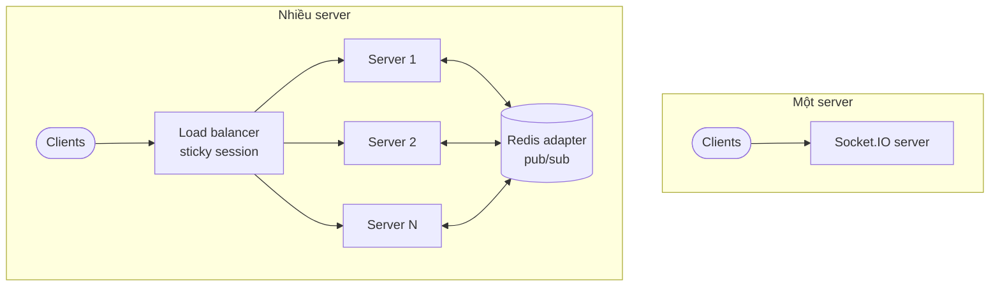

import EmitScopeDemo from "@site/src/components/EmitScopeDemo";

# WebSocket & Socket.IO

HTTP theo mô hình request-response: server chỉ trả lời khi client hỏi. Tin nhắn tức thời, thông báo đơn hàng, giá cổ phiếu hay cộng tác trên cùng tài liệu đòi hỏi server **chủ động đẩy** dữ liệu ngay khi có — đó là việc của WebSocket và các thư viện như Socket.IO.

| Ứng dụng | Ví dụ |
| --- | --- |
| 💬 Chat | Gửi, nhận tin nhắn gần như tức thời, trạng thái "đang gõ" |
| 🎮 Game online | Đồng bộ hành động của nhiều người chơi |
| 📈 Theo dõi dữ liệu | Giá cổ phiếu, vị trí xe trên bản đồ |
| 🔔 Thông báo trực tiếp | Nhận thông báo không cần tải lại trang |
| 🤝 Công cụ cộng tác | Nhiều người cùng sửa tài liệu, cùng vẽ trên bảng trắng |

## WebSocket hay Socket.IO?

| | WebSocket | Socket.IO |
| --- | --- | --- |
| Bản chất | Giao thức chuẩn ([RFC 6455](https://datatracker.ietf.org/doc/html/rfc6455)), có sẵn trong trình duyệt | Thư viện xây trên WebSocket, có giao thức riêng |
| Tương thích | Mọi client WebSocket | **Chỉ** client Socket.IO — không kết nối được bằng `new WebSocket()` thuần |
| Kết nối lại, heartbeat | Tự viết | Có sẵn |
| Fallback khi WebSocket bị chặn | Không | HTTP long-polling |
| Rooms, broadcast, acknowledgement | Tự viết | Có sẵn |
| Overhead | Thấp nhất | Cao hơn một chút (metadata của gói tin) |
| Nên dùng khi | Cần hiệu năng thô, client đa nền tảng, giao thức chuẩn | Muốn có đủ tính năng nhanh, cả client và server đều dùng Socket.IO |

:::tip

Nếu chỉ cần server đẩy một chiều (thông báo, feed), **Server-Sent Events** (`EventSource`) đơn giản hơn: chạy trên HTTP thường, tự kết nối lại, không cần thư viện.

:::

## WebSocket hoạt động thế nào



1. **Handshake** — client gửi một request HTTP `GET` với header `Upgrade: websocket`. Nếu chấp nhận, server trả `101 Switching Protocols`; từ đó kết nối TCP được giữ mở và chuyển sang giao thức WebSocket.
2. **Truyền dữ liệu** — hai bên gửi dữ liệu bất cứ lúc nào (full-duplex), đóng gói thành **frame**. Header của frame chỉ vài byte (loại dữ liệu text/binary, độ dài), nhẹ hơn nhiều so với header của mỗi request HTTP.
3. **Đóng kết nối** — một bên gửi **Close frame**, bên kia trả lời bằng Close frame, rồi đóng TCP.

API có sẵn trong trình duyệt:

```js
const ws = new WebSocket("wss://example.com/chat"); // luôn dùng wss:// (TLS) ở production

ws.addEventListener("open", () => ws.send(JSON.stringify({ type: "hello" })));
ws.addEventListener("message", (event) => console.log(JSON.parse(event.data)));
ws.addEventListener("close", (event) => console.log("Đóng:", event.code, event.reason));
```

WebSocket thuần không tự kết nối lại, không có rooms hay xác nhận đã nhận — những thứ Socket.IO bổ sung.

## Socket.IO

| Tính năng | Mô tả |
| --- | --- |
| **Tự kết nối lại** | Client tự thử lại (có backoff) khi mất mạng |
| **Fallback transport** | Bắt đầu bằng HTTP long-polling rồi nâng cấp lên WebSocket; vẫn chạy được khi proxy chặn WebSocket |
| **Rooms & namespaces** | Room: nhóm socket để gửi theo nhóm (phòng chat). Namespace: tách kênh logic trên cùng kết nối (`/admin`, `/chat`) |
| **Broadcasting** | Gửi cho tất cả, tất cả trừ người gửi, hoặc một room — một dòng lệnh |
| **Acknowledgement** | Bên nhận gọi callback để xác nhận, tạo luồng request-response trên socket |
| **Buffering** | Client đệm các `emit` khi mất kết nối và gửi lại khi kết nối lại. Chiều server → client cần bật _connection state recovery_ (v4.6+) |

### Phạm vi emit

Room trong ví dụ: A, B, D ở `room1`; C ở `room2`. A là client đang gửi sự kiện.

<EmitScopeDemo />

### Acknowledgement

```js
// Client: chờ server xác nhận
const response = await socket.timeout(5000).emitWithAck("order:create", { productId: 42 });

// Server
socket.on("order:create", async (payload, callback) => {
  const order = await createOrder(payload);
  callback({ ok: true, id: order.id });
});
```

## Mở rộng nhiều server



Một server giữ mọi kết nối trong bộ nhớ — đơn giản nhưng có giới hạn và là điểm lỗi duy nhất. Khi chạy nhiều server:

- **Load balancer** phân phối kết nối giữa các server.
- **Sticky session** giữ một client luôn ở cùng server. Bắt buộc khi bật long-polling, vì mỗi lần poll là một request HTTP riêng phải về đúng server đang giữ phiên. Nếu chỉ dùng `transports: ["websocket"]` thì không cần.
- **Redis adapter** — user A ở server 1 không nhận được `io.to(room).emit()` gọi từ server 2. Adapter phát mỗi sự kiện qua Redis pub/sub để mọi server chuyển tiếp cho client của mình.

```js title="server.js"
import { createAdapter } from "@socket.io/redis-adapter";
import { createClient } from "redis";

const pubClient = createClient({ url: "redis://localhost:6379" });
const subClient = pubClient.duplicate();
await Promise.all([pubClient.connect(), subClient.connect()]);

io.adapter(createAdapter(pubClient, subClient));
```

Đứng sau [Nginx](../../../devops/web-servers/nginx.mdx#load-balancing), cần chuyển tiếp header `Upgrade` và bật sticky session:

```nginx title="nginx.conf"
upstream socket_nodes {
    ip_hash; # sticky session theo IP client
    server 10.0.1.1:3000;
    server 10.0.1.2:3000;
}

server {
    location /socket.io/ {
        proxy_pass http://socket_nodes;
        proxy_http_version 1.1;
        proxy_set_header Upgrade $http_upgrade;
        proxy_set_header Connection "upgrade";
        proxy_set_header Host $host;
    }
}
```

## Bảo mật

- **Xác thực khi kết nối** — client gửi token trong `auth`, server kiểm tra bằng middleware trước khi chấp nhận:

  ```js
  // Client
  const socket = io("https://api.example.com", { auth: { token } });

  // Server
  io.use(async (socket, next) => {
    try {
      socket.data.user = await verifyJwt(socket.handshake.auth.token);
      next();
    } catch {
      next(new Error("unauthorized"));
    }
  });
  ```

- **CORS** — chỉ cho phép origin của frontend (`cors: { origin: ["https://app.example.com"] }`), không dùng `"*"`.
- **Validate payload** của mọi sự kiện như validate request body; không tin dữ liệu từ client.
- **Giới hạn tần suất** sự kiện và kích thước tin nhắn (`maxHttpBufferSize`) để chống spam, DoS.

## Thực hành

Server chat tối thiểu:

```js title="server.js"
import { Server } from "socket.io";

const io = new Server(3000, {
  cors: { origin: ["http://localhost:5173"] },
});

io.on("connection", (socket) => {
  console.log(`Client kết nối: ${socket.id}`);
  socket.emit("welcome", "Chào mừng bạn đến với chat!");

  socket.on("chat message", (msg) => {
    // Gửi cho mọi client khác, trừ người gửi
    socket.broadcast.emit("chat message", { user: socket.id, message: msg });
  });

  socket.on("disconnect", () => {
    io.emit("user disconnected", socket.id);
  });
});
```

```js title="client.js"
import { io } from "socket.io-client";

const socket = io("http://localhost:3000");

socket.on("welcome", (text) => console.log(text));
socket.on("chat message", ({ user, message }) => console.log(`${user}: ${message}`));
socket.emit("chat message", "Xin chào!");
```

Ý tưởng dự án để luyện tập:

| Dự án | Luyện được |
| --- | --- |
| Ứng dụng chat | Rooms, danh sách người online, trạng thái "đang gõ" |
| Bảng Kanban real-time | Đồng bộ kéo-thả thẻ cho mọi người đang xem |
| Dashboard thống kê | Server đẩy dữ liệu, cập nhật biểu đồ không tải lại trang |
| Game multiplayer (Pong, Snake) | Đồng bộ trạng thái tần suất cao |
| Hệ thống thông báo | Gửi tới đúng user/room khi có sự kiện mới |
| Bảng vẽ cộng tác | Broadcast nét vẽ, xử lý nhiều người cùng thao tác |

## Xem thêm

- [WebSocket trong NestJS](../be-frameworks/nest/in-depth.mdx#websockets): gateway, xác thực, Redis adapter
- [Real-time communication](../../dotnet/real-time-communication.md): mô hình giao tiếp, SignalR, message broker
