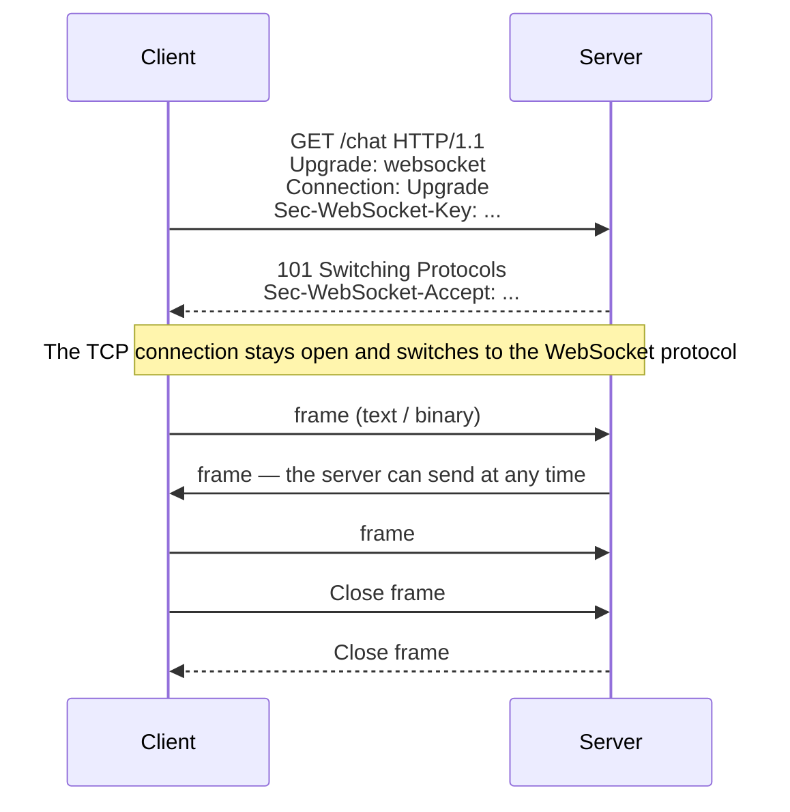
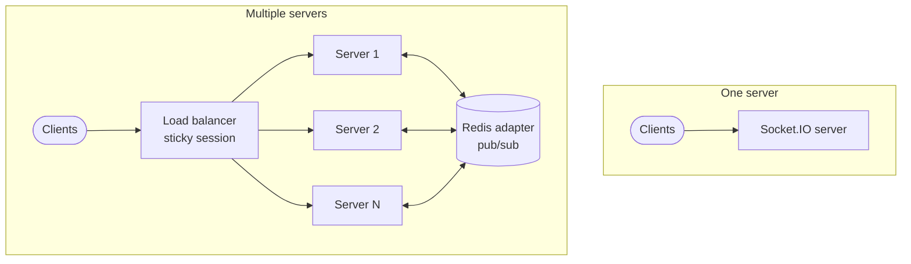

import EmitScopeDemo from "@site/src/components/EmitScopeDemo";

# WebSocket & Socket.IO

HTTP is request-response: the server replies only when the client asks. Instant messages, order notifications, stock prices, or collaboration on the same document need the server to **actively push** data as soon as it exists — that is the job of WebSocket and libraries such as Socket.IO.

| Use | Example |
| --- | --- |
| 💬 Chat | Send and receive messages almost instantly, plus a "typing" status |
| 🎮 Online games | Sync the actions of many players |
| 📈 Data monitoring | Stock prices, a vehicle's position on a map |
| 🔔 Live notifications | Receive notifications without reloading the page |
| 🤝 Collaboration tools | Several people edit the same document, or draw on the same whiteboard |

## WebSocket or Socket.IO?

| | WebSocket | Socket.IO |
| --- | --- | --- |
| What it is | A standard protocol ([RFC 6455](https://datatracker.ietf.org/doc/html/rfc6455)), built into the browser | A library built on WebSocket, with its own protocol |
| Compatibility | Any WebSocket client | **Only** a Socket.IO client — a plain `new WebSocket()` cannot connect |
| Reconnect, heartbeat | You write it | Built in |
| Fallback when WebSocket is blocked | None | HTTP long-polling |
| Rooms, broadcast, acknowledgement | You write it | Built in |
| Overhead | Lowest | A bit higher (packet metadata) |
| Use when | You need raw performance, multi-platform clients, a standard protocol | You want the features quickly, and both client and server use Socket.IO |

:::tip

If the server only needs to push one way (notifications, a feed), **Server-Sent Events** (`EventSource`) is simpler: it runs on ordinary HTTP, reconnects by itself, and needs no library.

:::

## How WebSocket works



1. **Handshake** — the client sends an HTTP `GET` with the header `Upgrade: websocket`. If the server accepts, it returns `101 Switching Protocols`; from then on the TCP connection stays open and switches to the WebSocket protocol.
2. **Data transfer** — either side can send at any time (full-duplex), packed into **frames**. A frame header is only a few bytes (text/binary type, length), much lighter than the header of each HTTP request.
3. **Closing the connection** — one side sends a **Close frame**, the other replies with a Close frame, then TCP closes.

The API built into the browser:

```js
const ws = new WebSocket("wss://example.com/chat"); // always use wss:// (TLS) in production

ws.addEventListener("open", () => ws.send(JSON.stringify({ type: "hello" })));
ws.addEventListener("message", (event) => console.log(JSON.parse(event.data)));
ws.addEventListener("close", (event) => console.log("Closed:", event.code, event.reason));
```

Plain WebSocket does not reconnect by itself, and it has no rooms or delivery acknowledgement — Socket.IO adds those.

## Socket.IO

| Feature | Description |
| --- | --- |
| **Automatic reconnect** | The client retries (with backoff) when the network drops |
| **Transport fallback** | Starts with HTTP long-polling, then upgrades to WebSocket; still works when a proxy blocks WebSocket |
| **Rooms & namespaces** | Room: a group of sockets so you can send to a group (a chat room). Namespace: a separate logical channel on the same connection (`/admin`, `/chat`) |
| **Broadcasting** | Send to everyone, everyone except the sender, or one room — one line |
| **Acknowledgement** | The receiver calls a callback to confirm, which gives you a request-response flow over the socket |
| **Buffering** | The client buffers `emit` calls while disconnected and sends them again on reconnect. Server → client needs _connection state recovery_ turned on (v4.6+) |

### Emit scope

Rooms in the example: A, B, and D are in `room1`; C is in `room2`. A is the client sending the event.

<EmitScopeDemo />

### Acknowledgement

```js
// Client: wait for the server to confirm
const response = await socket.timeout(5000).emitWithAck("order:create", { productId: 42 });

// Server
socket.on("order:create", async (payload, callback) => {
  const order = await createOrder(payload);
  callback({ ok: true, id: order.id });
});
```

## Scaling across servers



One server keeps every connection in memory — simple, but limited, and a single point of failure. When you run multiple servers:

- **Load balancer** distributes connections across the servers.
- **Sticky session** keeps one client on the same server. Required when long-polling is on, because each poll is a separate HTTP request that must reach the server holding the session. If you use only `transports: ["websocket"]`, you do not need it.
- **Redis adapter** — user A on server 1 does not receive an `io.to(room).emit()` called from server 2. The adapter publishes each event through Redis pub/sub so every server forwards it to its own clients.

```js title="server.js"
import { createAdapter } from "@socket.io/redis-adapter";
import { createClient } from "redis";

const pubClient = createClient({ url: "redis://localhost:6379" });
const subClient = pubClient.duplicate();
await Promise.all([pubClient.connect(), subClient.connect()]);

io.adapter(createAdapter(pubClient, subClient));
```

Behind [Nginx](../../../devops/web-servers/nginx.mdx#load-balancing), forward the `Upgrade` header and turn on sticky sessions:

```nginx title="nginx.conf"
upstream socket_nodes {
    ip_hash; # sticky session by client IP
    server 10.0.1.1:3000;
    server 10.0.1.2:3000;
}

server {
    location /socket.io/ {
        proxy_pass http://socket_nodes;
        proxy_http_version 1.1;
        proxy_set_header Upgrade $http_upgrade;
        proxy_set_header Connection "upgrade";
        proxy_set_header Host $host;
    }
}
```

## Security

- **Authenticate on connect** — the client sends a token in `auth`; the server checks it with middleware before accepting:

  ```js
  // Client
  const socket = io("https://api.example.com", { auth: { token } });

  // Server
  io.use(async (socket, next) => {
    try {
      socket.data.user = await verifyJwt(socket.handshake.auth.token);
      next();
    } catch {
      next(new Error("unauthorized"));
    }
  });
  ```

- **CORS** — allow only the frontend origin (`cors: { origin: ["https://app.example.com"] }`); do not use `"*"`.
- **Validate payload** of every event the same way you validate a request body; do not trust data from the client.
- **Rate-limit** events and message size (`maxHttpBufferSize`) against spam and DoS.

## Practice

A minimal chat server:

```js title="server.js"
import { Server } from "socket.io";

const io = new Server(3000, {
  cors: { origin: ["http://localhost:5173"] },
});

io.on("connection", (socket) => {
  console.log(`Client connected: ${socket.id}`);
  socket.emit("welcome", "Welcome to the chat!");

  socket.on("chat message", (msg) => {
    // Send to every other client, except the sender
    socket.broadcast.emit("chat message", { user: socket.id, message: msg });
  });

  socket.on("disconnect", () => {
    io.emit("user disconnected", socket.id);
  });
});
```

```js title="client.js"
import { io } from "socket.io-client";

const socket = io("http://localhost:3000");

socket.on("welcome", (text) => console.log(text));
socket.on("chat message", ({ user, message }) => console.log(`${user}: ${message}`));
socket.emit("chat message", "Hello!");
```

Project ideas to practice:

| Project | What you practice |
| --- | --- |
| Chat app | Rooms, an online user list, a "typing" status |
| Real-time Kanban board | Sync card drag-and-drop for everyone watching |
| Stats dashboard | The server pushes data; charts update without a page reload |
| Multiplayer game (Pong, Snake) | Sync state at a high rate |
| Notification system | Send to the right user or room when there is a new event |
| Collaborative whiteboard | Broadcast strokes; handle several people acting at once |

## See also

- [WebSockets in NestJS](../be-frameworks/nest/in-depth.mdx#websockets): gateway, authentication, Redis adapter
- [Real-time communication](../../dotnet/real-time-communication.md): communication models, SignalR, message broker
