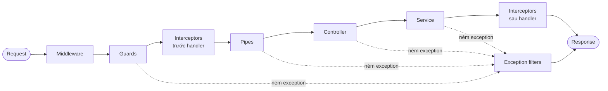
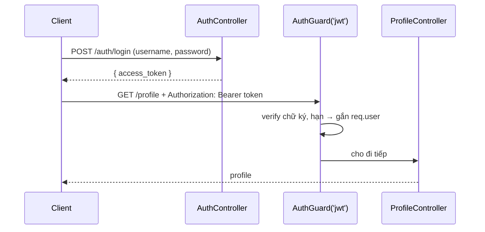

import Tabs from "@theme/Tabs";
import TabItem from "@theme/TabItem";

# NestJS chuyên sâu

Trang này đi sâu hơn [NestJS handbook](./index.md): thứ tự các thành phần chạy trong một request, cách DI quản lý vòng đời provider, và các vấn đề thực tế khi đưa NestJS vào microservices, real-time và production.

## Vòng đời request



| Bước | Dùng để | Ví dụ |
| --- | --- | --- |
| **Middleware** | Logic chung trước routing, có thể sửa `req`/`res` | logging, `helmet`, CORS |
| **Guards** | Quyết định request có được đi tiếp hay không; trả `false` → `403` | `AuthGuard('jwt')`, `RolesGuard` |
| **Interceptors** (trước) | Bọc quanh handler: đo thời gian, cache, ghi đè hành vi | `CacheInterceptor`, timeout |
| **Pipes** | Biến đổi và validate tham số (body, params, query) | `ValidationPipe`, `ParseIntPipe` |
| **Controller → Service** | Xử lý request, logic nghiệp vụ | |
| **Interceptors** (sau) | Biến đổi kết quả trả về | bọc `{ data }`, serialize |
| **Exception filters** | Bắt exception ở bất kỳ bước nào, định dạng response lỗi | `HttpExceptionFilter` |

Guards, interceptors, pipes và filters đều gắn được ở 3 mức: **global** (`app.useGlobal*()` hoặc provider `APP_*`), **controller** và **method** (`@UseGuards()`, `@UseInterceptors()`…). Khi request đi vào, chúng chạy từ global → controller → method; interceptors sau handler và filters chạy theo chiều ngược lại.

## Dependency injection & provider scopes

Khai báo dependency trong constructor, Nest IoC container sẽ tạo và inject instance:

```ts title="users.controller.ts"
@Controller("users")
export class UsersController {
  constructor(private readonly usersService: UsersService) {}
}
```

| Scope | Instance | Khi nào dùng |
| --- | --- | --- |
| `DEFAULT` (singleton) | Một instance cho cả ứng dụng | Hầu hết service — nhanh nhất, nên giữ stateless |
| `REQUEST` | Một instance mới cho mỗi request | Cần dữ liệu riêng của request (tenant, user) |
| `TRANSIENT` | Một instance mới mỗi lần được inject | Helper có state riêng cho từng consumer (logger có context) |

```ts
@Injectable({ scope: Scope.REQUEST })
export class TenantService {
  constructor(@Inject(REQUEST) private readonly request: Request) {}
}
```

:::warning

Scope `REQUEST` lan ngược lên chuỗi phụ thuộc: controller inject một provider request-scoped cũng trở thành request-scoped và bị tạo lại mỗi request. Dùng có chọn lọc vì ảnh hưởng hiệu năng.

:::

Ngoài class, provider còn có thể là giá trị, class thay thế hoặc factory:

```ts title="app.module.ts"
providers: [
  { provide: "API_URL", useValue: "https://api.example.com" },
  { provide: PaymentGateway, useClass: process.env.NODE_ENV === "test" ? FakeGateway : StripeGateway },
  {
    provide: "REDIS",
    useFactory: (config: ConfigService) => new Redis(config.get("REDIS_URL")),
    inject: [ConfigService],
  },
],
```

## Validation với DTO

**DTO** (Data Transfer Object) là class mô tả dữ liệu đi qua mạng. Decorator của `class-validator` khai báo luật, `ValidationPipe` thực thi chúng.

```ts title="create-post.dto.ts"
import { IsString, IsNotEmpty, MinLength } from "class-validator";

export class CreatePostDto {
  @IsString()
  @MinLength(5)
  title: string;

  @IsString()
  @IsNotEmpty()
  content: string;
}
```

```ts title="main.ts"
app.useGlobalPipes(
  new ValidationPipe({
    whitelist: true, // bỏ các field không có decorator
    forbidNonWhitelisted: true, // ...hoặc trả 400 nếu có field lạ
    transform: true, // chuyển plain object thành instance của DTO, ép kiểu params
  }),
);
```

Khi validate thất bại, pipe ném `BadRequestException` kèm danh sách lỗi theo từng field.

## Các gói phổ biến

Bảng tổng hợp có trong [handbook](./index.md#2-popular-packages). Cách tích hợp từng gói:

<Tabs groupId="nest-package">
<TabItem value="config" label="config">

```ts
// app.module.ts
@Module({
  imports: [ConfigModule.forRoot({ isGlobal: true })],
})
export class AppModule {}

// any.service.ts
constructor(private readonly config: ConfigService) {
  const dbHost = this.config.get<string>("DATABASE_HOST");
}
```

</TabItem>
<TabItem value="typeorm" label="typeorm">

```ts
// app.module.ts
TypeOrmModule.forRootAsync({
  inject: [ConfigService],
  useFactory: (config: ConfigService) => ({
    type: "postgres",
    url: config.get("DATABASE_URL"),
    autoLoadEntities: true,
  }),
}),

// users.module.ts
imports: [TypeOrmModule.forFeature([User])],

// users.service.ts
constructor(@InjectRepository(User) private readonly users: Repository<User>) {}
```

</TabItem>
<TabItem value="mongoose" label="mongoose">

```ts
// app.module.ts
imports: [MongooseModule.forRoot("mongodb://localhost/nest")],

// cats.module.ts
imports: [MongooseModule.forFeature([{ name: Cat.name, schema: CatSchema }])],

// cats.service.ts
constructor(@InjectModel(Cat.name) private readonly catModel: Model<Cat>) {}
```

</TabItem>
<TabItem value="swagger" label="swagger">

```ts title="main.ts"
const config = new DocumentBuilder().setTitle("API").setVersion("1.0").addBearerAuth().build();
const document = SwaggerModule.createDocument(app, config);
SwaggerModule.setup("api", app, document); // UI tại /api
```

</TabItem>
<TabItem value="jwt" label="passport + jwt">

```ts
// auth.module.ts
@Module({
  imports: [
    PassportModule,
    JwtModule.registerAsync({
      inject: [ConfigService],
      useFactory: (config: ConfigService) => ({
        secret: config.get("JWT_SECRET"), // không hard-code secret
        signOptions: { expiresIn: "15m" },
      }),
    }),
  ],
  providers: [AuthService, JwtStrategy],
})
export class AuthModule {}

// auth.service.ts
async login(user: User) {
  return { access_token: await this.jwtService.signAsync({ sub: user.id, roles: user.roles }) };
}

// profile.controller.ts
@UseGuards(AuthGuard("jwt"))
@Get("profile")
getProfile(@Req() req) {
  return req.user;
}
```

</TabItem>
<TabItem value="axios" label="axios">

```ts
// some.module.ts
imports: [HttpModule],

// some.service.ts — HttpService trả về Observable
constructor(private readonly http: HttpService) {}

async fetchData() {
  const { data } = await firstValueFrom(this.http.get("https://api.example.com/data"));
  return data;
}
```

</TabItem>
<TabItem value="throttler" label="throttler">

```ts title="app.module.ts"
@Module({
  imports: [
    ThrottlerModule.forRoot([{ ttl: 60_000, limit: 10 }]), // 10 request / 60 giây (v5+: ttl tính bằng ms)
  ],
  providers: [{ provide: APP_GUARD, useClass: ThrottlerGuard }],
})
export class AppModule {}
```

</TabItem>
</Tabs>

## Microservices

Package `@nestjs/microservices` trừu tượng hóa transport (TCP, Redis, NATS, RabbitMQ, Kafka, gRPC…): cùng một `@MessagePattern()` / `@EventPattern()` chạy được trên nhiều transport khác nhau.

### Chọn kiểu giao tiếp

| | REST | gRPC | Kafka / RabbitMQ / NATS |
| --- | --- | --- | --- |
| Kiểu | Đồng bộ, request-response | Đồng bộ (RPC), streaming hai chiều | Bất đồng bộ, event / pub-sub |
| Độ trễ | Trung bình | Rất thấp (HTTP/2 + Protobuf) | Thấp đến trung bình |
| Độ tin cậy | Phải tự retry | Phải tự retry | Message được broker lưu bền, consumer xử lý lại được |
| Dùng khi | API công khai, đơn giản | Gọi nội bộ giữa service, cần nhanh | Tách rời service, event-driven, data pipeline |

### Database per service

Mỗi service sở hữu database riêng; service khác chỉ đọc qua API hoặc event của nó. Đổi lại được **ghép nối lỏng**, **tự chọn loại DB** phù hợp (SQL cho giao dịch, NoSQL cho profile) và **scale độc lập** — nhưng phải xử lý giao dịch phân tán và tính nhất quán dữ liệu (xem bên dưới).

### Scaling & logging

| | Scale dọc (up) | Scale ngang (out) |
| --- | --- | --- |
| Cách làm | Tăng CPU/RAM cho một máy | Thêm instance sau load balancer |
| Giới hạn | Trần phần cứng, có downtime khi nâng cấp | Gần như không giới hạn |
| Chi phí ở quy mô lớn | Tăng nhanh | Tuyến tính hơn |
| Yêu cầu | Không | Service phải stateless |

Với nhiều service, **logging tập trung** là bắt buộc ([ELK stack](../../../../devops/observability/elk-stack/index.md), Grafana Loki). Sinh một **correlation ID** (trace ID) ở điểm vào, truyền qua mọi lời gọi service và ghi vào mọi log để lần theo một request xuyên hệ thống. OpenTelemetry làm việc này tự động.

### Thách thức thường gặp

<details>
<summary>Giao dịch phân tán → Saga</summary>

Tạo đơn hàng cần trừ tồn kho (product service) và thanh toán (payment service) — không có transaction ACID xuyên service.

**Saga** chia thao tác thành chuỗi transaction cục bộ: mỗi bước cập nhật DB của một service rồi phát event kích hoạt bước tiếp theo. Nếu một bước lỗi, các **transaction bù** (compensating) hoàn tác những bước đã xong (ví dụ: hoàn lại tồn kho).

</details>

<details>
<summary>Truy vấn xuyên service → API composition hoặc CQRS</summary>

Không thể `JOIN` giữa các database.

- **API composition**: một aggregator hoặc API gateway gọi nhiều service rồi ghép kết quả.
- **CQRS**: tách model ghi (command) và đọc (query). Model đọc là view đã denormalize, cập nhật bằng cách lắng nghe event từ nhiều service — xem `@nestjs/cqrs`.

</details>

<details>
<summary>Một service sập → Circuit breaker</summary>

Circuit breaker bọc lời gọi đến service khác. Khi lỗi liên tục, mạch **mở**: các lời gọi sau thất bại ngay, không chờ timeout. Sau một khoảng, mạch **nửa mở** và thử vài lời gọi; thành công thì **đóng** lại. Trong Node.js có thể dùng `opossum`.

</details>

## WebSockets

Trong NestJS, WebSocket server là **gateway** — class gắn `@WebSocketGateway()`, chạy trên Socket.IO (mặc định) hoặc `ws`.

```ts title="chat.gateway.ts"
@WebSocketGateway({ cors: { origin: ["https://app.example.com"] } })
export class ChatGateway implements OnGatewayConnection {
  @WebSocketServer()
  server: Server;

  constructor(private readonly jwt: JwtService) {}

  async handleConnection(client: Socket) {
    try {
      // Client gửi token khi kết nối: io(url, { auth: { token } })
      client.data.user = await this.jwt.verifyAsync(client.handshake.auth.token);
    } catch {
      client.disconnect();
    }
  }

  @SubscribeMessage("joinRoom")
  handleJoinRoom(@MessageBody() room: string, @ConnectedSocket() client: Socket) {
    client.join(room);
    client.emit("joinedRoom", room);
  }

  @SubscribeMessage("sendMessage")
  handleMessage(@MessageBody() data: { room: string; message: string }, @ConnectedSocket() client: Socket) {
    this.server.to(data.room).emit("newMessage", { user: client.data.user.sub, text: data.message });
  }
}
```

- **Xác thực**: dùng chung JWT với REST API. Verify ở `handleConnection` để từ chối ngay khi bắt tay, hoặc viết guard cho từng message (`context.switchToWs().getClient()`).
- **Scale nhiều instance**: user A ở instance 1 không nhận được message phát từ instance 2. Dùng Redis adapter (`@socket.io/redis-adapter`) để các instance phát event cho nhau qua Redis pub/sub; load balancer cần sticky session nếu Socket.IO dùng long-polling.
- **Kết nối chết**: Socket.IO tự gửi heartbeat ping/pong (`pingInterval`, `pingTimeout`) và đóng kết nối không phản hồi, nên không cần tự xử lý.

## Bảo mật

### Xác thực & phân quyền



Phân quyền theo vai trò bằng một guard đọc metadata:

```ts title="roles.guard.ts"
export const Roles = Reflector.createDecorator<string[]>();

@Injectable()
export class RolesGuard implements CanActivate {
  constructor(private readonly reflector: Reflector) {}

  canActivate(context: ExecutionContext): boolean {
    const roles = this.reflector.get(Roles, context.getHandler());
    if (!roles) return true;
    const { user } = context.switchToHttp().getRequest();
    return roles.some((role) => user?.roles?.includes(role));
  }
}

// Dùng: @Roles(["admin"]) @UseGuards(AuthGuard("jwt"), RolesGuard)
```

:::tip

Lưu token ở cookie `HttpOnly` an toàn hơn `localStorage` trước XSS, nhưng khi đó phải chống CSRF (bên dưới).

:::

### Các mối đe dọa phổ biến

| Mối đe dọa | Giải pháp trong NestJS |
| --- | --- |
| Brute-force, DoS | `@nestjs/throttler` với `ThrottlerGuard` global; giới hạn chặt hơn cho `/auth/login` bằng `@Throttle()` |
| Gọi API từ domain khác | `app.enableCors({ origin: ["https://app.example.com"], credentials: true })` — không dùng `origin: "*"` cùng cookie |
| HTTP header không an toàn | `app.use(helmet())` — đặt `Strict-Transport-Security`, `X-Content-Type-Options`, CSP… |
| CSRF (khi xác thực bằng cookie) | Cookie `SameSite=Lax`/`Strict` và CSRF token, ví dụ `csrf-csrf` (`csurf` đã ngừng phát triển). API dùng header `Authorization: Bearer` không bị CSRF |
| Dữ liệu đầu vào độc hại | `ValidationPipe` với `whitelist: true`, không truyền thẳng body vào query |
