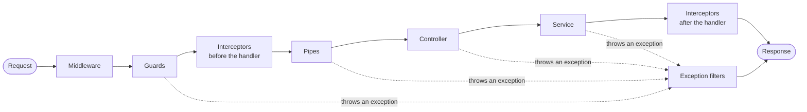
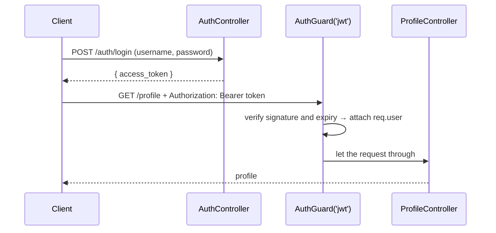

import Tabs from "@theme/Tabs";
import TabItem from "@theme/TabItem";

# NestJS in depth

This page goes deeper than the [NestJS handbook](./index.md): the order components run in during a request, how DI manages provider lifetime, and the practical issues of using NestJS for microservices, real-time, and production.

## Request lifecycle



| Step | Used for | Example |
| --- | --- | --- |
| **Middleware** | Shared logic before routing; can modify `req`/`res` | logging, `helmet`, CORS |
| **Guards** | Decide whether the request continues; return `false` → `403` | `AuthGuard('jwt')`, `RolesGuard` |
| **Interceptors** (before) | Wrap the handler: timing, cache, override behavior | `CacheInterceptor`, timeout |
| **Pipes** | Transform and validate parameters (body, params, query) | `ValidationPipe`, `ParseIntPipe` |
| **Controller → Service** | Handle the request, business logic | |
| **Interceptors** (after) | Transform the returned result | wrap `{ data }`, serialize |
| **Exception filters** | Catch an exception at any step and format the error response | `HttpExceptionFilter` |

Guards, interceptors, pipes, and filters can all be attached at 3 levels: **global** (`app.useGlobal*()` or an `APP_*` provider), **controller**, and **method** (`@UseGuards()`, `@UseInterceptors()`…). On the way in they run global → controller → method; interceptors after the handler and filters run in reverse.

## Dependency injection & provider scopes

Declare the dependency in the constructor. The Nest IoC container creates the instance and injects it:

```ts title="users.controller.ts"
@Controller("users")
export class UsersController {
  constructor(private readonly usersService: UsersService) {}
}
```

| Scope | Instance | When to use |
| --- | --- | --- |
| `DEFAULT` (singleton) | One instance for the whole application | Most services — fastest; keep them stateless |
| `REQUEST` | A new instance for each request | Need data that belongs to that request (tenant, user) |
| `TRANSIENT` | A new instance each time it is injected | A helper with its own state per consumer (a logger with context) |

```ts
@Injectable({ scope: Scope.REQUEST })
export class TenantService {
  constructor(@Inject(REQUEST) private readonly request: Request) {}
}
```

:::warning

The `REQUEST` scope propagates up the dependency chain: a controller that injects a request-scoped provider also becomes request-scoped and is recreated on every request. Use it selectively — it costs performance.

:::

Besides a class, a provider can also be a value, a replacement class, or a factory:

```ts title="app.module.ts"
providers: [
  { provide: "API_URL", useValue: "https://api.example.com" },
  { provide: PaymentGateway, useClass: process.env.NODE_ENV === "test" ? FakeGateway : StripeGateway },
  {
    provide: "REDIS",
    useFactory: (config: ConfigService) => new Redis(config.get("REDIS_URL")),
    inject: [ConfigService],
  },
],
```

## Validation with DTOs

A **DTO** (Data Transfer Object) is a class that describes data sent over the network. `class-validator` decorators declare the rules; `ValidationPipe` enforces them.

```ts title="create-post.dto.ts"
import { IsString, IsNotEmpty, MinLength } from "class-validator";

export class CreatePostDto {
  @IsString()
  @MinLength(5)
  title: string;

  @IsString()
  @IsNotEmpty()
  content: string;
}
```

```ts title="main.ts"
app.useGlobalPipes(
  new ValidationPipe({
    whitelist: true, // remove fields that have no decorator
    forbidNonWhitelisted: true, // ...or return 400 if an unknown field is present
    transform: true, // turn the plain object into a DTO instance and coerce param types
  }),
);
```

If validation fails, the pipe throws `BadRequestException` with an error list per field.

## Common packages

The summary table is in the [handbook](./index.md#2-popular-packages). How to integrate each package:

<Tabs groupId="nest-package">
<TabItem value="config" label="config">

```ts
// app.module.ts
@Module({
  imports: [ConfigModule.forRoot({ isGlobal: true })],
})
export class AppModule {}

// any.service.ts
constructor(private readonly config: ConfigService) {
  const dbHost = this.config.get<string>("DATABASE_HOST");
}
```

</TabItem>
<TabItem value="typeorm" label="typeorm">

```ts
// app.module.ts
TypeOrmModule.forRootAsync({
  inject: [ConfigService],
  useFactory: (config: ConfigService) => ({
    type: "postgres",
    url: config.get("DATABASE_URL"),
    autoLoadEntities: true,
  }),
}),

// users.module.ts
imports: [TypeOrmModule.forFeature([User])],

// users.service.ts
constructor(@InjectRepository(User) private readonly users: Repository<User>) {}
```

</TabItem>
<TabItem value="mongoose" label="mongoose">

```ts
// app.module.ts
imports: [MongooseModule.forRoot("mongodb://localhost/nest")],

// cats.module.ts
imports: [MongooseModule.forFeature([{ name: Cat.name, schema: CatSchema }])],

// cats.service.ts
constructor(@InjectModel(Cat.name) private readonly catModel: Model<Cat>) {}
```

</TabItem>
<TabItem value="swagger" label="swagger">

```ts title="main.ts"
const config = new DocumentBuilder().setTitle("API").setVersion("1.0").addBearerAuth().build();
const document = SwaggerModule.createDocument(app, config);
SwaggerModule.setup("api", app, document); // UI at /api
```

</TabItem>
<TabItem value="jwt" label="passport + jwt">

```ts
// auth.module.ts
@Module({
  imports: [
    PassportModule,
    JwtModule.registerAsync({
      inject: [ConfigService],
      useFactory: (config: ConfigService) => ({
        secret: config.get("JWT_SECRET"), // do not hard-code the secret
        signOptions: { expiresIn: "15m" },
      }),
    }),
  ],
  providers: [AuthService, JwtStrategy],
})
export class AuthModule {}

// auth.service.ts
async login(user: User) {
  return { access_token: await this.jwtService.signAsync({ sub: user.id, roles: user.roles }) };
}

// profile.controller.ts
@UseGuards(AuthGuard("jwt"))
@Get("profile")
getProfile(@Req() req) {
  return req.user;
}
```

</TabItem>
<TabItem value="axios" label="axios">

```ts
// some.module.ts
imports: [HttpModule],

// some.service.ts — HttpService returns an Observable
constructor(private readonly http: HttpService) {}

async fetchData() {
  const { data } = await firstValueFrom(this.http.get("https://api.example.com/data"));
  return data;
}
```

</TabItem>
<TabItem value="throttler" label="throttler">

```ts title="app.module.ts"
@Module({
  imports: [
    ThrottlerModule.forRoot([{ ttl: 60_000, limit: 10 }]), // 10 requests / 60 seconds (v5+: ttl is in ms)
  ],
  providers: [{ provide: APP_GUARD, useClass: ThrottlerGuard }],
})
export class AppModule {}
```

</TabItem>
</Tabs>

## Microservices {#microservices}

The `@nestjs/microservices` package abstracts the transport (TCP, Redis, NATS, RabbitMQ, Kafka, gRPC…): the same `@MessagePattern()` / `@EventPattern()` can run on many different transports.

### Choosing a communication style

| | REST | gRPC | Kafka / RabbitMQ / NATS |
| --- | --- | --- | --- |
| Type | Synchronous, request-response | Synchronous (RPC), bidirectional streaming | Asynchronous, event / pub-sub |
| Latency | Medium | Very low (HTTP/2 + Protobuf) | Low to medium |
| Reliability | You have to retry yourself | You have to retry yourself | The broker stores the message durably; the consumer can process it again |
| Use when | A public, simple API | Internal calls between services that need to be fast | Decoupling services, event-driven, data pipelines |

### Database per service

Each service owns its own database; other services only read through its API or its events. In return you get **loose coupling**, a **choice of DB type** that fits (SQL for transactions, NoSQL for profiles), and **independent scaling** — but you have to handle distributed transactions and data consistency (see below).

### Scaling & logging

| | Vertical scale (up) | Horizontal scale (out) |
| --- | --- | --- |
| How | Add CPU/RAM to one machine | Add instances behind a load balancer |
| Limit | Hardware ceiling, with downtime when you upgrade | Almost unlimited |
| Cost at large scale | Rises quickly | More linear |
| Requirement | None | The service must be stateless |

With many services, **centralized logging** is required ([ELK stack](../../../../devops/observability/elk-stack/index.md), Grafana Loki). Generate a **correlation ID** (trace ID) at the entry point, pass it through every service call, and write it on every log so you can follow one request across the system. OpenTelemetry does this automatically.

### Common challenges

<details>
<summary>Distributed transactions → Saga</summary>

Creating an order has to deduct stock (product service) and take payment (payment service) — there is no ACID transaction across services.

A **saga** splits the operation into a chain of local transactions: each step updates one service's database, then emits an event that triggers the next step. If a step fails, **compensating transactions** undo the steps already finished (for example, restore the stock).

</details>

<details>
<summary>Cross-service queries → API composition or CQRS</summary>

You cannot `JOIN` across databases.

- **API composition**: an aggregator or API gateway calls several services, then combines the results.
- **CQRS**: separate the write model (command) and the read model (query). The read model is a denormalized view, updated by listening to events from several services — see `@nestjs/cqrs`.

</details>

<details>
<summary>One service goes down → Circuit breaker</summary>

A circuit breaker wraps calls to another service. After repeated failures, the circuit **opens**: later calls fail immediately, without waiting for a timeout. After a while the circuit is **half-open** and tries a few calls; on success it **closes** again. In Node.js you can use `opossum`.

</details>

## WebSockets {#websockets}

In NestJS, the WebSocket server is a **gateway** — a class decorated with `@WebSocketGateway()`, running on Socket.IO (the default) or `ws`.

```ts title="chat.gateway.ts"
@WebSocketGateway({ cors: { origin: ["https://app.example.com"] } })
export class ChatGateway implements OnGatewayConnection {
  @WebSocketServer()
  server: Server;

  constructor(private readonly jwt: JwtService) {}

  async handleConnection(client: Socket) {
    try {
      // The client sends the token on connect: io(url, { auth: { token } })
      client.data.user = await this.jwt.verifyAsync(client.handshake.auth.token);
    } catch {
      client.disconnect();
    }
  }

  @SubscribeMessage("joinRoom")
  handleJoinRoom(@MessageBody() room: string, @ConnectedSocket() client: Socket) {
    client.join(room);
    client.emit("joinedRoom", room);
  }

  @SubscribeMessage("sendMessage")
  handleMessage(@MessageBody() data: { room: string; message: string }, @ConnectedSocket() client: Socket) {
    this.server.to(data.room).emit("newMessage", { user: client.data.user.sub, text: data.message });
  }
}
```

- **Authentication**: share the JWT with the REST API. Verify in `handleConnection` so you reject it during the handshake, or write a guard per message (`context.switchToWs().getClient()`).
- **Scaling to many instances**: user A on instance 1 does not receive a message emitted from instance 2. Use the Redis adapter (`@socket.io/redis-adapter`) so instances publish events to each other over Redis pub/sub; the load balancer needs a sticky session if Socket.IO uses long-polling.
- **Dead connections**: Socket.IO sends heartbeat ping/pong itself (`pingInterval`, `pingTimeout`) and closes connections that do not respond, so you do not handle that yourself.

## Security

### Authentication & authorization



Role-based authorization with a guard that reads metadata:

```ts title="roles.guard.ts"
export const Roles = Reflector.createDecorator<string[]>();

@Injectable()
export class RolesGuard implements CanActivate {
  constructor(private readonly reflector: Reflector) {}

  canActivate(context: ExecutionContext): boolean {
    const roles = this.reflector.get(Roles, context.getHandler());
    if (!roles) return true;
    const { user } = context.switchToHttp().getRequest();
    return roles.some((role) => user?.roles?.includes(role));
  }
}

// Use: @Roles(["admin"]) @UseGuards(AuthGuard("jwt"), RolesGuard)
```

:::tip

Storing the token in an `HttpOnly` cookie is safer than `localStorage` against XSS, but then you must defend against CSRF (below).

:::

### Common threats

| Threat | Solution in NestJS |
| --- | --- |
| Brute-force, DoS | `@nestjs/throttler` with a global `ThrottlerGuard`; a tighter limit on `/auth/login` with `@Throttle()` |
| API calls from another domain | `app.enableCors({ origin: ["https://app.example.com"], credentials: true })` — do not use `origin: "*"` together with cookies |
| Unsafe HTTP headers | `app.use(helmet())` — sets `Strict-Transport-Security`, `X-Content-Type-Options`, CSP… |
| CSRF (when authenticating with a cookie) | A `SameSite=Lax`/`Strict` cookie and a CSRF token, for example `csrf-csrf` (`csurf` is no longer developed). An API that uses the `Authorization: Bearer` header is not affected by CSRF |
| Malicious input | `ValidationPipe` with `whitelist: true`; do not pass the body straight into a query |
