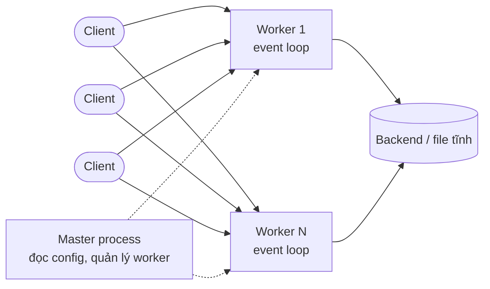

import Tabs from "@theme/Tabs";
import TabItem from "@theme/TabItem";
import LoadBalancerSimulator from "@site/src/components/LoadBalancerSimulator";

# Nginx

> **Quick reference:** [Nginx Cheatsheet](./nginx-cheatsheet.mdx)

Nginx là web server hiệu năng cao, đồng thời thường được dùng làm **reverse proxy**, **load balancer** và điểm kết thúc HTTPS (SSL termination) đứng trước các ứng dụng React, Next.js, Node.js hay Spring Boot.

:::info Dùng Nginx để

- Phục vụ file tĩnh (bản build của SPA) nhanh và nhẹ
- Đứng trước backend: định tuyến, ẩn port nội bộ, gắn header
- Phân phối tải giữa nhiều instance
- Quản lý HTTPS, security headers, nén, cache và rate limit tập trung

:::

## Kiến trúc hướng sự kiện

Thay vì tạo một tiến trình mới cho mỗi request, Nginx dùng một tiến trình `master` để đọc cấu hình và quản lý các tiến trình `worker`. Mỗi `worker` chạy một event loop bất đồng bộ, xử lý hàng nghìn kết nối đồng thời — nên tốn ít RAM và chịu tải tốt hơn mô hình process/thread-per-request.



## Reverse proxy theo loại ứng dụng

<Tabs groupId="app-type">
<TabItem value="react" label="React (Static)">

```nginx
server {
    listen 80;
    server_name your_react_app.com;

    root /var/www/your_react_app/build;
    index index.html;

    location / {
        try_files $uri $uri/ /index.html;
    }
}
```

Chỉ thị quan trọng là `try_files $uri $uri/ /index.html;`: mọi request không khớp file hoặc thư mục tĩnh sẽ trả về `index.html`, để React Router xử lý định tuyến phía client.

</TabItem>
<TabItem value="nextjs" label="Next.js (SSR)">

```nginx
server {
    listen 80;
    server_name your_nextjs_app.com;

    location / {
        proxy_pass http://localhost:3000;
        proxy_set_header Host $host;
        proxy_set_header X-Real-IP $remote_addr;
        proxy_set_header X-Forwarded-For $proxy_add_x_forwarded_for;
        proxy_set_header X-Forwarded-Proto $scheme;
    }
}
```

`proxy_pass` chuyển request đến server Next.js ở port 3000. Các `proxy_set_header` giúp backend biết thông tin thật của request gốc (host, IP client, giao thức).

</TabItem>
<TabItem value="nodejs" label="Node.js API">

```nginx
server {
    listen 80;
    server_name api.your_domain.com;

    location / {
        proxy_pass http://localhost:5000; # Port của API
        proxy_set_header Host $host;
        proxy_set_header X-Real-IP $remote_addr;
        proxy_set_header X-Forwarded-For $proxy_add_x_forwarded_for;
        proxy_set_header X-Forwarded-Proto $scheme;
    }
}
```

Nginx đóng vai trò cổng vào (gateway) cho API Node.js, nhờ đó tận dụng được SSL termination, rate limiting và caching của Nginx.

</TabItem>
<TabItem value="springboot" label="Spring Boot API">

```nginx
server {
    listen 80;
    server_name api.your_domain.com;

    location / {
        proxy_pass http://localhost:8080; # Port mặc định
        proxy_set_header Host $host;
        proxy_set_header X-Real-IP $remote_addr;
        proxy_set_header X-Forwarded-For $proxy_add_x_forwarded_for;
        proxy_set_header X-Forwarded-Proto $scheme;
    }
}
```

Chuyển request đến Spring Boot ở port 8080. Đặt `server.forward-headers-strategy=framework` để Spring đọc đúng các header `X-Forwarded-*`.

</TabItem>
</Tabs>

## Load balancing

Khai báo các instance trong một khối `upstream`, rồi trỏ `proxy_pass http://backend;` tới nó. Thuật toán được chọn bằng một chỉ thị trong `upstream`. Thử mô phỏng bên dưới: Server 3 xử lý chậm gấp 3 lần, hãy so sánh Round Robin với Least Connections.

<LoadBalancerSimulator />

| Thuật toán        | Chỉ thị          | Khi nào dùng                                                   |
| ----------------- | ---------------- | -------------------------------------------------------------- |
| Round Robin       | _(mặc định)_     | Các server cấu hình tương đương, request xử lý nhanh như nhau  |
| Least Connections | `least_conn;`    | Thời gian xử lý request chênh lệch nhiều                       |
| IP Hash           | `ip_hash;`       | Cần session persistence (session lưu trong bộ nhớ server)      |
| Weighted          | `server ... weight=3;` | Các server có cấu hình mạnh yếu khác nhau                |

:::tip

`ip_hash` chỉ dùng 3 octet đầu của IPv4, nên mọi client trong cùng dải `/24` (ví dụ sau cùng một NAT công ty) đều vào một server. Nếu cần chia đều hơn, dùng `hash $remote_addr consistent;` — hoặc tốt hơn là lưu session ở Redis để không cần sticky session.

:::

## Triển khai

| Cách triển khai          | Ưu điểm                                     | Nhược điểm                       |
| ------------------------ | ------------------------------------------- | -------------------------------- |
| Ubuntu Server (thủ công) | Kiểm soát hoàn toàn, tối ưu sâu ở mức OS    | Phức tạp, khó giữ nhất quán      |
| Docker (Dockerfile)      | Đóng gói Nginx + cấu hình, nhất quán, di động | Phải quản lý từng container riêng |
| Docker Compose           | Quản lý cả stack (frontend, backend, Nginx, DB) | Chỉ trên một host             |

Ví dụ một stack full-stack, trong đó Nginx là cổng vào duy nhất và định tuyến theo đường dẫn:

```yaml title="docker-compose.yml"
services:
  frontend:
    build: ./frontend
  backend:
    build: ./backend
  nginx:
    image: nginx:stable-alpine
    ports:
      - "80:80"
    volumes:
      - ./nginx.conf:/etc/nginx/conf.d/default.conf:ro
    depends_on:
      - frontend
      - backend
```

```nginx title="nginx.conf"
server {
    listen 80;

    location /api/ {
        proxy_pass http://backend:5000/;
    }

    location / {
        proxy_pass http://frontend:3000;
    }
}
```

Trong mạng của Compose, tên service (`frontend`, `backend`) chính là hostname, nên không cần IP. Chỉ có `nginx` mở port ra ngoài.

## Bảo mật

### HTTPS với Let's Encrypt

`certbot` tự động lấy chứng chỉ SSL miễn phí, sửa cấu hình Nginx và gia hạn định kỳ:

```bash
sudo certbot --nginx -d your_domain.com
```

Chuyển hướng toàn bộ traffic HTTP sang HTTPS:

```nginx
server {
    listen 80;
    server_name your_domain.com;
    return 301 https://$host$request_uri;
}
```

### HTTP security headers

```nginx
add_header Strict-Transport-Security "max-age=31536000; includeSubDomains" always; # Buộc dùng HTTPS
add_header X-Frame-Options "SAMEORIGIN" always;                                     # Chống clickjacking
add_header X-Content-Type-Options "nosniff" always;                                 # Chặn MIME sniffing
add_header Referrer-Policy "strict-origin-when-cross-origin" always;
```

:::warning

- Thiếu `always` thì header không được gửi kèm các response lỗi (4xx, 5xx).
- Nếu một `location` có `add_header` riêng, nó **không kế thừa** các `add_header` của khối cha — phải khai báo lại toàn bộ. Từ Nginx 1.29.3 (có trong bản stable 1.30) có thể dùng `add_header_inherit merge;` để gộp header của khối cha.

:::

## Tối ưu hiệu năng

| Kỹ thuật      | Chỉ thị                                     | Tác dụng                                          |
| ------------- | ------------------------------------------- | ------------------------------------------------- |
| Caching       | `proxy_cache_path`, `proxy_cache`           | Lưu response hay dùng, giảm tải backend           |
| Nén Gzip      | `gzip on;`, `gzip_types`                    | Giảm dung lượng HTML/CSS/JS, tải trang nhanh hơn  |
| Rate limiting | `limit_req_zone`, `limit_req`               | Chống brute-force và lạm dụng tài nguyên          |
| Worker        | `worker_processes`, `worker_connections`    | Tận dụng hết số lõi CPU và số kết nối đồng thời   |

```nginx title="nginx.conf"
worker_processes auto; # bằng số lõi CPU

events {
    worker_connections 1024;
}

http {
    gzip on;
    gzip_types text/css application/javascript application/json image/svg+xml; # text/html luôn được nén

    proxy_cache_path /var/cache/nginx levels=1:2 keys_zone=app_cache:10m max_size=1g inactive=60m;
    limit_req_zone $binary_remote_addr zone=api_limit:10m rate=10r/s;

    server {
        location /api/ {
            limit_req zone=api_limit burst=20 nodelay;
            proxy_cache app_cache;
            proxy_cache_valid 200 10m;
            proxy_pass http://backend;
        }
    }
}
```

## Công cụ quản lý

Cấu hình bằng file văn bản là đủ mạnh, nhưng giao diện đồ họa giúp quản lý dễ hơn khi mới bắt đầu hoặc có nhiều host.

| Công cụ                                                | Tốt nhất cho   | Ghi chú                                                         |
| ------------------------------------------------------ | -------------- | --------------------------------------------------------------- |
| [Nginx Proxy Manager](https://nginxproxymanager.com/)  | Quản lý proxy  | Web UI cho reverse proxy, tích hợp sẵn Let's Encrypt            |
| [Portainer](https://www.portainer.io/)                 | Quản lý Docker | Xem log, quản lý container, image, volume, network trực quan    |
| [Webmin](https://webmin.com/)                          | Quản trị server | Control panel cho Linux, có module Nginx, user, firewall…      |
