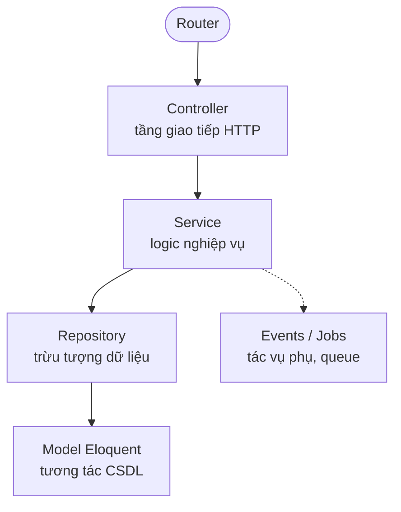
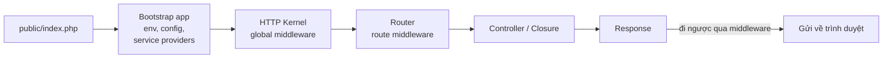
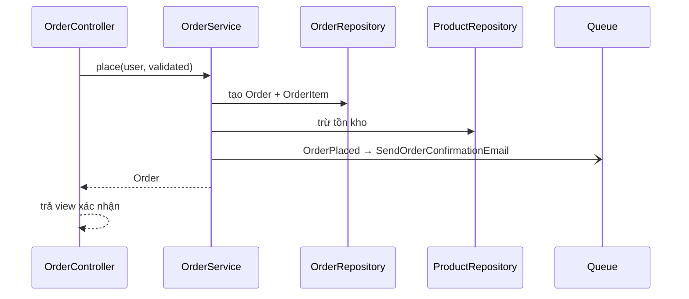
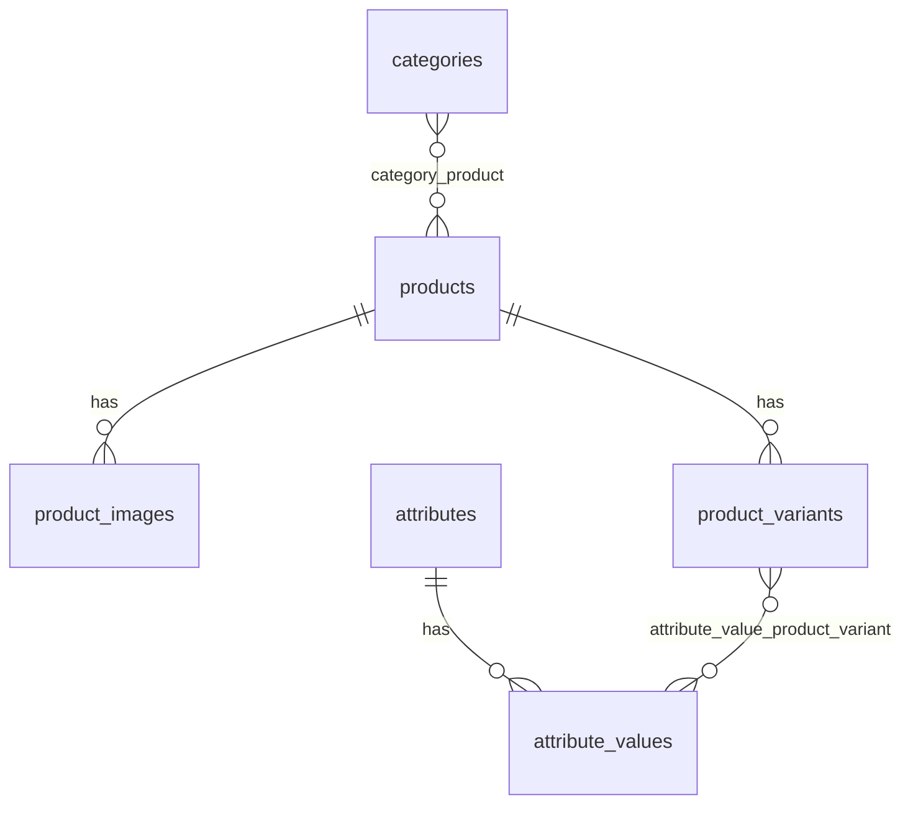

import Tabs from "@theme/Tabs";
import TabItem from "@theme/TabItem";

# Kiến trúc phân tầng trong Laravel

Laravel không bắt buộc cấu trúc nào ngoài MVC, nhưng các dự án lớn thường thêm tầng **Service** và **Repository** để tách logic nghiệp vụ khỏi HTTP và khỏi database. Trang này mô tả từng tầng, so sánh với Spring Boot và áp dụng vào một hệ thống thương mại điện tử.

:::info

Cài đặt, service container, migration, auth… đã có trong [Laravel Handbook](./index.mdx). Trang này tập trung vào cách tổ chức code.

:::

## Các tầng



| Tầng | Vai trò | Trách nhiệm | Nguyên tắc |
| --- | --- | --- | --- |
| **Controller** | Nhận HTTP request, trả HTTP response | Điều phối luồng, nhận dữ liệu đã validate (Form Request), gọi Service, trả View hoặc JSON | Giữ controller "mỏng", không chứa logic nghiệp vụ |
| **Service** | Đóng gói logic nghiệp vụ | Quy trình phức tạp (đặt hàng, khuyến mãi), điều phối nhiều Repository, gọi dịch vụ ngoài (thanh toán, vận chuyển) | Nơi logic nghiệp vụ "sống", tái sử dụng được từ controller, command, job |
| **Repository** | Lớp trừu tượng giữa nghiệp vụ và nguồn dữ liệu | Interface nhất quán (`find`, `create`, `update`), đóng gói truy vấn Eloquent phức tạp, dễ mock khi test | Tùy chọn — hữu ích cho dự án lớn, thừa với CRUD đơn giản |
| **Model** | Đại diện một bảng (Active Record) | Relationships (`hasMany`, `belongsTo`), `$fillable`/`$guarded`, accessors & mutators, local scopes, CRUD cơ bản | Chỉ chứa logic gắn với dữ liệu của chính nó |

### Ví dụ: đặt hàng

```php
// app/Http/Controllers/OrderController.php
class OrderController extends Controller
{
    public function __construct(private OrderService $orders) {}

    public function store(StoreOrderRequest $request)
    {
        $order = $this->orders->place($request->user(), $request->validated());

        return redirect()->route('orders.show', $order);
    }
}

// app/Services/OrderService.php
class OrderService
{
    public function __construct(
        private OrderRepository $orders,
        private ProductRepository $products,
    ) {}

    public function place(User $user, array $data): Order
    {
        $order = DB::transaction(function () use ($user, $data) {
            $order = $this->orders->createWithItems($user, $data['items']);
            $this->products->decrementStock($data['items']);

            return $order;
        });

        OrderPlaced::dispatch($order); // gửi email, thông báo… qua listener

        return $order;
    }
}
```

Service Container tự inject các dependency qua constructor. Nếu Repository là interface, bind nó trong một Service Provider:

```php
// app/Providers/AppServiceProvider.php
public function register(): void
{
    $this->app->bind(OrderRepository::class, EloquentOrderRepository::class);
}
```

## Luồng xử lý request



1. **`public/index.php`** — điểm vào duy nhất, nạp autoloader của Composer và tạo application.
2. **Bootstrap** — nạp `.env`, config, đăng ký rồi boot các Service Provider (Router, Database và provider của ứng dụng).
3. **HTTP Kernel** — bọc request thành đối tượng `Request`, cho đi qua global middleware.
4. **Router** — tìm route khớp URI và method, chạy middleware gắn với route.
5. **Controller / Closure** — xử lý, gọi Service/Model.
6. **Response** — View hoặc JSON, đi ngược qua chuỗi middleware rồi gửi về client.

Chi tiết từng bước: [Application Lifecycle](./index.mdx#25-application-lifecycle-deep-dive).

## So sánh với Spring Boot

| Thành phần | Laravel | Spring Boot |
| --- | --- | --- |
| Routing | File route tập trung (`routes/web.php`, `routes/api.php`), cú pháp fluent, Route Model Binding, Resource Controller | Annotation trên controller (`@GetMapping`, `@PostMapping`), phân tán theo từng controller |
| Middleware | Class PHP đơn giản, đăng ký trong `bootstrap/app.php` (`->withMiddleware()`, Laravel 11+) hoặc `app/Http/Kernel.php` (Laravel 10 trở xuống) | Servlet `Filter` và `HandlerInterceptor`, nhiều tầng hơn nhưng phức tạp hơn |
| Dependency Injection | Service Container, tự resolve theo type-hint (zero config), binding trong Service Provider | `ApplicationContext`, dựa trên annotation (`@Service`, constructor injection) |
| ORM | Eloquent — Active Record, model gắn với bảng (`$user->save()`) | Spring Data JPA — Repository pattern, entity là POJO, truy vấn qua repository interface |
| Validation | Form Request gói cả validation và authorization | Bean Validation (Jakarta Validation) với annotation trên DTO (`@NotNull`, `@Size`) |
| Template | Blade — cú pháp gần PHP, biên dịch và cache | Thymeleaf — "natural templating" (HTML hợp lệ), thuộc tính `th:*` |

## Áp dụng: thương mại điện tử

<Tabs groupId="ecommerce-feature">
<TabItem value="orders" label="Đơn hàng">



1. **Controller** nhận request từ trang checkout, dữ liệu đã validate bằng Form Request.
2. **OrderService** lấy giỏ hàng, tạo `Order` và `OrderItem` qua **OrderRepository**, trừ tồn kho qua **ProductRepository** — tất cả trong một transaction.
3. Service phát event **OrderPlaced**; listener `SendOrderConfirmationEmail` (implements `ShouldQueue`) gửi email qua queue.
4. Controller trả về view xác nhận đơn hàng.

**Gói đề xuất**

- Trạng thái đơn hàng: `spatie/laravel-model-states` (pending → processing → shipped…)
- Thanh toán: `laravel/cashier` (Stripe, chính chủ), `stripe/stripe-php`, `srmklive/laravel-paypal`
- Giỏ hàng: `gloudemans/shoppingcart`, hoặc tự xây bằng bảng `carts` / session

</TabItem>
<TabItem value="products" label="Sản phẩm">

- **CRUD sản phẩm & danh mục** — Resource Controller + Form Request.
- **Hình ảnh** — upload, resize, tạo thumbnail với `spatie/laravel-medialibrary`.
- **Biến thể** — thuộc tính (màu, size) và biến thể cụ thể (áo đỏ size M) có SKU và tồn kho riêng, cần thiết kế bảng cẩn thận:



- **Admin panel** — dùng [Filament](https://filamentphp.com/) hoặc [Laravel Nova](https://nova.laravel.com/) để dựng nhanh giao diện CRUD cho sản phẩm, danh mục, đơn hàng.

</TabItem>
<TabItem value="users" label="Người dùng">

**Xác thực**

- Từ Laravel 12: starter kit mới cho React, Vue hoặc Livewire (Breeze và Jetstream không còn được phát triển thêm).
- Laravel 11 trở xuống: **Breeze** (tối giản, Blade) hoặc **Jetstream** (Livewire/Inertia, 2FA, team).
- **Sanctum** — token/cookie auth cho SPA và ứng dụng di động.

**Phân quyền**

- **Gates & Policies** — có sẵn, hợp với quy tắc đơn giản hoặc theo từng model.
- **`spatie/laravel-permission`** — RBAC có cấu trúc (role `admin`, `customer`; permission `manage products`).

```php
// Chỉ admin hoặc người có quyền "manage products" vào được trang quản lý sản phẩm
// (alias `permission` của spatie phải được đăng ký trong bootstrap/app.php)
Route::middleware(['auth', 'permission:manage products'])
    ->resource('admin/products', Admin\ProductController::class);
```

</TabItem>
</Tabs>

## Thực tiễn tốt

| Thực tiễn | Vì sao | Ví dụ |
| --- | --- | --- |
| Eager loading | Tránh N+1 query khi duyệt quan hệ | `Order::with('items.product')->get()` |
| Queue cho tác vụ dài | Gửi email, xử lý ảnh không làm chậm response | `class SendOrderConfirmationEmail implements ShouldQueue` |
| Validation qua Form Request | Gói validation + authorization, controller gọn | `php artisan make:request StoreOrderRequest` |
| Events & Listeners | Tách tác vụ phụ (thông báo, tồn kho) khỏi luồng chính | `OrderPlaced::dispatch($order)` |
| Cache có chủ đích | Giảm truy vấn tốn kém hoặc dữ liệu ít đổi | `Cache::remember('categories', 3600, fn () => Category::all())` |
| Viết test | Giữ chất lượng và ổn định khi refactor | Feature test cho luồng đặt hàng, unit test cho Service |

:::tip

Bật `Model::preventLazyLoading(! app()->isProduction());` trong `AppServiceProvider::boot()` để Laravel báo lỗi ngay khi có lazy loading (dấu hiệu N+1) trong môi trường dev.

:::
