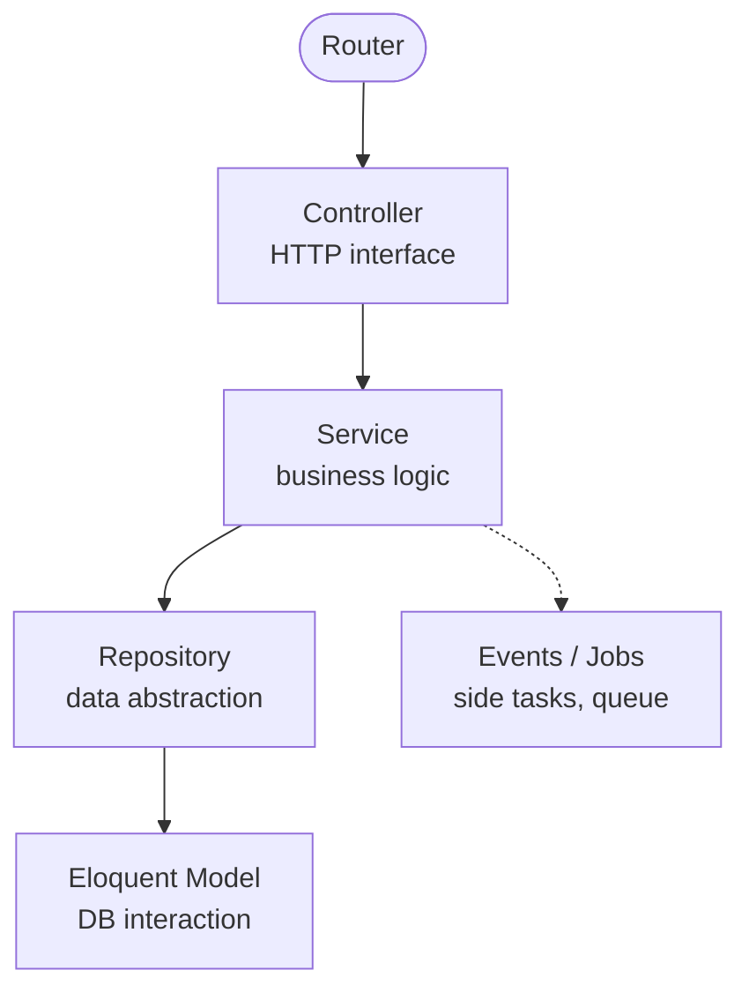
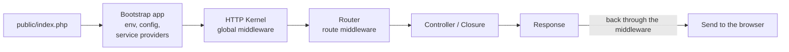
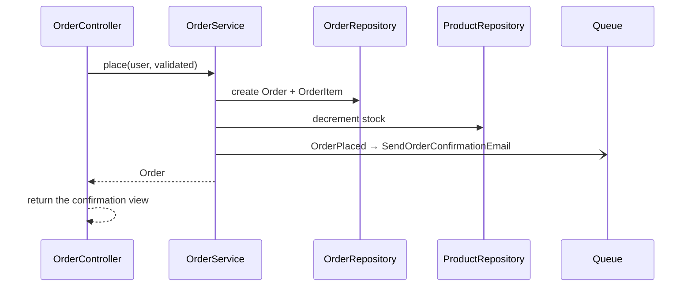
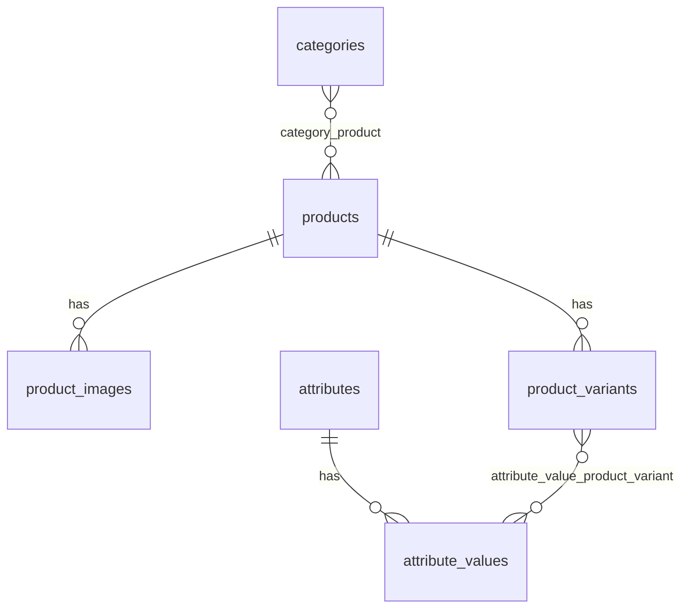

import Tabs from "@theme/Tabs";
import TabItem from "@theme/TabItem";

# Layered architecture in Laravel

Laravel does not require any structure beyond MVC, but large projects usually add a **Service** layer and a **Repository** layer to separate business logic from HTTP and from the database. This page describes each layer, compares it with Spring Boot, and applies it to an e-commerce system.

:::info

Setup, the service container, migrations, auth, and the rest are already in the [Laravel Handbook](./index.mdx). This page focuses on how the code is organized.

:::

## The layers



| Layer | Role | Responsibility | Principle |
| --- | --- | --- | --- |
| **Controller** | Receive the HTTP request, return the HTTP response | Orchestrate the flow, take data that is already validated (Form Request), call the Service, return a View or JSON | Keep the controller "thin", with no business logic |
| **Service** | Wrap the business logic | Complex processes (placing an order, promotions), coordinate several Repositories, call outside services (payment, shipping) | Where business logic "lives", reusable from a controller, a command, or a job |
| **Repository** | The abstraction between the business logic and the data source | A consistent interface (`find`, `create`, `update`), wrap complex Eloquent queries, easy to mock in tests | Optional — useful on a large project, overkill for simple CRUD |
| **Model** | Represents one table (Active Record) | Relationships (`hasMany`, `belongsTo`), `$fillable`/`$guarded`, accessors and mutators, local scopes, basic CRUD | Holds only logic tied to its own data |

### Example: placing an order

```php
// app/Http/Controllers/OrderController.php
class OrderController extends Controller
{
    public function __construct(private OrderService $orders) {}

    public function store(StoreOrderRequest $request)
    {
        $order = $this->orders->place($request->user(), $request->validated());

        return redirect()->route('orders.show', $order);
    }
}

// app/Services/OrderService.php
class OrderService
{
    public function __construct(
        private OrderRepository $orders,
        private ProductRepository $products,
    ) {}

    public function place(User $user, array $data): Order
    {
        $order = DB::transaction(function () use ($user, $data) {
            $order = $this->orders->createWithItems($user, $data['items']);
            $this->products->decrementStock($data['items']);

            return $order;
        });

        OrderPlaced::dispatch($order); // send the email, notifications… through a listener

        return $order;
    }
}
```

The Service Container injects the dependencies through the constructor on its own. If the Repository is an interface, bind it in a Service Provider:

```php
// app/Providers/AppServiceProvider.php
public function register(): void
{
    $this->app->bind(OrderRepository::class, EloquentOrderRepository::class);
}
```

## Request-handling flow



1. **`public/index.php`** — the only entry point; it loads Composer's autoloader and creates the application.
2. **Bootstrap** — loads `.env` and config, then registers and boots the Service Providers (Router, Database, and the application's providers).
3. **HTTP Kernel** — wraps the request as a `Request` object and passes it through the global middleware.
4. **Router** — finds the route that matches the URI and method, and runs the middleware attached to that route.
5. **Controller / Closure** — handles the request, and calls a Service or Model.
6. **Response** — a View or JSON; it goes back through the middleware chain, then is sent to the client.

Step by step: [Application Lifecycle](./index.mdx#25-application-lifecycle-deep-dive).

## Comparison with Spring Boot

| Piece | Laravel | Spring Boot |
| --- | --- | --- |
| Routing | Central route files (`routes/web.php`, `routes/api.php`), fluent syntax, Route Model Binding, Resource Controller | Annotations on the controller (`@GetMapping`, `@PostMapping`), spread across each controller |
| Middleware | A simple PHP class, registered in `bootstrap/app.php` (`->withMiddleware()`, Laravel 11+) or `app/Http/Kernel.php` (Laravel 10 and earlier) | Servlet `Filter` and `HandlerInterceptor`; more layers, but more complex |
| Dependency Injection | Service Container, auto-resolves from the type-hint (zero config), bindings in a Service Provider | `ApplicationContext`, based on annotations (`@Service`, constructor injection) |
| ORM | Eloquent — Active Record; the model is tied to the table (`$user->save()`) | Spring Data JPA — Repository pattern; the entity is a POJO, queries go through a repository interface |
| Validation | A Form Request packages both validation and authorization | Bean Validation (Jakarta Validation) with annotations on the DTO (`@NotNull`, `@Size`) |
| Template | Blade — syntax close to PHP, compiled and cached | Thymeleaf — "natural templating" (valid HTML), `th:*` attributes |

## Applied: e-commerce

<Tabs groupId="ecommerce-feature">
<TabItem value="orders" label="Orders">



1. The **Controller** receives the request from the checkout page; the data is already validated by a Form Request.
2. **OrderService** gets the cart, creates `Order` and `OrderItem` through **OrderRepository**, and decrements stock through **ProductRepository** — all inside one transaction.
3. The service fires the **OrderPlaced** event; the `SendOrderConfirmationEmail` listener (implements `ShouldQueue`) sends the email through the queue.
4. The controller returns the order-confirmation view.

**Suggested packages**

- Order status: `spatie/laravel-model-states` (pending → processing → shipped…)
- Payments: `laravel/cashier` (Stripe, official), `stripe/stripe-php`, `srmklive/laravel-paypal`
- Cart: `gloudemans/shoppingcart`, or build your own with a `carts` table / session

</TabItem>
<TabItem value="products" label="Products">

- **Product and category CRUD** — Resource Controller + Form Request.
- **Images** — upload, resize, and create thumbnails with `spatie/laravel-medialibrary`.
- **Variants** — attributes (color, size) and a concrete variant (a red shirt, size M) with its own SKU and stock; the tables need a careful design:



- **Admin panel** — use [Filament](https://filamentphp.com/) or [Laravel Nova](https://nova.laravel.com/) to put up a CRUD UI quickly for products, categories, and orders.

</TabItem>
<TabItem value="users" label="Users">

**Authentication**

- From Laravel 12: new starter kits for React, Vue, or Livewire (Breeze and Jetstream are no longer developed further).
- Laravel 11 and earlier: **Breeze** (minimal, Blade) or **Jetstream** (Livewire/Inertia, 2FA, teams).
- **Sanctum** — token/cookie auth for an SPA and a mobile app.

**Authorization**

- **Gates & Policies** — built in; a fit for simple rules, or for rules per model.
- **`spatie/laravel-permission`** — structured RBAC (roles `admin`, `customer`; permission `manage products`).

```php
// Only an admin, or someone with the "manage products" permission, can open the product admin pages
// (spatie's `permission` alias must be registered in bootstrap/app.php)
Route::middleware(['auth', 'permission:manage products'])
    ->resource('admin/products', Admin\ProductController::class);
```

</TabItem>
</Tabs>

## Good practices

| Practice | Why | Example |
| --- | --- | --- |
| Eager loading | Avoid an N+1 query when walking a relationship | `Order::with('items.product')->get()` |
| Queue long-running tasks | Sending email or processing images should not slow the response | `class SendOrderConfirmationEmail implements ShouldQueue` |
| Validation through a Form Request | Packages validation and authorization, and keeps the controller small | `php artisan make:request StoreOrderRequest` |
| Events and Listeners | Pull side tasks (notifications, stock) out of the main flow | `OrderPlaced::dispatch($order)` |
| Cache on purpose | Cut an expensive query, or data that rarely changes | `Cache::remember('categories', 3600, fn () => Category::all())` |
| Write tests | Keep quality and stability when you refactor | A feature test for the order flow, a unit test for the Service |

:::tip

Turn on `Model::preventLazyLoading(! app()->isProduction());` in `AppServiceProvider::boot()` so Laravel errors immediately when there is lazy loading (a sign of N+1) in dev.

:::
