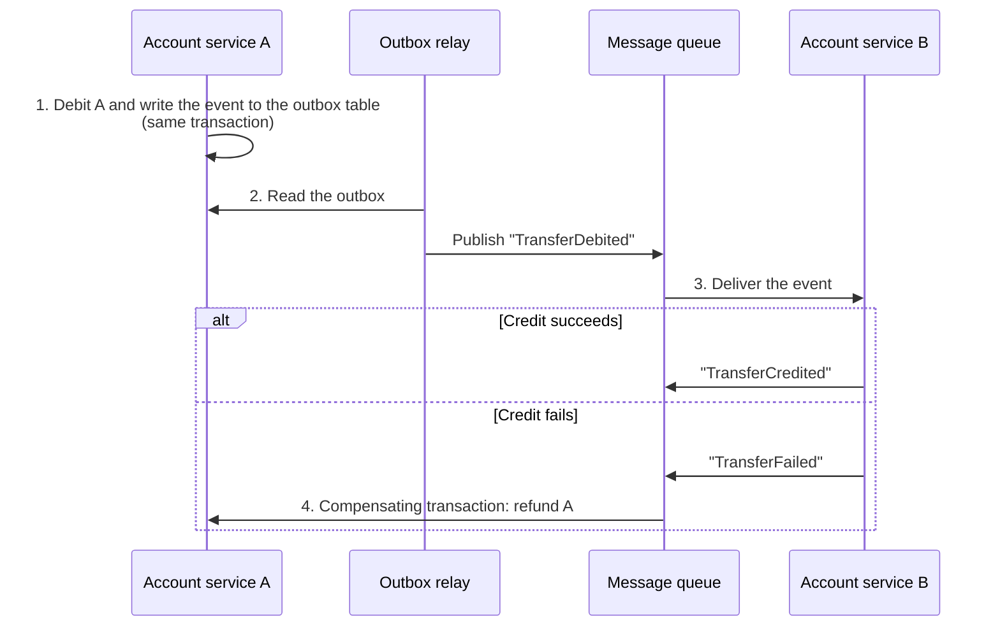
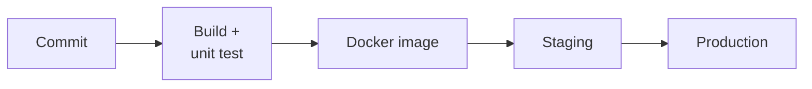

import Tabs from "@theme/Tabs";
import TabItem from "@theme/TabItem";

A learning project that builds a banking app with **React + Spring Boot**, from a monolith to microservices across 3 phases. Banking is a good topic for the hardest parts of backend work: money movement has to be exactly right, security has several layers, and data has to stay consistent once the system is split apart.


## Three-phase roadmap

| | Phase 1: Monolith core | Phase 2: Features and security | Phase 3: Microservices |
| --- | --- | --- | --- |
| **Architecture** | Modular monolith | Modular monolith | Microservices |
| **Features** | Sign-up, sign-in, OTP, internal transfers, transaction history | Simple KYC, financial reports, account management | Interbank transfers (simulated), asynchronous notifications |
| **Security** | Password hashing, JWT, HTTPS | CSRF/XSS protection, data encryption (AES), CSP | Service-to-service authentication |
| **Data** | ACID transactions | Fake data for testing | Retry, transactional outbox, saga; event sourcing (optional) |
| **DevOps** | Docker, Docker Compose | CI/CD with GitHub Actions, a staging environment | Centralized logging and monitoring (ELK, Prometheus) |
| **What you learn** | Integrating React with Spring Boot, ACID transactions, Docker | Web security, CI/CD, generating fake data | Microservice design, message queues, observing a distributed system |

A modular monolith in phases 1–2 keeps the focus on the domain first; clear module boundaries make the split into services in phase 3 easier. When to split, and what it costs: see [Microservices architecture](/docs/key-notes/microservices/).

## Suggested stack

| Component | Choice | Why |
| --- | --- | --- |
| Backend | Spring Boot | A strong ecosystem for financial work: Spring Security, `@Transactional`, validation |
| Frontend | React | A fast interactive SPA; it escapes content by default, which lowers XSS risk |
| Database | **PostgreSQL** | ACID transactions, row locks, constraints (`CHECK balance >= 0`, foreign keys) — what a ledger needs |
| Containers | Docker, Docker Compose | The same environment from a dev machine to production |
| Message queue | RabbitMQ or Kafka | Asynchronous communication, decoupling services, background work such as sending notifications |

:::note

The original proposal suggested MongoDB. MongoDB does support multi-document transactions, but for a ledger — where you need strict constraints and aggregate queries — a relational database is the safer default.

:::

## Core features

| Feature | Backend (Spring Boot) | Frontend (React) |
| --- | --- | --- |
| **Sign-up, sign-in, OTP** | Sign-up and sign-in APIs, password hashing, creating and checking OTPs, issuing JWTs | Sign-up, sign-in, and OTP forms; signed-in state |
| **Accounts and history** | Account-info API; transaction history with pagination and filters | Account list and detail; a history table that can be filtered and sorted |
| **Transfers and reports** | Transfer API inside one ACID transaction; an aggregation API for reports | Transfer form with a confirmation step; reports as charts and tables |

An OTP should expire quickly (a few minutes), be single-use, cap the number of wrong attempts, and be stored on the server only as a hash.

## Security

| Layer | Measures |
| --- | --- |
| **Authentication and authorization** | JWT for a stateless API, stored in an `HttpOnly`, `Secure`, `SameSite` cookie; OAuth2 when sign-in goes through a third party |
| **Passwords** | Never store them in plain text; hash with Argon2id or bcrypt (each user already gets their own salt) |
| **Encryption in transit** | TLS/HTTPS for every connection |
| **Encryption at rest** | Encrypt sensitive data (PII) with AES-256-GCM; the key lives in a secret manager or KMS, not in code and not in the same database |
| **CSRF** | Required when the JWT is in a cookie: Spring Security's CSRF token plus a `SameSite` cookie |
| **XSS** | Validate and sanitize input, rely on React's escaping (avoid `dangerouslySetInnerHTML`), and turn on a Content Security Policy |

## Transactions and data consistency

<Tabs groupId="banking-arch">
<TabItem value="monolith" label="Monolith: ACID transactions">

Inside one database, a transfer is **all or nothing**: debit A and credit B commit together, and a failure at any step rolls the whole thing back.

```java title="TransferService.java"
@Transactional
public Transfer transfer(UUID fromId, UUID toId, BigDecimal amount, String idempotencyKey) {
    // A repeated request (flaky network, the user clicks twice) returns the previous result
    var existing = transfers.findByIdempotencyKey(idempotencyKey);
    if (existing.isPresent()) return existing.get();

    // Lock the two rows in a fixed id order to avoid a deadlock
    var first = fromId.compareTo(toId) < 0 ? fromId : toId;
    var second = first.equals(fromId) ? toId : fromId;
    accounts.findByIdForUpdate(first);  // SELECT ... FOR UPDATE
    accounts.findByIdForUpdate(second);

    var from = accounts.getReferenceById(fromId);
    var to = accounts.getReferenceById(toId);
    if (from.getBalance().compareTo(amount) < 0) throw new InsufficientFundsException();

    from.debit(amount);
    to.credit(amount);
    return transfers.save(new Transfer(fromId, toId, amount, idempotencyKey));
}
```

- Store money as `BigDecimal` (or as an integer in the smallest unit). **Do not use `double`.**
- `idempotencyKey` has a `UNIQUE` constraint in the database, so two identical requests do not create two transfers.
- Better still: double-entry bookkeeping — each transfer writes one debit line and one credit line, and the balance is the sum of the lines.

</TabItem>
<TabItem value="microservices" label="Microservices: outbox + saga">

When account A and account B belong to two services with two databases, there is no shared transaction. Use a **transactional outbox** so events are not lost, and a **saga** to undo the work on failure:



1. Service A debits the account and writes the event to the `outbox` table **in the same transaction** — both are stored, or neither is.
2. A relay process (or CDC such as Debezium) reads the outbox and publishes to the message queue, retrying until it succeeds.
3. Service B receives the event and applies the credit.
4. If B fails, it publishes a failure event; A runs a **compensating transaction** to refund the money (a saga).

The queue delivers **at least once**, so the consumer must be **idempotent**: store the ids of events already handled and skip duplicates.

</TabItem>
</Tabs>

## DevOps and testing



| Area | Tool | Purpose |
| --- | --- | --- |
| CI/CD | GitHub Actions | Automatically build, test, package, and deploy |
| Monitoring | Prometheus + Grafana | CPU, memory, request latency, error rate |
| Logging | ELK stack or Loki | Centralized logs for diagnosing incidents |
| Sandbox | A separate staging environment | Try new features without affecting dev or production |
| API mocks | WireMock, Postman mock server | Simulate third-party APIs (payment gateways, other banks) |
| Fake data | Datafaker (Java), Faker.js | Realistic data covering many test scenarios |

When you deploy to a VPS: see [Ubuntu server setup](/docs/devops/vps/ubuntu-server-setup/).
