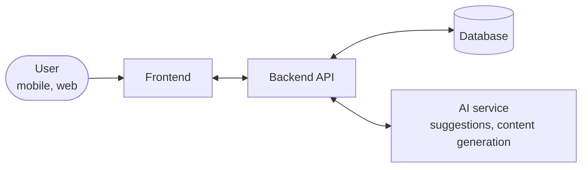
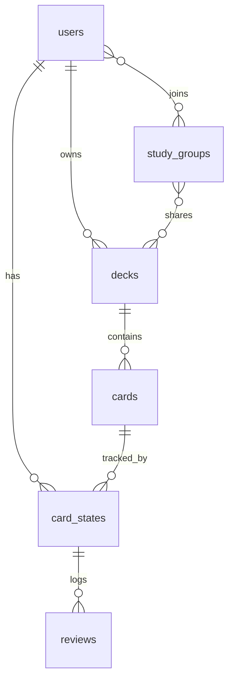

**Fluxlingo** is a blueprint for a next-generation language-learning app: flashcards with **spaced repetition** at the core, then AI personalization, social features, and a minimal interface — so study stays effective and compelling enough that people come back every day.


## Market context

| App | Strengths | Opportunity for Fluxlingo |
| --- | --- | --- |
| **Anki** | A very effective SRS algorithm, deep customization | A UI/UX that is friendly to beginners; seamless AI integration |
| **Memrise** | Native-speaker videos, gamification | Tests generated from study history; community features and group study |
| **Quizlet** | A huge library of user-created content, many study modes | An AI-personalized path instead of relying only on existing content; a leaderboard |
| **Duolingo** | Market-leading gamification, very engaging | Deeper customization of study sets, sharing personal flashcard decks, focused study groups |
| **Drops** | Visual vocabulary, 5-minute lessons | Extend it to grammar and tests, cross-platform sync, and social features |

**Positioning:** Anki's SRS strength + Duolingo's appeal + Quizlet's personal content, in an interface that is easy to use.

## Core: spaced repetition

Each card is reviewed just before the learner is about to forget it. A correct answer lengthens the gap until the next review; a miss sends the card back to a short gap. The classic algorithm is **SM-2**:

```ts title="sm2.ts"
type CardState = { repetitions: number; intervalDays: number; easeFactor: number };

// grade: 0 (total blackout) … 5 (recalled at once)
export function review(card: CardState, grade: number): CardState {
  if (grade < 3) return { ...card, repetitions: 0, intervalDays: 1 };

  const repetitions = card.repetitions + 1;
  const intervalDays =
    repetitions === 1 ? 1 : repetitions === 2 ? 6 : Math.round(card.intervalDays * card.easeFactor);
  const easeFactor = Math.max(1.3, card.easeFactor + 0.1 - (5 - grade) * (0.08 + (5 - grade) * 0.02));

  return { repetitions, intervalDays, easeFactor };
}
```

A new card starts with `easeFactor = 2.5`. Once there is review data, you can move to **FSRS** — the algorithm Anki has used by default since version 23.10. It learns its parameters from that user's own history and predicts more accurately. This is also where "AI personalization" has the most real value.

## Features

| Feature | Description | Phase |
| --- | --- | --- |
| 🔁 **SRS review** | Decks, a daily review session, a schedule driven by the algorithm | MVP |
| 🔄 **Sync** | Save progress on the server, sync up to 3 devices | MVP |
| 📝 **Generated tests** | Build a test from study history, focused on cards the learner often misses | After MVP |
| 🎯 **AI personalization** | An adaptive path, difficulty adjustment, content suggestions | After MVP |
| 🤖 **AI-generated material** | Generate flashcard decks and new example sentences | After MVP |
| 👥 **Group study** | Create a group, share decks, discuss | After MVP |
| 🏆 **Leaderboard** | Compete with friends and the community | After MVP |

AI-generated content needs a look from the user before it goes into a deck — a grammatically wrong example sentence will be reviewed over and over.

## Design

| Principle | How |
| --- | --- |
| 🎨 Minimal | The review screen shows only the card and the grade buttons; remove anything that distracts |
| 📱 Personalized interface | Custom theme, font, and font size |
| ✨ Subtle motion | Card flip and smooth transitions between cards; respect `prefers-reduced-motion` |
| 🌗 Light / dark | Follow the system, with a manual switch — learners often review at night |

## Architecture



A review session should run **offline**: keep a queue of review results on the device and sync when the network is back. The schedule is recomputed from review history, so conflicts between devices are not a concern.

### Data model



- `card_states`: one user's SRS state for one card (`interval`, `ease_factor`, `due_at`) — kept separate from `cards` so many people can study the same deck.
- `reviews`: one review (grade, response time) — the input for generated tests, statistics, and FSRS.
- The most important query is "cards due today": index `(user_id, due_at)`.
