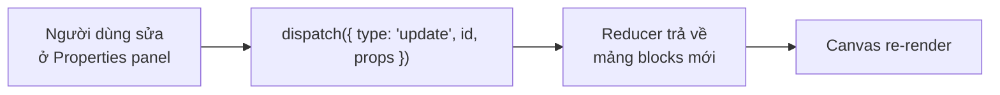
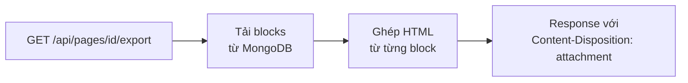

import ProjectStructureExplorer from "@site/src/components/ProjectStructureExplorer";

Một dự án full-stack vừa sức cho **Junior developer** trong 2–4 tuần: công cụ kéo-thả để tạo landing page (lấy cảm hứng từ Carrd), có live preview, lưu trang vào database, thu thập dữ liệu form và xuất ra file HTML tĩnh. Sơ đồ luồng chi tiết của dự án nằm ở trang [Landing Pages Workflows](./workflows.mdx).


## Công nghệ

| Phần | Lựa chọn |
| --- | --- |
| Frontend & backend | Next.js (App Router: Route Handlers, Server Actions) |
| Styling | Tailwind CSS |
| State | React Context + `useReducer` |
| Kéo-thả | dnd-kit |
| Database | MongoDB (Mongoose) |
| Xác thực | Auth.js (NextAuth) |
| Deploy | Vercel, MongoDB Atlas |

Một repo Next.js duy nhất chứa cả giao diện lẫn API — full-stack monolith, dễ quản lý cho một người.

## Lộ trình 4 tuần

| Tuần | Trọng tâm | Mục tiêu |
| --- | --- | --- |
| **1** | Thiết lập & giao diện | Khởi tạo Next.js + Tailwind; layout chính (header, sidebar, canvas); các block tĩnh (`TextBlock`, `ImageBlock`…); nắm cấu trúc thư mục |
| **2** | Trình chỉnh sửa & live preview | State bằng Context; kéo block từ sidebar vào canvas; panel thuộc tính để sửa block; preview cập nhật tức thì |
| **3** | Backend, lưu trữ & form | Schema MongoDB; API CRUD cho trang; lưu/tải trang; API nhận dữ liệu form |
| **4** | Hoàn thiện | Xuất HTML/CSS; responsive cho cả tool và trang được tạo; thông báo, README; deploy lên Vercel |

## Cấu trúc thư mục

Nhấn vào từng mục để xem vai trò của nó.

<ProjectStructureExplorer
  initialSelectedId="contexts/PageContext.tsx"
  nodes={[
    {
      id: "app",
      label: "app/",
      isFolder: true,
      description: "Routing của App Router: trang giao diện và API cùng một chỗ.",
      children: [
        { id: "app/page.tsx", label: "page.tsx", description: "Trang chủ: danh sách landing page của người dùng." },
        {
          id: "app/editor",
          label: "editor/[pageId]/",
          isFolder: true,
          description: "Trình chỉnh sửa một trang.",
          children: [{ id: "app/editor/page", label: "page.tsx", description: "Ghép sidebar, canvas và panel thuộc tính." }],
        },
        {
          id: "app/p",
          label: "p/[slug]/",
          isFolder: true,
          description: "Trang đã xuất bản, render từ dữ liệu block trong database.",
          children: [{ id: "app/p/page", label: "page.tsx", description: "Render trang công khai." }],
        },
        {
          id: "app/api",
          label: "api/",
          isFolder: true,
          description: "Route Handlers — toàn bộ backend.",
          children: [
            { id: "app/api/pages", label: "pages/[id]/route.ts", description: "CRUD trang (GET, PUT, DELETE), kiểm tra quyền sở hữu." },
            { id: "app/api/export", label: "pages/[id]/export/route.ts", description: "Trả về file HTML tĩnh để tải xuống." },
            { id: "app/api/leads", label: "leads/route.ts", description: "Endpoint công khai nhận dữ liệu form từ trang đã xuất bản." },
          ],
        },
      ],
    },
    {
      id: "components",
      label: "components/",
      isFolder: true,
      description: "Các thành phần giao diện.",
      children: [
        { id: "components/blocks", label: "blocks/", isFolder: true, description: "Khối xây trang: TextBlock, ImageBlock, FormBlock… Mỗi block có phần render và phần chỉnh thuộc tính." },
        { id: "components/layout", label: "layout/", isFolder: true, description: "Khung trình chỉnh sửa: Header, Sidebar, Canvas, PropertiesPanel." },
        { id: "components/ui", label: "ui/", isFolder: true, description: "Thành phần nhỏ tái sử dụng: Button, Input." },
      ],
    },
    {
      id: "contexts",
      label: "contexts/",
      isFolder: true,
      description: "State toàn cục.",
      children: [{ id: "contexts/PageContext.tsx", label: "PageContext.tsx", description: "Nguồn sự thật duy nhất cho danh sách block của trang đang sửa (Context + useReducer)." }],
    },
    {
      id: "lib",
      label: "lib/",
      isFolder: true,
      description: "Kết nối DB và hàm tiện ích.",
      children: [
        { id: "lib/db.ts", label: "db.ts", description: "Kết nối Mongoose, cache connection giữa các lần gọi serverless." },
        { id: "lib/export.ts", label: "export.ts", description: "Chuyển danh sách block thành chuỗi HTML, có escape nội dung." },
      ],
    },
    {
      id: "models",
      label: "models/",
      isFolder: true,
      description: "Schema MongoDB.",
      children: [
        { id: "models/LandingPage.ts", label: "LandingPage.ts", description: "Trang: chủ sở hữu, tiêu đề, slug, mảng block, trạng thái xuất bản." },
        { id: "models/Lead.ts", label: "Lead.ts", description: "Dữ liệu một lần gửi form, gắn với trang." },
      ],
    },
    { id: ".env.local", label: ".env.local", description: "MONGODB_URI, AUTH_SECRET… Không commit file này." },
  ]}
/>

## Khái niệm kỹ thuật cốt lõi

### Mô hình dữ liệu: trang là một mảng block

```ts title="types.ts"
type Block =
  | { id: string; type: "text"; props: { text: string; align: "left" | "center" } }
  | { id: string; type: "image"; props: { src: string; alt: string } }
  | { id: string; type: "form"; props: { fields: string[]; buttonLabel: string } };

type LandingPage = { pageId: string; ownerId: string; title: string; slug: string; blocks: Block[]; published: boolean };
```

Editor, trang công khai và file xuất đều render từ **cùng một mảng `blocks`** — chỉ cần lưu JSON này vào MongoDB.

### Live preview



Reducer luôn trả về **object mới** (không sửa trực tiếp state) để React nhận ra thay đổi. Bọc từng block bằng `React.memo` để chỉ block vừa sửa render lại — quan trọng khi trang có nhiều block.

### Xuất HTML



Cách đơn giản và chạy được trong Route Handler: mỗi loại block có một hàm trả về chuỗi HTML.

```ts title="lib/export.ts"
const escapeHtml = (s: string) =>
  s.replace(/[&<>"']/g, (c) => ({ "&": "&amp;", "<": "&lt;", ">": "&gt;", '"': "&quot;", "'": "&#39;" })[c]!);

const renderBlock = (block: Block): string => {
  switch (block.type) {
    case "text":
      return `<p style="text-align:${block.props.align}">${escapeHtml(block.props.text)}</p>`;
    case "image":
      return ``;
    case "form":
      return `<form>${block.props.fields.map((f) => `<input name="${escapeHtml(f)}" placeholder="${escapeHtml(f)}">`).join("")}<button>${escapeHtml(block.props.buttonLabel)}</button></form>`;
  }
};
```

:::warning

Nội dung trong block do người dùng nhập — **luôn escape** khi ghép HTML, nếu không trang xuất ra sẽ chứa XSS. Với ảnh, chỉ chấp nhận URL `https:`. File xuất cần kèm một stylesheet nhỏ viết sẵn, vì class Tailwind chỉ có tác dụng khi có file CSS đã build.

:::

## Triển khai và thực hành tốt

| Thực hành | Chi tiết |
| --- | --- |
| Chia nhỏ component | Mỗi block một file; giữ component nhỏ, dễ tái sử dụng |
| Hiệu năng | `React.memo`, `useCallback` để tránh render thừa; đo bằng React Profiler |
| Code sạch | TypeScript, ESLint, Prettier |
| Bảo mật API | Kiểm tra người dùng có sở hữu trang trước khi sửa/xóa; validate input ở server (ví dụ zod); session trong cookie `HttpOnly` |
| Endpoint form công khai | Validate, giới hạn kích thước và tần suất gửi, thêm honeypot chống spam |
| README | Mô tả, ảnh chụp, cách cài đặt, chạy local và deploy |
| Deploy | Vercel cho Next.js, MongoDB Atlas cho database; biến môi trường đặt trên Vercel |

Khi đưa dự án vào CV: xem [Dự án cá nhân cho Junior](/docs/key-notes/interviews/personal-project/) — ví dụ trong đó chính là dự án này.
