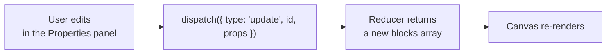
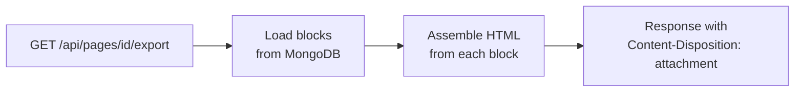

import ProjectStructureExplorer from "@site/src/components/ProjectStructureExplorer";

A full-stack project a **junior developer** can finish in 2–4 weeks: a drag-and-drop tool for building landing pages (inspired by Carrd), with live preview, pages saved in a database, form-data collection, and export to a static HTML file. Detailed flow diagrams are on [Landing Pages Workflows](./workflows.mdx).


## Stack

| Part | Choice |
| --- | --- |
| Frontend and backend | Next.js (App Router: Route Handlers, Server Actions) |
| Styling | Tailwind CSS |
| State | React Context + `useReducer` |
| Drag and drop | dnd-kit |
| Database | MongoDB (Mongoose) |
| Authentication | Auth.js (NextAuth) |
| Deploy | Vercel, MongoDB Atlas |

One Next.js repo holds both the UI and the API — a full-stack monolith, manageable for one person.

## Four-week roadmap

| Week | Focus | Goal |
| --- | --- | --- |
| **1** | Setup and UI | Scaffold Next.js + Tailwind; the main layout (header, sidebar, canvas); static blocks (`TextBlock`, `ImageBlock`…); get used to the folder structure |
| **2** | Editor and live preview | State with Context; drag a block from the sidebar onto the canvas; a properties panel to edit the block; the preview updates immediately |
| **3** | Backend, storage, and forms | MongoDB schema; a CRUD API for pages; save and load a page; an API that receives form data |
| **4** | Finish | Export HTML/CSS; responsive layout for both the tool and the pages it creates; notifications, a README; deploy to Vercel |

## Folder structure

Click an item to see what it is for.

<ProjectStructureExplorer
  initialSelectedId="contexts/PageContext.tsx"
  nodes={[
    {
      id: "app",
      label: "app/",
      isFolder: true,
      description: "App Router routing: UI pages and the API in one place.",
      children: [
        { id: "app/page.tsx", label: "page.tsx", description: "Home page: the user's list of landing pages." },
        {
          id: "app/editor",
          label: "editor/[pageId]/",
          isFolder: true,
          description: "The editor for one page.",
          children: [{ id: "app/editor/page", label: "page.tsx", description: "Composes the sidebar, canvas, and properties panel." }],
        },
        {
          id: "app/p",
          label: "p/[slug]/",
          isFolder: true,
          description: "The published page, rendered from block data in the database.",
          children: [{ id: "app/p/page", label: "page.tsx", description: "Renders the public page." }],
        },
        {
          id: "app/api",
          label: "api/",
          isFolder: true,
          description: "Route Handlers — the whole backend.",
          children: [
            { id: "app/api/pages", label: "pages/[id]/route.ts", description: "Page CRUD (GET, PUT, DELETE), with an ownership check." },
            { id: "app/api/export", label: "pages/[id]/export/route.ts", description: "Returns a static HTML file to download." },
            { id: "app/api/leads", label: "leads/route.ts", description: "Public endpoint that receives form data from a published page." },
          ],
        },
      ],
    },
    {
      id: "components",
      label: "components/",
      isFolder: true,
      description: "UI components.",
      children: [
        { id: "components/blocks", label: "blocks/", isFolder: true, description: "Blocks that build the page: TextBlock, ImageBlock, FormBlock… Each block has a render view and a properties editor." },
        { id: "components/layout", label: "layout/", isFolder: true, description: "Editor shell: Header, Sidebar, Canvas, PropertiesPanel." },
        { id: "components/ui", label: "ui/", isFolder: true, description: "Small reusable pieces: Button, Input." },
      ],
    },
    {
      id: "contexts",
      label: "contexts/",
      isFolder: true,
      description: "Global state.",
      children: [{ id: "contexts/PageContext.tsx", label: "PageContext.tsx", description: "The single source of truth for the block list of the page being edited (Context + useReducer)." }],
    },
    {
      id: "lib",
      label: "lib/",
      isFolder: true,
      description: "Database connection and helpers.",
      children: [
        { id: "lib/db.ts", label: "db.ts", description: "Mongoose connection, cached across serverless invocations." },
        { id: "lib/export.ts", label: "export.ts", description: "Turns the block list into an HTML string, with the content escaped." },
      ],
    },
    {
      id: "models",
      label: "models/",
      isFolder: true,
      description: "MongoDB schemas.",
      children: [
        { id: "models/LandingPage.ts", label: "LandingPage.ts", description: "A page: owner, title, slug, block array, published state." },
        { id: "models/Lead.ts", label: "Lead.ts", description: "One form submission, tied to a page." },
      ],
    },
    { id: ".env.local", label: ".env.local", description: "MONGODB_URI, AUTH_SECRET… Do not commit this file." },
  ]}
/>

## Core technical ideas

### Data model: a page is an array of blocks

```ts title="types.ts"
type Block =
  | { id: string; type: "text"; props: { text: string; align: "left" | "center" } }
  | { id: string; type: "image"; props: { src: string; alt: string } }
  | { id: string; type: "form"; props: { fields: string[]; buttonLabel: string } };

type LandingPage = { pageId: string; ownerId: string; title: string; slug: string; blocks: Block[]; published: boolean };
```

The editor, the public page, and the exported file all render from **the same `blocks` array** — store this JSON in MongoDB.

### Live preview



The reducer always returns a **new object** (it does not mutate state) so React notices the change. Wrap each block in `React.memo` so only the block that just changed re-renders — this matters when a page has many blocks.

### HTML export



A simple approach that works inside a Route Handler: each block type has a function that returns an HTML string.

```ts title="lib/export.ts"
const escapeHtml = (s: string) =>
  s.replace(/[&<>"']/g, (c) => ({ "&": "&amp;", "<": "&lt;", ">": "&gt;", '"': "&quot;", "'": "&#39;" })[c]!);

const renderBlock = (block: Block): string => {
  switch (block.type) {
    case "text":
      return `<p style="text-align:${block.props.align}">${escapeHtml(block.props.text)}</p>`;
    case "image":
      return ``;
    case "form":
      return `<form>${block.props.fields.map((f) => `<input name="${escapeHtml(f)}" placeholder="${escapeHtml(f)}">`).join("")}<button>${escapeHtml(block.props.buttonLabel)}</button></form>`;
  }
};
```

:::warning

Block content is entered by the user — **always escape** it when assembling HTML, or the exported page contains XSS. For images, accept only `https:` URLs. The exported file needs a small stylesheet written ahead of time, because Tailwind classes only work when a built CSS file is present.

:::

## Deployment and good practice

| Practice | Detail |
| --- | --- |
| Split components up | One file per block; keep components small and easy to reuse |
| Performance | `React.memo` and `useCallback` to avoid extra renders; measure with the React Profiler |
| Clean code | TypeScript, ESLint, Prettier |
| API security | Check that the user owns the page before editing or deleting it; validate input on the server (zod, for example); session in an `HttpOnly` cookie |
| Public form endpoint | Validate, limit payload size and how often someone can submit, and add a honeypot against spam |
| README | Description, screenshots, how to install, run locally, and deploy |
| Deploy | Vercel for Next.js, MongoDB Atlas for the database; set environment variables on Vercel |

When you put the project on a CV: see [Personal project for a junior](/docs/key-notes/interviews/personal-project/) — the example there is this project.
