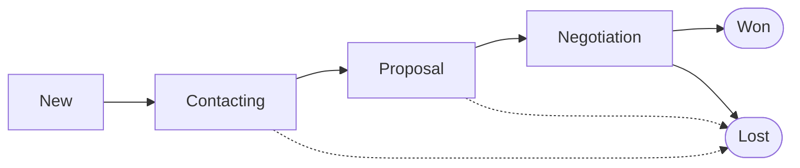
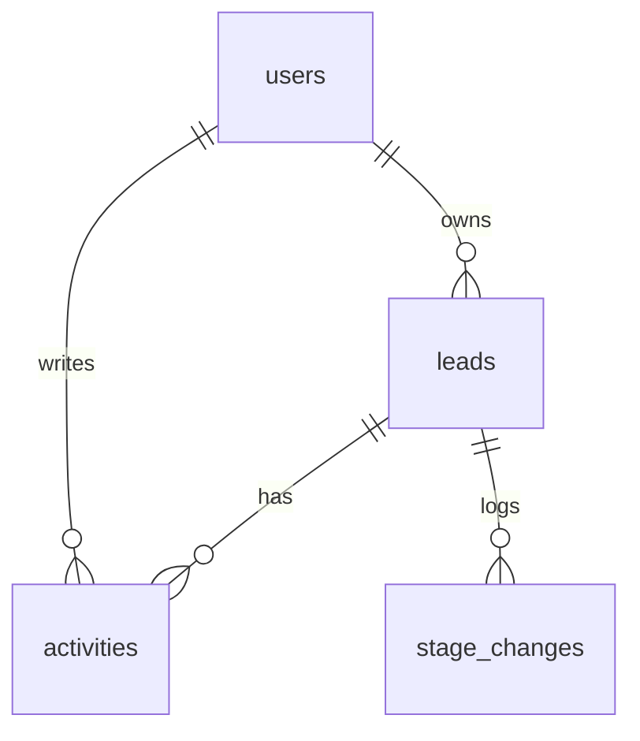
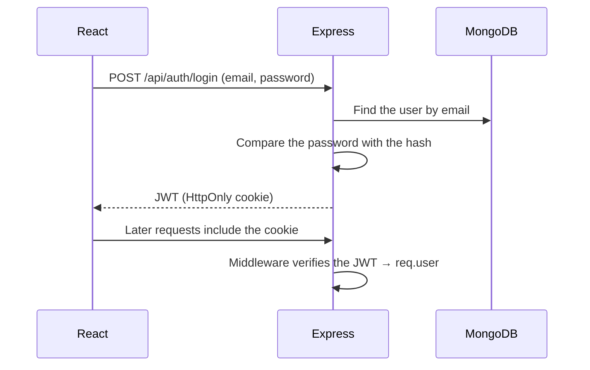

A small **Mini-CRM** on the MERN stack (MongoDB, Express, React, Node.js): one place for leads, a Kanban sales pipeline, and basic reports — instead of the spreadsheets and scattered notes of self-employed sellers, small businesses, and startups.


## Overview

| Goal | Users |
| --- | --- |
| Centralized lead management | Self-employed salespeople |
| Track pipeline progress | Small and micro businesses |
| Higher productivity | Small sales teams |
| Basic reports | Early-stage startups |
| Easy to use, no training required | |

**Value:** replace the spreadsheet with one system, see the whole sales process so opportunities are not missed, keep the history of each customer conversation, and decide from the numbers — at a low cost.

## Sales pipeline

Each lead moves through stages, shown as Kanban columns; drag a card to another column to change its stage.



A lead card shows the name, company, and expected value; open the card for the detail and the note history.

## Data model



| Collection | Main fields | Notes |
| --- | --- | --- |
| `users` | `email`, `passwordHash`, `role` | Password hashed with bcrypt or Argon2 |
| `leads` | `name`, `company`, `value`, `stage`, `ownerId` | `stage` is a fixed enum; `value` is stored as an integer (VND), not a float |
| `activities` | `leadId`, `type` (note, call, email), `content`, `createdAt` | History of interaction with the customer |
| `stage_changes` | `leadId`, `from`, `to`, `changedAt` | Stored on every stage change — input for conversion rate and time to close |

Index `{ ownerId: 1, stage: 1 }` for the Kanban query.

## API

| Method | Endpoint | Description |
| --- | --- | --- |
| `POST` | `/api/auth/login` | Sign in, return a JWT |
| `GET` | `/api/leads?stage=&q=` | The user's leads, with filter and search |
| `POST` | `/api/leads` | Create a lead |
| `PATCH` | `/api/leads/:id` | Update a lead, change its stage (also write `stage_changes`) |
| `DELETE` | `/api/leads/:id` | Delete a lead |
| `POST` | `/api/leads/:id/activities` | Add a note |
| `GET` | `/api/reports/pipeline` | Count and total value by stage |

:::warning Check ownership

Every query by `:id` must also filter on `ownerId` (`Lead.findOne({ _id: id, ownerId: req.user.id })`). Filtering only on `_id` lets a user change the id in the URL and read someone else's lead (an IDOR bug).

:::

## Flows

### Authentication



Store the JWT in an `HttpOnly`, `Secure`, `SameSite` cookie instead of `localStorage`, so a malicious script cannot read it.

### Create a lead

1. The user enters the lead on a form.
2. The frontend sends `POST /api/leads` (the cookie is attached automatically).
3. The backend verifies the token, validates the data, sets `ownerId = req.user.id`, and saves it to MongoDB.
4. The frontend adds the new lead to the "New" column on the Kanban board.

## Reporting dashboard

The numbers for the pipeline chart come from one aggregation:

```js title="reports.controller.js"
const pipeline = await Lead.aggregate([
  { $match: { ownerId: req.user._id } }, // or the whole team, if this user is a manager
  { $group: { _id: "$stage", count: { $sum: 1 }, totalValue: { $sum: "$value" } } },
]);
```

From `stage_changes` you can also compute: win rate, conversion rate between stages, and average time to close a deal.

## Further development

| Feature | Description |
| --- | --- |
| Email and calendar | Send email and schedule meetings inside the CRM |
| Task management | Create and assign tasks tied to each lead |
| Finer-grained permissions | Admin, Manager, and Sales roles; a manager sees the whole team's leads |
| Richer reports | Add filters for time range, salesperson, and chart type |
| Automation | Automatically send an email or create a task when a lead changes stage |
| Docker and CI/CD | Package the app and deploy it automatically — see [Ubuntu server setup](/docs/devops/vps/ubuntu-server-setup/) |
